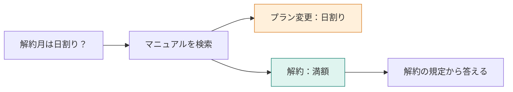

この本では、架空のサービス **TaskFlow の問い合わせ回答システム**を作ります。マニュアルの一文を検索して答えるところから始め、質問に合わない検索結果や、複数の規定が必要な問い合わせへ対応していきます。

読むときの主役は、実行時間や点数ではありません。**「いま何が足りないか」「次に何を渡すか」「返った値でどこへ進むか」**です。各章では、この判断を一つずつ追いかけます。

## 作るのは、同じマニュアルを使う小さなアプリ

例えば、次の問い合わせを受けたとします。

> Standardプランを月の途中で解約したら、日割りになりますか？

検索の1位は「プラン変更時の日割り」でした。しかし、答えが書いてあるのは「退会後の請求」です。話題は近くても、適用する場面が違います。

ここで「検索を賢くする」で済ませず、候補を増やすのか、並べ替えるのか、検索し直すのかを切り分けます。同じ質問と規定を使うので、手法を足す理由と、足しても変わらない部分が見えてきます。

## 各章は、入力を持って処理の中へ入る

| 読む場面 | 読者が確かめること |
|---|---|
| 冒頭のサマリーと図 | 今回は何を作り、なぜ必要か |
| 入力・プロンプト | 自分なら何を渡すか。条件や規定は足りているか |
| 返り値と短いコード | この値なら、次にどの処理へ進むか |
| 比較と考察 | 答えはどこまで変わったか。失敗はどこに残ったか |

先に出力を暗記する必要はありません。コードも、APIのラッパーを上から全部読むのではなく、検索・判断・生成が切り替わる箇所に絞って読みます。実行環境がなくても、本文の入出力を手で追える構成です。

## 学ぶ順番と、できあがるもの

| 章 | 作るもの | 身につけたい判断 |
|---|---|---|
| 第1〜2章 | RAGの全体像と実行環境 | 文書、検索、回答モデルの役割を分ける |
| 第3〜5章 | マニュアルの検索用索引 | 何を1件とし、何を保存するか |
| 第6〜9章 | 基本の回答と候補の選別 | 近さ、役立ち、採用の下限を分ける |
| 第10〜12章 | 検索と回答の確認 | いつ検索し直し、いつ回答を書き直すか |
| 第13〜16章 | 階層・逐次検索・グラフ | 複数の根拠をどの経路で集めるか |
| 第17章 | 改善方法の選び方 | 失敗した段を見て、次の変更を決める |

途中の章から読む場合も、その章の問い合わせから始められます。コードを動かす場合は、[第2章の環境構築](./02-setup)を準備してください。TypeScriptの基本構文とDockerの実行経験があると、実装を追いやすくなります。

:::message
リポジトリは [kouji0705/rag-study](https://github.com/kouji0705/rag-study) です。現在の `manual/` は18節です。本文には、15節・16節だった時点の保存ログも載せています。各章で当時の条件を明記しており、現在の18節で順位や数値が同じになることは前提にしません。
:::

数値は、本書用アプリで取得したログを小数第4位まで載せます。説明用の例、過去のQiita記事の結果、未検証の改善案は、それぞれその場で区別します。モデルの判断が期待と違った場合も残します。質問を何度も繰り返す評価や、実運用の権限制御までを完成させる本ではありません。
