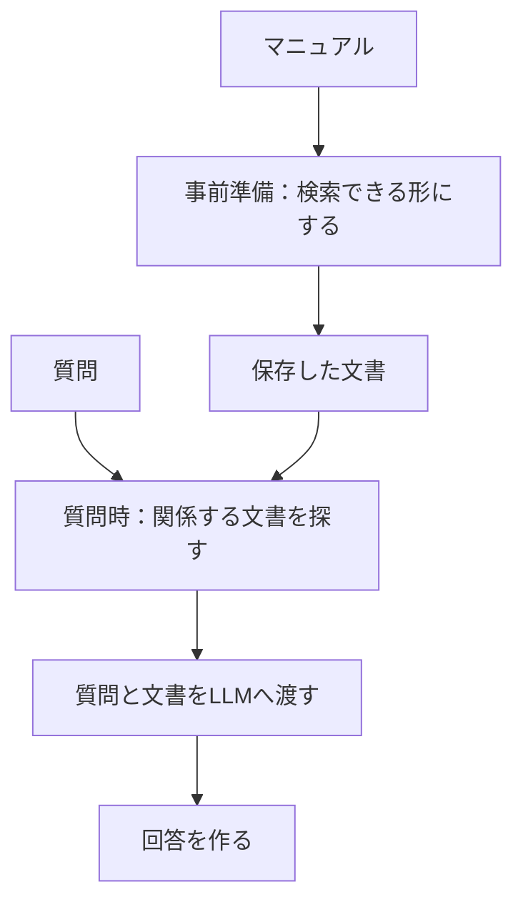

> **この章の要点：** RAGは、資料を探し、見つけた内容と質問をLLMへ渡して答えを作る仕組みです。

**前提知識：** LLMは、与えられた文章から続きや回答を生成するモデルです。この章は、RAGの予備知識なしで読めます。ベクトルやデータベースの手順は、第3章以降で扱います。

**今回の問い：** RAGは、何をどの順でするのか。

具体例には、[はじめに](./introduction) の質問Aを使います。全文は「退会後、データはいつ削除されますか？」です。

## この章の構成

- 文書を渡すと答えが変わる
- 全部を渡すと限界がある
- 3つの段
- この本での呼び方
- まとめ

## 文書を渡すと答えが変わる

文書を渡すと、LLMは渡された文章を根拠にして答えられます。文書が無いときは、モデルが元から持っている知識だけで答えます。

TaskFlow の退会マニュアルには、「退会後のデータ削除」という規定があります。質問A「退会後、データはいつ削除されますか？」に対して、この規定を渡した場合と渡さない場合では、答えの材料が違います。渡したあとの答えは、その規定の文言に沿う余地が生まれます。

この違いを画面で体験する手順は、過去記事「DifyでRAGを体験する」にあります。本編で押さえるのは、質問、根拠にした文書、回答の対応です。操作画面のクリック順は、再現するときの補足に回します。

本書用の環境で、文書の有無を同じ条件で並べた対照実験は未実験です。この節で見るのは、文書を渡すと答えの材料が変わる、という体験までです。文書の分割とデータベースへの登録は、第3章以降です。

モデルの記憶だけで答えない、というのがRAGを3段に分ける理由です。手元のマニュアルは、モデルの学習データに入っているとは限りません。入っていても、版が違うことがあります。回答の材料を、検索で取った文章に置きます。

文書を渡したあとも、渡した文章に書いていないことをモデルが足すことがあります。その確認は [第12章 回答が文書に基づいているか確認する](./12-verify-answer) で扱います。

## 全部を渡すと限界がある

資料の全文を毎回プロンプトへ入れる方法は、資料が長くなると、入力できる長さの上限、処理時間、費用を考える必要が出てきます。資料が短いあいだは、検索を挟まずに済みます。この段落は設計上の説明です。

過去記事のポケモン図鑑 Step2 は、コードで条件を指定して図鑑データを探す実験です。Qiita掲載結果では、30匹で約0.7秒、151匹で約1.14秒です。件数とともに処理時間は伸びています。この秒数は、コードで件数を変えて探した時間です。マニュアル全文をLLMへ渡した時間としては使いません。

Step3 で検索を導入した主眼は、言い方が曖昧な質問でも対象を探せるようにすることです。記事中の例は、「尻尾が炎で燃えている」のような質問です。名前や番号が質問文に無くても、特徴の記述から候補を探します。この本では、その導入を速度改善の実験としては扱いません。

この本の本編は、TaskFlow の規定を必要なものだけ探して渡す例に統一します。ポケモン図鑑の秒数は、件数とともに処理が重くなる背景として読みます。

| 渡し方 | この章で示すこと | 結果の状態 |
|---|---|---|
| 文書を渡さない | モデルの知識だけで答える | 本書用の対照は未実験 |
| 関係する規定を渡す | その文章を根拠に答えが変わる | 体験の説明。本書用の再実験は未実施 |
| 資料の全文を毎回渡す | 長さ、時間、費用を考える必要が出る | 設計上の説明 |
| コードで件数を変えて探す | 30匹で約0.7秒、151匹で約1.14秒 | Qiita掲載結果。LLMへ全文を渡した時間ではない |

## 3つの段

RAGは、用意、検索、生成の3段です。文書の準備は質問の前に行い、質問を受けてから検索と回答生成を行います。

図の読みどころは、準備と、質問を受けてからの処理の境目です。上段の「検索できる形にする」は質問が来る前に終わります。下段の検索と回答生成は、質問のたびに動きます。

段の名前は、この本では次で固定します。括弧内は、元記事「LangChain Step5」で使われている英語名です。

1. **用意する（Indexing）。** 資料を、検索できる形で持っておきます。これは事前準備です。中身は、第3章の見出し分割、第4章のベクトル化、第5章の保存です。
2. **探す（Retrieval）。** 質問への回答に必要な資料を取ります。質問を受けてから動きます。
3. **答える（Generation）。** 取れた文章と質問を渡し、LLMが回答を作ります。

## この本での呼び方

RAGは、検索した情報を材料に回答を生成する仕組みの総称です。検索方法はベクトル検索に限りません。キーワード、属性、文書の関係を使う方法も、この本ではRAGの中で扱います。

この本では、ベクトル検索で近い文書を取り、並べ替えも除外もせず、そのまま回答生成へ渡す基本構成を **Naive RAG** と呼びます。第6章で、TaskFlow に対してこれを動かします。第8章以降の比較相手は、この基本構成です。

種類の名前の一覧は、この章には置きません。土台の前に名前が並ぶと、各手法がどの段を変えるのかが見えにくくなります。一覧は第6部の [第17章 困りごとから改善方法を選ぶ](./17-choose) にまとめます。

## まとめ

- RAGは、探してから、見つけた文章を渡して答えさせる仕組みです。
- 資料の全文を毎回渡す方法は、資料が長くなると入力の長さ、時間、費用を考える必要が出ます。
- 段は、用意、検索、生成の3つです。用意は事前、検索と生成は質問のあとです。
- 一番単純な形の名前は Naive RAG です。ベクトル検索で近い文書を、そのまま渡します。

次の [第2章 環境構築](./02-setup) では、実装の前に Docker と API キーを用意します。見出しへの分割は [第3章](./03-split-by-heading) です。仕組みだけ読む場合は、第2章を飛ばして第3章へ進めます。

## 参考資料

- [DifyでRAGを体験する](https://qiita.com/koji0705/items/462eb6c573ea49e7ee1b)
- [Difyでポケモン図鑑を実装する(Step2:パフォーマンス測定)](https://qiita.com/koji0705/items/89bee4cf64a747e1ab8d)
- [Difyでポケモン図鑑を実装する(Step3:RAGの導入)](https://qiita.com/koji0705/items/85b0f066f75f2887fb54)
- [LangChainを学びたい(Step5:入力の柔軟化（Step5:RAGの概要を学ぶ）)](https://qiita.com/koji0705/items/e7e207bf9fabead7eebd)
