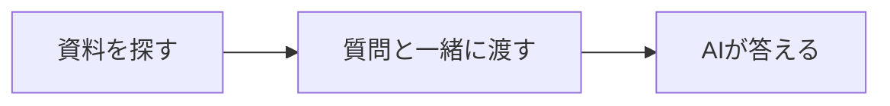

**RAGは、資料を調べてからAIに答えてもらう仕組みです。**

例えば、TaskFlowというサービスに、こんな問い合わせが来たとします。

> 退会後、データはいつ削除されますか？

マニュアルには、次の規定があります。

> 退会が完了してから30日後に、データは完全に削除されます。

この一文を質問と一緒にAIへ渡せば、回答の材料になります。

**この規定を使った回答例：**「退会完了から30日後に削除されます。」

## やることは「探す → 渡す → 答える」

**その質問に必要な部分を、その都度渡す**のがポイントです。

RAGは Retrieval-Augmented Generation の略で、日本語では「検索拡張生成」と呼ばれます。回答を作るAIには、LLM（大規模言語モデル）を使います。

## マニュアルを全部渡せばいい？

短い資料なら、それも選択肢です。

ただ、資料が増えると、質問と関係のない文章まで毎回送ることになります。入力できる長さにも上限があります。

そこで、先に必要な部分を検索します。

| 渡し方 | AIへ送るもの |
|---|---|
| 全文を渡す | 料金、請求、退会など、マニュアルの全体 |
| 検索して渡す | 今回の質問に関係する規定 |

## 検索できるように、先に準備する

本書の基本形では、質問を受ける前に資料を準備しておきます。

| いつ | すること | 章 |
|---|---|---|
| 事前 | 文書を分け、数値にして保存する | 第3〜5章 |
| 質問が来たとき | 関係する文書を探し、回答を作る | 第6章 |

検索した文書をそのまま渡す基本形を、本書では **Naive RAG** と呼びます。

ただし、検索で見つかった文書が、質問の答えとは限りません。「似た文書なのに答えられない」例を、第6章で見ていきましょう。

**覚えておくことは一つ。RAGは「必要な資料を探してから答える」仕組みです。**

コードも動かす場合は第2章へ。仕組みを続けて読む場合は、第3章へ進めます。

:::details 参考にした記事
- [DifyでRAGを体験する](https://qiita.com/koji0705/items/462eb6c573ea49e7ee1b)
- [LangChainでRAGの概要を学ぶ](https://qiita.com/koji0705/items/e7e207bf9fabead7eebd)

冒頭は、マニュアルの規定を使った説明用の例です。本書用環境での実行結果ではありません。
:::
