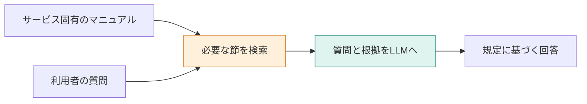

**この章で学ぶのは、AIに「何を知ってもらうか」を、検索で用意する考え方です。** TaskFlow の退会規定を使い、質問が来る前の準備と、来た後の回答を分けます。読み終えたら、文書の中身を変える作業と、AIへの指示を変える作業の違いを説明できるはずです。



## まず、回答の材料を自分で選んでみる

TaskFlowに次の質問が届きました。

> 退会後、データはいつ削除されますか？

マニュアルには、次の二つの規定があります。

| 見出し | 本文 |
|---|---|
| 退会後の請求 | 解約した月の料金は満額です。日割りにはなりません。 |
| 退会後のデータ削除 | 退会完了から30日後にデータを削除します。 |

回答の材料にしたいのは、後者です。「退会」という言葉が入るだけでは足りず、削除の時期まで分かる必要があります。

この選び方をプログラムで行い、選んだ本文を質問と一緒にLLMへ送ります。**RAGは、必要な資料を探してから回答を作る仕組み**です。Retrieval-Augmented Generationの略で、検索拡張生成と呼びます。LLMは、回答文を作る大規模言語モデルです。

## LLMへ渡すものを組み立てる

次は、処理の形をつかむための説明用の例です。APIの実行結果ではありません。

```text
指示：
渡された文書だけを根拠に答えてください。
文書から判断できなければ、「分からない」と答えてください。

質問：
退会後、データはいつ削除されますか？

文書：
退会完了から30日後にデータを削除します。
```

この材料からなら、「退会完了から30日後です」という回答を作れます。LLMにTaskFlowの規定を覚え直させる必要はありません。その問い合わせで使ってほしい情報を、入力に加えています。

では、文書が「解約した月の料金は満額です」だけだったらどうでしょう。指示どおりなら削除日は判断できません。**回答の材料に必要な一文が入っているか**が、RAGの最初の確認点です。

## マニュアルを全部渡す方法から、検索へ進む理由

短い資料なら、全体をそのまま渡す方法もあります。ただし、資料が増えると無関係な本文も毎回送ることになり、入力の長さや費用が増えます。モデルに渡せる長さにも上限があります。

| 方法 | 送る材料 | 設計するときに考えること |
|---|---|---|
| 全文を渡す | すべての規定 | 全体が入力に収まるか。無関係な記述が多くないか |
| 検索して渡す | 選ばれた規定 | 必要な一文を取りこぼさないか |

検索を入れると入力を絞れますが、検索に失敗すると必要な情報がLLMに届きません。検索できたことと、正しく回答できることを別々に見る理由はここにあります。

## 質問が来る前と、来た後を分ける

本書では、質問が来るたびに全マニュアルを読み直してベクトル化することはしません。

| タイミング | 処理 | できあがるもの |
|---|---|---|
| 事前準備：Indexing | 見出しで分割 → ベクトル化 → 保存 | 本文と数値を結びつけた検索用の索引 |
| 質問時：Retrieval | 質問をベクトル化 → 近い文書を選ぶ | 今回の回答候補 |
| 質問時：Generation | 質問と候補の本文をLLMへ送る | 利用者への回答 |

ベクトルは、意味の近さを計算するための数値の列です。第3〜5章で索引を作り、第6章で検索と回答をつなぎます。検索結果をそのまま渡す基本形を、本書では **Naive RAG** と呼びます。

:::details 考えてみる：規定を30日から60日に変更したら？
この実装では、マニュアルを直し、索引の本文とベクトルを更新します。質問時に古い本文を取り出していたら、LLMへの指示だけを変えても新しい規定は伝わりません。

更新が必要なのは資料側です。回答の誤りを調べるときも、まず「どの版の文書を渡したか」を確認します。
:::

ここでは問い合わせを手で選びました。次は、この作業を同じアプリで再現できる環境を用意します。

:::details 参考にした記事
- [Naive RAG](https://qiita.com/koji0705/items/b424ac5432928de95abe)
- [LangChainでRAGの概要を学ぶ](https://qiita.com/koji0705/items/e7e207bf9fabead7eebd)

本章の入力と回答は、仕組みを説明するための例です。
:::
