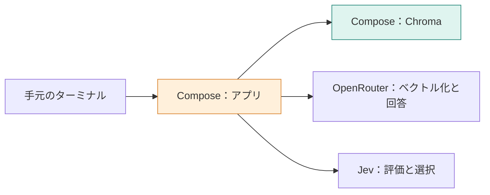

**この章では、TypeScriptアプリからベクトルDBへ接続できる環境を作ります。** RAGは検索・評価・回答を別の道具へ依頼するため、まず「どこで何が動くか」を確認します。ゴールは、文書登録前に接続の問題を切り分けられる状態です。



## アプリ、DB、モデルを分担させる

問い合わせを受けたアプリが処理の順序を管理します。DBに検索を依頼し、モデルには文章の数値化や回答、評価を依頼します。

| 道具 | 担当すること | 自分では行わないこと |
|---|---|---|
| TypeScriptアプリ | 本文の分割、API呼び出し、返り値での分岐 | 固有の規定を推測して補うこと |
| Chroma | 本文・ベクトル・属性の保存と検索 | 回答文の生成 |
| OpenRouter | Embeddingモデルと回答モデルの呼び出し | 索引の永続化 |
| Jev | 基準に沿う採点と選択 | この実装での検索文・回答文の生成 |
| Docker Compose | アプリとChromaの起動、接続先の設定 | 外部APIのキー発行 |

アプリはNode.js 26、DBは `chromadb/chroma:1.5.4` のコンテナを使います。バージョン指定は `app/Dockerfile` と `compose.yaml` にあります。

## STEP 1：リポジトリと設定を用意する

GitとDocker Composeを使える環境で、次を実行します。すでに取得済みなら、リポジトリのルートへ移動してください。

```bash
git clone https://github.com/kouji0705/rag-study.git
cd rag-study
cp .env.example .env
```

OpenRouterとJevで発行したAPIキーを `.env` に設定します。モデルの呼び出しには料金がかかります。キーの設定先は、[OpenRouter](https://openrouter.ai/settings/keys) と [TypeSafe（Jev）](https://typesafe.ai/) です。

```dotenv
OPENROUTER_API_KEY=発行したキー
JEV_API_KEY=発行したキー
CHROMA_HOST=localhost
CHROMA_PORT=8001
```

`.env` はGitの管理対象外です。キーの値をログへ出す必要はありません。

| パス | この先で開く理由 |
|---|---|
| `manual/*.md` | 検索する元の規定を見る |
| `app/src/main.ts` | コマンドと処理の入口を確認する |
| `app/src/commands.ts` | 検索・判断・回答の順番を読む |
| `app/src/models.ts` | モデル名、指示、判定基準を見る |
| `compose.yaml` | DBの保存先とネットワークを確認する |

## STEP 2：DBを起動し、アプリから接続する

```bash
docker compose up -d chroma
docker compose --progress plain run --rm app
```

初回はアプリ用イメージのビルドも行います。引数を省略すると `check` が動き、キーの有無と、Chromaのheartbeatへの接続を確認します。


`set` はキーが設定されていること、`chroma: ok` はアプリからDBへ届いたことを意味します。**`set` だけでは、キーの有効性や外部APIの利用可否までは確認していません。** ベクトル化と評価を実行したときに、その接続も確かめます。

## STEP 3：宛先が二つある理由を確かめる

ログの `chroma:8000` と `.env` の `localhost:8001` は、見る場所が違います。

| 接続元 | 宛先 | 理由 |
|---|---|---|
| Compose内のアプリ | `chroma:8000` | サービス名とコンテナ内部のポートで接続する |
| 手元のマシン | `localhost:8001` | 公開したポート経由で接続する |

Composeはアプリの接続先を `chroma:8000` に上書きします。コンテナから見た `localhost` は、そのコンテナ自身なので、ホスト用の宛先をそのまま使わない点がポイントです。

Chromaが停止していれば、アプリは約30秒待って `chroma: failed` で終了します。`docker compose ps` で状態を見て、先にChromaを起動してください。外部APIの認証エラーはDB接続とは別に調べます。

## 止めても索引を残す

```bash
docker compose down
```

DBの内容は名前付きボリュームに保存されるため、この停止操作では残ります。文書の登録はまだ行っていません。次の分割コマンドで、モデルを呼ぶ前の入力を確認します。

:::details 考えてみる：キーもDBも確認できたら、回答の準備は完了？
まだです。マニュアルの分割、ベクトル化、DBへの登録が必要です。接続できることと、検索対象が入っていることは別の状態です。第5章で登録件数と本文の読み戻しを確認します。
:::
