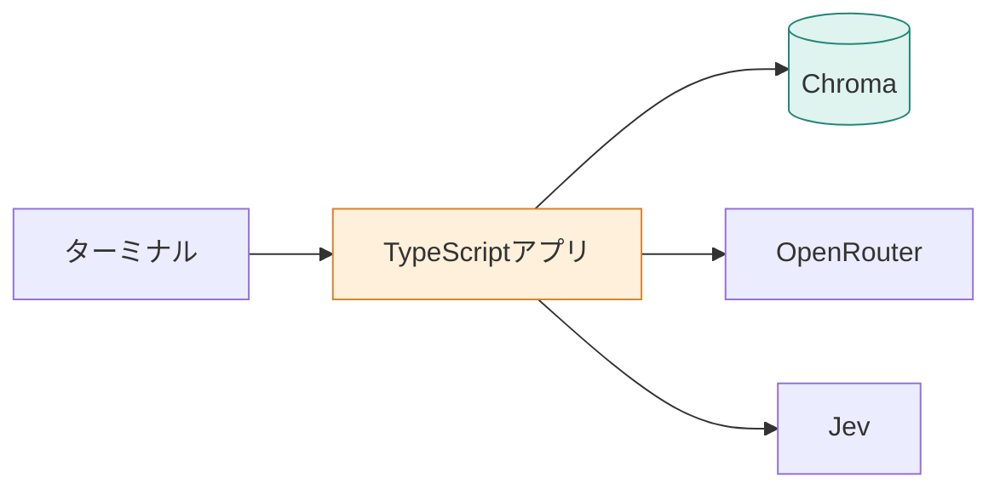

## 環境構築
この章では、**Docker Composeを使ってRAGの実行環境を構築します。** TypeScriptアプリとベクトルDBのChromaを起動し、接続を確認するところまで進めます。

## 1. 使用する技術

本書では、次の技術を使用します。

| 技術 | 役割 |
|---|---|
| TypeScript / Node.js | RAGの処理とAPI呼び出し |
| Chroma | 文書とベクトルの保存・検索 |
| OpenRouter | Embeddingと回答生成 |
| Jev | 文書の評価や処理の選択 |
| Docker Compose | 実行環境の管理 |

全体の構成は次のとおりです。



アプリが処理を制御し、必要に応じてChromaや外部APIを呼び出します。

## 2. 事前準備

開発環境には、次のツールが必要です。

| ツール | 用途 |
|---|---|
| Git | ソースコードの取得 |
| Docker Desktop | コンテナの実行（macOS / Windows） |
| Docker Compose | 複数コンテナの管理 |

Docker DesktopにはDocker Composeが含まれています。LinuxではDocker EngineとComposeプラグインを使用できます。

- [Docker Desktopのインストール（macOS）](https://docs.docker.com/desktop/setup/install/mac-install/)
- [Docker Desktopのインストール（Windows）](https://docs.docker.com/desktop/setup/install/windows-install/)
- [Docker Composeのインストール](https://docs.docker.com/compose/install/)

Docker Desktopをインストールしたら、アプリケーションを起動し、ターミナルで次を確認します。

```bash
git --version
docker --version
docker compose version
docker info
```

`docker info`でDocker Engineの情報が表示されれば準備完了です。`Cannot connect to the Docker daemon`などが出る場合は、Docker Desktopが起動しているか確認してください。

**Node.jsやTypeScriptをPCへ直接インストールする必要はありません。** 本書ではDockerコンテナ内で実行します。

## 3. プロジェクトの構成

リポジトリを取得し、プロジェクトのルートディレクトリへ移動します。

本書の主なファイル構成は次のとおりです。

```text
rag-study/
├── app/
│   ├── Dockerfile
│   ├── package.json
│   ├── package-lock.json
│   ├── tsconfig.json
│   └── src/
│       ├── main.ts
│       ├── check.ts
│       ├── commands.ts
│       ├── manual.ts
│       ├── chroma.ts
│       ├── openrouter.ts
│       ├── jev.ts
│       └── ...
├── manual/
├── compose.yaml
└── .env.example
```

| ファイル | 役割 |
|---|---|
| `app/src/main.ts` | コマンドの入口 |
| `app/src/commands.ts` | RAGの処理を組み立てる |
| `app/src/manual.ts` | マニュアルの読み込み・分割 |
| `app/src/chroma.ts` | ベクトルDBとの通信 |
| `app/src/openrouter.ts` | Embedding・LLMの呼び出し |
| `app/src/jev.ts` | Jevへの評価リクエスト |
| `compose.yaml` | コンテナの起動設定 |

### Dockerfileの内容

アプリの`Dockerfile`は次の構成です。

```dockerfile
FROM node:26-bookworm-slim

WORKDIR /app

COPY package.json package-lock.json ./
RUN npm ci

COPY tsconfig.json ./
COPY src ./src

ENTRYPOINT ["npx", "tsx", "src/main.ts"]
```

Node.js 26をベースに、`npm ci`で依存パッケージをインストールします。

TypeScriptは`tsx`を使って直接実行するため、事前のJavaScriptファイル生成は不要です。実行するコマンドは`src/main.ts`を入口としています。

## 4. APIキーを設定する

プロジェクトのルートで、環境変数ファイルを作成します。

```bash
cp .env.example .env
```

OpenRouterとJevでAPIキーを発行し、`.env`へ設定します。

```dotenv
OPENROUTER_API_KEY=発行したキー
JEV_API_KEY=発行したキー
CHROMA_HOST=localhost
CHROMA_PORT=8001
```

- [OpenRouterのAPIキー](https://openrouter.ai/settings/keys)
- [TypeSafe（Jev）](https://typesafe.ai/)

外部APIの呼び出しには料金が発生する場合があります。APIキーを記載した`.env`はGitにコミットしないでください。

## 5. コンテナを起動する

まずChromaを起動します。

```bash
docker compose up -d chroma
```

続いてアプリのイメージをビルドし、接続確認を実行します。

```bash
docker compose build app
docker compose run --rm app
```

アプリは引数なしの場合に`check`を実行し、APIキーの設定有無とChromaへの接続を確認します。


主なログの意味は次のとおりです。

| 表示 | 意味 |
|---|---|
| `set` | APIキーが設定されている |
| `chroma: ok` | Chromaへの接続に成功 |
| `chroma: failed` | Chromaへの接続に失敗 |

なお、`set`はキーの存在確認です。APIキーが有効かどうかまでは検証していません。

### 接続先について

Dockerでは、接続元によって宛先が異なります。

| 接続元 | Chromaの接続先 |
|---|---|
| ホストPC | `localhost:8001` |
| アプリコンテナ | `chroma:8000` |

アプリコンテナからは、Composeのサービス名`chroma`でアクセスします。ホスト向けの`localhost`をそのまま使わない点に注意してください。

## 6. 停止とトラブルシューティング

コンテナの状態を確認するときは、次のコマンドを使用します。

```bash
docker compose ps
docker compose logs chroma
```

検証が終わったら、次のコマンドで停止できます。

```bash
docker compose down
```

名前付きボリュームを使用している場合、通常の`down`では保存データは残ります。`down -v`はボリュームも削除するため、注意してください。

## まとめ

今回は、DockerでTypeScriptアプリとChromaを起動し、接続を確認しました。

まだマニュアルの登録や回答生成は行っていません。次章では、**マニュアルを検索しやすい単位（チャンク）に分割する処理**を実装します。
