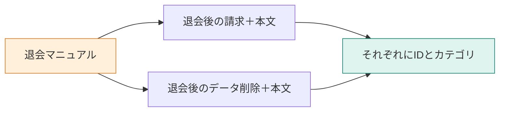

**この章では、マニュアルから「検索の1件」を作ります。** 一つのファイルに料金と削除の規定が混ざったままでは、質問に必要な部分を選びにくくなります。見出しで分け、条件を失わずに本文と出典を持たせる設計を学びます。



## 「いつ消える？」に、どこまで渡すか

問い合わせは「退会後、データはいつ削除されますか？」です。`manual/withdrawal.md` には、次の節があります。以下はその一部です。

```markdown
# 退会

## 退会後の請求

解約した月の料金は満額です。日割りにはなりません。

## 退会後のデータ削除

退会完了から30日後にデータを削除します。
```

ファイル全体で1件にすると、削除を探す検索に請求の本文も混ざります。反対に「30日後」だけを切り出すと、何から30日なのか分かりません。

**一つの規定を、条件と結論が通じるまとまりで残す**ことにします。分割した断片をチャンクと呼びます。

## STEP 1：見出しを境に、本文を確定させる

実装は `app/src/manual.ts` の `splitMarkdown` です。`#` を文書タイトルとして覚え、`##` 以下の見出しを見つけたら、それまでの節を確定します。

```typescript
const flush = (): void => {
  const text = buffer.join("\n").trim();
  if (heading.length > 0 && text.length > 0) {
    sections.push({ heading, text });
  }
  buffer = [];
};
```

`buffer` は、今読んでいる節の本文です。見出しだけで本文が空なら1件にしません。最後の節には次の見出しが来ないので、ファイル末尾でも `flush()` を呼びます。

この処理はLLMには依頼しません。同じMarkdownを渡すと同じ位置で分かれるため、分割の問題と検索の問題を別々に調べられます。

## STEP 2：本文の外と中に、文脈を残す

切り出した節を、次の形に変えます。これは実装からの抜粋です。

```typescript
return sections.map((section) => ({
  id: `${filename}#${section.heading}`,
  source: filename,
  title,
  heading: section.heading,
  category: title,
  body: `${title}\n${section.heading}\n${section.text}`,
}));
```

同じ名前がいくつもありますが、使う場面が違います。

| 値 | 使う場面 |
|---|---|
| `id` | 更新時に同じ文書を識別する |
| `source`、`heading` | 検索結果から元の節を確認する |
| `category` | 「退会だけ」など、検索対象を絞る |
| `body` | ベクトル化し、後でLLMに渡す |

`body` の先頭にもタイトルと見出しを付けます。「退会」「退会後のデータ削除」という文脈を、モデルに渡す文字列にも残すためです。属性として保存するだけでは、本文しか見ないモデルには伝わりません。

## STEP 3：分割結果を先に点検する

[環境構築](./02-setup)後、リポジトリのルートで実行します。分割自体に外部APIは使いません。

```bash
docker compose run --rm app split
```

削除の節は、次の1件になります。

```text
id: withdrawal.md#退会後のデータ削除
category: 退会
heading: 退会後のデータ削除
body:
退会
退会後のデータ削除
退会完了から30日後にデータを削除します。
```

ここで見たいのは件数だけでなく、本文に「退会完了から」が残っていることです。同じコマンドをもう一度実行し、IDと本文が同じかも確かめます。

現在のマニュアルは18件です。

| カテゴリ | 件数 | 含まれる規定 |
|---|---:|---|
| アカウント | 2 | ログイン、パスワードの再設定 |
| 請求 | 10 | 請求日、契約開始とプラン変更の日割り、StandardとProの月額、SSO、支払い方法、支払いの失敗、領収書、プランの種類 |
| 退会 | 6 | 退会できる人、退会の手続き、退会後の請求、退会後のデータ削除、退会前の書き出し、解約の取り消し |

古い保存ログは15件です。そこから「支払いの失敗」「Proプランの月額」「SSO」が追加されています。

## 見出しで切れば、どの資料でも十分か

この実装は、短い規定が1節に収まる今回のMarkdown向けです。巨大な節は長いまま残ります。また、`###` 以下も独立した節として扱い、親見出しの経路は保持しません。表やコードフェンスを解釈するMarkdownパーサーでもありません。

| 資料の状態 | 検討する変更 |
|---|---|
| 一つの節に複数の規定がある | 段落や長さでも分割する |
| 条件が親の節にある | 親見出しや条件を子へ引き継ぐ |
| 見出しが同じファイル内で重複する | 位置などを加え、IDの衝突を避ける |

IDに見出しを使っているため、見出しの改名は新しいIDになります。後でDBへupsertするだけでは古いIDが残るので、改名・削除時の同期は別途必要です。

:::details 考えてみる：「30日後に削除します」だけを保存すると？
「いつから30日か」が文書の外に落ちます。検索順位がよくても、その断片では正確な起算日を答えられません。検索モデルの調整に進む前に、入力のまとまりを直すべき例です。
:::

次に、この `body` を意味の近さで比べられる数値へ変えます。

:::details 参考にした記事
[Naive RAGのIndexing](https://qiita.com/koji0705/items/b424ac5432928de95abe)。元記事の12チャンク・JSON保存とは構成が異なります。本章の対象は、このリポジトリのMarkdownです。
:::
