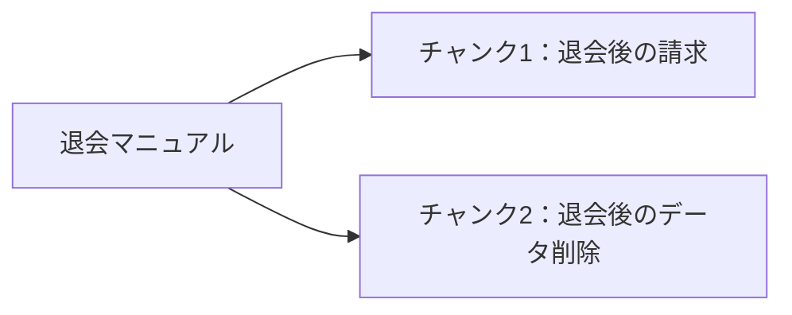

## Chunkingとは？

RAGでは、マニュアルから質問に関連する情報を検索します。そのために、まずマニュアルを検索しやすい単位に分割します。

この処理を**Chunking（チャンキング）**、分割した文章のまとまりを**チャンク**と呼びます。


## なぜチャンクに分割するのか？

例えば、TaskFlowの退会マニュアルに次の内容があるとします。

```markdown
# 退会

## 退会後の請求
解約した月の料金は満額です。日割りにはなりません。

## 退会後のデータ削除
退会完了から30日後にデータを削除します。
```

ここで「退会後、データはいつ削除されますか？」と質問された場合、必要なのは「退会後のデータ削除」の規定です。

マニュアル全体を1件として扱うと、関係のない請求情報まで検索結果に含まれます。そこで、見出しを境に分割します。



ただし、細かく分ければよいわけではありません。「30日後」だけを取り出してしまうと、何から30日後なのか分からなくなります。

**条件と結論が分かる、意味のあるまとまりで分割することが重要です。**

## ① 見出しを境に分割する

本書では、Markdownの`##`見出しを基本単位として分割します。

実装は`app/src/manual.ts`の`splitMarkdown`です。見出しと本文を読み取り、次の見出しが現れたところで一つのチャンクを確定します。

分割結果には、本文だけでなく次の情報を持たせます。

| 項目 | 内容 | 用途 |
|---|---|---|
| `id` | 文書の識別子 | 更新・重複判定 |
| `heading` | 見出し | 内容の識別 |
| `category` | マニュアルの分類 | 検索範囲の絞り込み |
| `body` | 見出しと本文 | 検索・LLMへの入力 |

`body`には文書タイトルと見出しも含めます。例えば、本文だけの「30日後に削除します」ではなく、「退会後のデータ削除」という文脈を残すためです。

## ② 実際に分割してみる

第2章で構築したDocker環境を使います。リポジトリのルートで次を実行してください。

```bash
docker compose run --rm app split
```

この処理ではLLMやJevを呼び出しません。Markdownの見出しをプログラムで解析するため、同じ入力から同じ分割結果を得られます。

「退会後のデータ削除」は、次のチャンクになります。

```text
id: withdrawal.md#退会後のデータ削除
category: 退会
heading: 退会後のデータ削除

body:
退会
退会後のデータ削除
退会完了から30日後にデータを削除します。
```

このように、検索に必要な本文と、文書を識別するための情報がセットになります。

現在のマニュアルは、合計18チャンクです。

| カテゴリ | チャンク数 |
|---|---:|
| アカウント | 2 |
| 請求 | 10 |
| 退会 | 6 |
| **合計** | **18** |

※ 以前の実験では15チャンクを使用していました。その後、SSO、Proプランの月額、支払いの失敗に関する規定を追加しています。

## チャンクの分割方法はこれで十分？

今回は見出し単位で分割しましたが、すべての資料に適しているわけではありません。

| 分割方法 | 特徴 |
|---|---|
| 見出し単位 | 文章の意味や構造を保ちやすい |
| 文字数・トークン数単位 | 大きさを制御しやすいが、文脈が途中で切れることがある |
| 意味的なまとまり単位 | 内容に応じて区切れるが、判定処理が必要になる |

本書のTaskFlowマニュアルは、1つの見出しに短い規定がまとまっているため、見出し単位を採用しました。

「30日後」だけがチャンクに残ったら、解約月の料金は答えられるでしょうか。見出しの前に書いた「解約した月の料金は満額です。」は、この実装ではどのチャンクにも入りません。削除日数のチャンクだけでは、日割りになるかは答えられません。

同じファイルに同名の見出しがあると、IDは `ファイル名#見出し` で重なります。コードフェンスの中にある `##` も、いまの分割では見出しとして切ります。これは、この実装がそう切るという確認であり、Markdown全般へ対応したという意味ではありません。

なお、今回の実装では見出しをIDに使用しています。見出しを変更すると別IDになるため、検索DBを更新するときは古い文書の削除にも注意が必要です。

## まとめ

Chunkingは、**検索したい情報を、意味が通じる単位に分割する処理**です。

検索の精度はモデルだけでなく、検索対象のチャンクがどのように作られているかにも左右されます。

次章では、分割した文章をEmbeddingモデルでベクトルに変換し、文章同士の意味的な近さを計算してみます。
