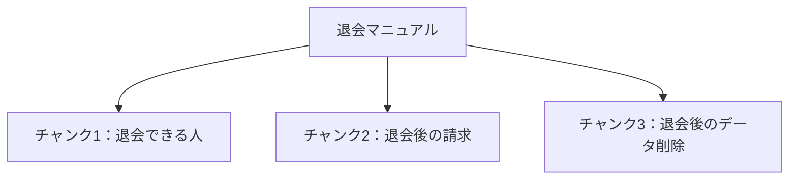

> **この章の要点：** 検索する1件を、マニュアル全体から、見出しごとの1つの規定へ小さくします。

**前提知識：** RAGは、資料を探してから、見つけた文章を渡して答える仕組みです。3段のうち、この章は用意の最初です。検索・処理のために分けた文章の断片を、チャンクと呼びます。この章で「文書」と書くときは、この断片を指します。実行環境は [第2章](./02-setup) の Docker です。仕組みだけ読む場合は、環境が無くてもこの章の分け方は追えます。

**今回の問い：** 検索に出す1件には、何を入れるのか。

この章で名前を固定する質問は、次の2つです。

- **A：削除時期** — 退会後、データはいつ削除されますか？
- **B：解約月の日割り** — Standardプランを月の途中で解約したら、日割りになりますか？

## この章の構成

- 1枚のままでは規定が混ざる
- 見出しを1件にする
- 1件に残す項目
- 後の章が使う名前
- まとめ

## 1枚のままでは規定が混ざる

マニュアルを1枚のまま1件にすると、質問と関係の薄い規定が同じ件に入ります。TaskFlow のマニュアルには、退会、請求、プランの規定が同居しています。

質問Aは、データをいつ消すかを聞いています。1枚を1件にすると、削除の規定と、請求の規定と、プラン変更の規定が同じ本文に入ります。検索でその1件が当たっても、回答の材料は「削除の期限」だけにはなりません。

質問Bは、解約した月の料金が日割りかを聞いています。[はじめに](./introduction) で対比したように、プラン変更時の日割りと、退会後の請求は、どちらにも「日割り」が出てきます。書いてある結論は違います。同じ1件に入ったままだと、どちらの結論を答えに使ったのかが本文の位置だけでは決まりません。

## 見出しを1件にする

この本の短い規定は、見出しごとに1件へ切ります。切った断片がチャンクです。一つの長い文書から、質問に関係する規定だけを取り出せる単位を作ります。

図の読みどころは、1枚のマニュアルが、規定ごとの断片になることです。図の3件は退会マニュアルの例です。プラン変更の規定は、別の見出しとして別の1件になります。

元記事「Naive RAG」の Indexing でも、見出しごとにチャンクへ分けています。元記事は12チャンクを JSON ファイルへ保存しています。この本の保存先は第5章の Chroma に変えるため、元記事の件数と検索順位は、この本の実行結果としては使いません。

見出しだけで長すぎる場合や、条件が前の節に書いてある場合もあります。この本の切り方を、あらゆる文書の正解とはしません。文字数で機械的に切ると、境界で1つの規定が割れることがあります。その論点は [第16章](./16-compare) の「取りこぼしと、分け方の影響」で扱います。

## 1件に残す項目

1件には、本文に加えて、あとから同じ規定を指す名前と所属を残します。第5章では、この項目をベクトルと一緒に保存します。

| 項目 | 役割 | 例 |
|---|---|---|
| 文書ID | 元ファイルと節を識別する。再登録と出典表示に使う | 退会マニュアルの「データ削除」の節を指すID |
| 本文 | 回答の材料になる規定。先頭に文書タイトルと節の見出しを付ける | 退会後、データをいつ消すかの本文 |
| 見出し | 取れた文書を話すときの名前 | 退会後のデータ削除 |
| カテゴリ | 所属の上段。第13章で階層をたどるときの入口 | 退会 |
| グループ | カテゴリの下段。同じカテゴリの中のまとまり | 退会後 |

本文の先頭にタイトルと見出しを付けるのは、元記事の Indexing と同じやり方です。検索用の文字列と、人が読む見出しを、同じ1件の中で揃えます。

カテゴリとグループは、この章では保存する項目として残します。属性で候補を狭める操作は [第7章](./07-metadata-filter)、階層を下りる操作は [第13章](./13-hierarchy) です。

第13章の木では、カテゴリ「退会」の下にグループ「退会後」と「手続き」を置きます。「退会後の請求」と「退会後のデータ削除」は、グループ「退会後」です。本書用マニュアルの確定版、文書IDの一覧、階層の全件は、まだ固定していません。上の表のカテゴリとグループは、その木で使う作業用の例です。台帳が確定したら、文書IDをそれに合わせます。

## 後の章が使う名前

取れた文書を章の本文で話すときは、見出しの名前で揃えます。文書IDは再登録と出典に使い、読者が結果を追うときは見出しを見ます。

質問A「退会後、データはいつ削除されますか？」の根拠は、見出し「退会後のデータ削除」です。

質問B「Standardプランを月の途中で解約したら、日割りになりますか？」の根拠は、見出し「退会後の請求」です。プラン変更時の日割りの節は、言葉は近くても、この質問の根拠ではありません。

## まとめ

- 検索する1件は、1つの規定にします。この本では見出しごとに切り、その断片をチャンクと呼びます。
- 1件には、文書ID、本文、見出し、カテゴリ、グループを残します。
- 所属は、第5章の登録と、後の階層探索で使います。
- 質問Aの根拠は「退会後のデータ削除」、質問Bの根拠は「退会後の請求」です。

次の [第4章 文章をベクトルにする](./04-embedding) では、この文書を数値の列にします。

## 参考資料

- [RAGを学びたい(Step0: NaiveRAG)](https://qiita.com/koji0705/items/b424ac5432928de95abe) の Indexing
