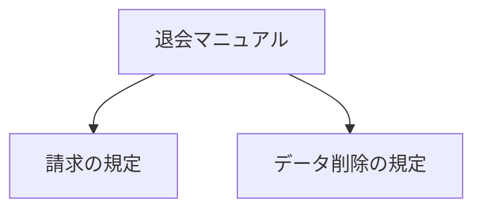

「データはいつ消えますか？」と聞かれたら、欲しいのは削除の規定です。料金やログインの説明まで、毎回渡す必要はありません。

**まず、必要な部分だけ取り出せるように、マニュアルを分けます。**

## 見出しごとに、一つの断片にする

退会マニュアルに、次の二つの節があるとします。

```markdown
# 退会

## 退会後の請求
解約した月の料金は満額です。日割りにはなりません。

## 退会後のデータ削除
退会完了から30日後にデータを削除します。
```

この例では、節ごとに切り出します。



分けた文章の断片を **チャンク** と呼びます。検索するときの「1件」です。

## 本文と一緒に、名前も残す

本文だけだと、検索後に「どの規定だったか」が分かりにくくなります。見出しや出典も一緒に持たせます。

| 残すもの | 何に使う？ |
|---|---|
| 文書ID | 同じ文書を識別する |
| 本文 | 検索し、回答の材料にする |
| 見出し・出典 | どの規定かを表示する |
| カテゴリなどの属性 | 検索する範囲を絞る |

本文の先頭にも「退会」「退会後のデータ削除」を付けておくと、何についての文章かを残せます。

## 小さければ、小さいほどよい？

細かく切りすぎると、条件と結論が離れてしまいます。

「退会完了から」を落として「30日後に削除」だけにすると、何から30日なのか分かりません。

**一つの規定を、意味が通じるまとまりで残す。** 本書の短いマニュアルでは、見出しごとに分けます。

:::details 参考にした記事
[Naive RAGのIndexing](https://qiita.com/koji0705/items/b424ac5432928de95abe)

冒頭のマニュアルは、規定を短くした説明用の例です。
:::
