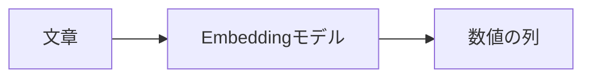

質問は「データをいつ**消す**？」。マニュアルの見出しは「退会後のデータ**削除**」。

言葉は違っても、同じ話をしています。こうした文章を探すために使うのが **Embedding** です。

## 文章を、数値の列に変える

Embeddingは、文章の意味を反映した数値の列を作る処理です。この数値の列を **ベクトル** と呼びます。



数値にする目的は、文章どうしの**意味の近さを計算するため**です。

例えば、次の組を比べてみましょう。

| 比べる文章                     | 意味の関係 |
| ------------------------------ | ---------- |
| 「いつ消す？」と「削除の時期」 | 近い話題   |
| 「いつ消す？」と「請求日」     | 違う話題   |

意味が近い文章ほど、近いベクトルになるように学習したモデルを使います。

## 文書と質問を、同じモデルに通す

検索するときは、質問もベクトルにします。

1. 登録するときに、文書をベクトルにする
2. 検索するときに、質問をベクトルにする
3. 二つの近さを比べる

**文書と質問には、同じモデルと設定を使います。** 違うモデルの数値を混ぜると、同じ基準で比べられません。

本書では、ベクトルの向きの近さを測る **コサイン類似度** で説明します。値が大きいほど、近いとみなします。

マニュアルを登録する前に、質問と二つの規定を同じモデルへ通します。

```bash
docker compose run --rm app embed
```


リクエストしたモデルは `openai/text-embedding-3-small`、応答のモデル名は `text-embedding-3-small`、次元数は 1536 でした。この呼び出しのトークン数は 70、処理時間は 1071 ミリ秒です。Chroma へは書いていません。

| 質問と規定                                           | コサイン類似度 |
| ---------------------------------------------------- | -------------- |
| 「データはいつ削除される？」と「退会後のデータ削除」 | 0.6082         |
| 「データはいつ削除される？」と「請求日」             | 0.2488         |

数値は、ログの小数第4位です。削除の規定の方が、請求日より質問に近くなりました。

## 近い文書なら、正解？

ここが落とし穴です。

「プラン変更の日割り」と「解約した月の日割り」は、話題が近くても、適用する規定が違います。

**Embeddingが教えてくれるのは意味の近さです。答えの根拠になるかは、別に確かめます。**

:::details 参考にした記事
[Embeddingについて学びたい](https://qiita.com/koji0705/items/32b9df2a2e25bad4cd2e)

考え方の表は説明用です。類似度の二つの値は、上記コマンドのログです。
:::
