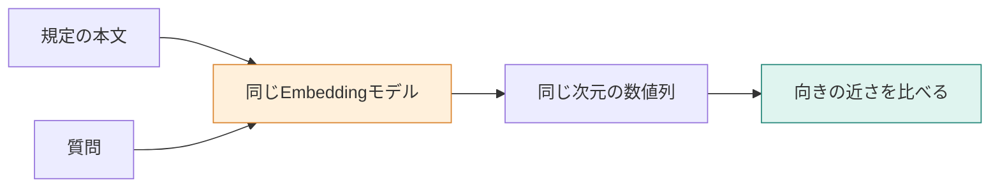

**この章では、言い方の違う質問と規定を、同じ基準で比べる準備をします。** 文章を数値へ変えるEmbeddingを使い、実際に二つの規定との近さを計算します。学ぶポイントは、数値の近さが示すものと、示さないものです。



## 単語が一致しない問い合わせを探したい

「データをいつ**消す**？」と「退会後のデータ**削除**」は、言葉が違っても同じ話をしています。単語の一致だけで探すと、このような言い換えに対応する工夫が必要です。

Embeddingは、文章の意味を反映する数値の列を作る処理です。その数値の列をベクトルと呼びます。意味が近い文章を近くに置くように学習したモデルを使い、文章同士を計算で比べます。

ただし、ベクトルの各成分に「料金」「退会」といった名前を人間が付けるわけではありません。数値を一つずつ読むより、同じモデルで作ったベクトル同士を比べて使います。

## STEP 1：何を数値にするか決める

`app/src/commands.ts` の `runEmbed` は、次の3文字列をまとめて送ります。

```typescript
const embedded = await embedTexts([
  deletion.body,
  billingDate.body,
  DELETE_QUERY,
]);
```

実際の入力は次の内容です。

```json
{
  "model": "openai/text-embedding-3-small",
  "input": [
    "退会\n退会後のデータ削除\n退会完了から30日後にデータを削除します。",
    "請求\n請求日\n料金は毎月1日に請求します。",
    "データはいつ削除される？"
  ]
}
```

送信先はOpenRouterの `/api/v1/embeddings` です。指示文で回答を求めるAPIではなく、`input` の文章それぞれに対応するベクトルを受け取ります。

## STEP 2：返り値を、元の文章に対応させる

`app/src/openrouter.ts` の `embedTexts` は、応答の `data[].index` 順にベクトルを並べ直します。0番の本文には0番のベクトルを対応させ、入力と同じ件数か、すべて1536次元かも確かめます。

| 配列位置 | 対応する文章 | 後で比較する相手 |
|---|---|---|
| `vectors[0]` | 削除の規定 | 質問 `vectors[2]` |
| `vectors[1]` | 請求日の規定 | 質問 `vectors[2]` |
| `vectors[2]` | 質問 | 上の二つの規定 |

本文とベクトルを取り違えると、検索順位だけ正しくても、取り出す本文が違ってしまいます。1536個の数値を紙面に並べる代わりに、この対応を押さえてください。

## STEP 3：質問との近さを計算する

ここでは **コサイン類似度** を使います。ベクトルの内積を、それぞれの長さの積で割る値です。

```text
cosine similarity = 内積(質問, 文書) / (質問の長さ × 文書の長さ)
```

この尺度では値が大きいほど向きが近くなります。実装で比べる箇所は次のとおりです。

```typescript
cosineSimilarity(embedded.vectors[2], embedded.vectors[0]);
cosineSimilarity(embedded.vectors[2], embedded.vectors[1]);
```

実行前に、どちらが近くなるか予想してから試します。[環境構築](./02-setup)後、次を実行します。DBへの保存はしません。

```bash
docker compose run --rm app embed
```


保存ログの結果は次のとおりでした。

| 質問と規定 | コサイン類似度 |
|---|---:|
| 「データはいつ削除される？」と削除の規定 | 0.6082 |
| 同じ質問と請求日の規定 | 0.2488 |

削除の規定の方が近くなっています。応答のモデル名は `text-embedding-3-small`、各ベクトルは1536次元でした。

## 0.6082を、正解する確率として読まない

この値は「60.82%の確率で正しい回答になる」という意味ではありません。今回は二つの規定のうち、削除の規定が近かったという結果です。

「プラン変更の日割り」と「解約した月の日割り」は、話題が近くても適用場面が違います。距離だけで根拠になるかを決めると、この違いを取り違えることがあります。

**同じモデル・同じ設定で意味の近さを比べ、根拠としての十分さは別に確かめる。** モデルを変更する場合は、質問だけを新しいモデルにせず、文書側も作り直します。同じ次元数でも、別のモデルの空間を混ぜてよいとは限りません。

:::details 考えてみる：質問に「30日」を入れればよい？
実際の利用者は答えの日数を知りません。正解を含む質問だけで検索を試すと、言い換えへの対応を十分に確かめられません。「いつ消える？」など、答えを知らない状態の問い合わせでも確認します。この言い換えでの追加実験は、上の表には含めていません。
:::

:::details 計測条件と参考記事
上の結果は `embed` の保存ログです。入力は合計70トークン、処理時間は1071ミリ秒でした。小数は第4位までです。図のための仮のベクトル値は使っていません。

[Embeddingについて学びたい](https://qiita.com/koji0705/items/32b9df2a2e25bad4cd2e)
:::
