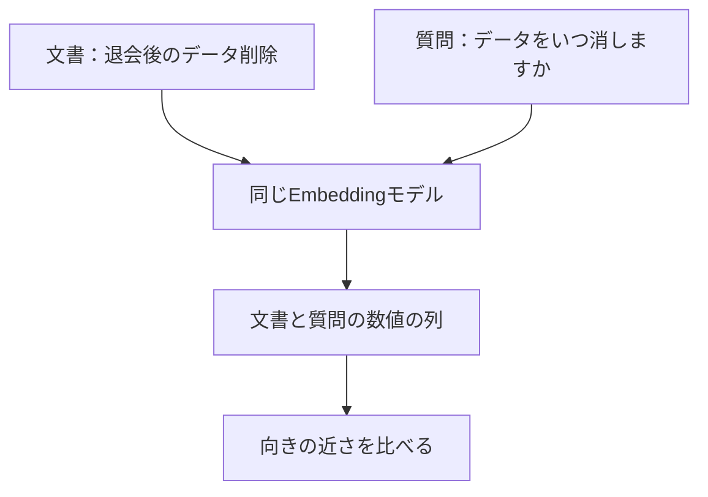

> **この章の要点：** 文章を数値の列に変換すると、言い方の違う質問と文書を、意味の近さで比べられます。

**前提知識：** 検索対象は、[第3章](./03-split-by-heading) で見出しごとに分けた短い文書です。文章を数値の列に変換する処理を Embedding と呼びます。数値の列そのものをベクトルと呼びます。この章ではデータベースへは入れません。保存は [第5章](./05-vector-db) です。

**今回の問い：** 言葉が違っても、意味が近い文書を探すには何が要るのか。

例に使う質問は、質問A「退会後、データはいつ削除されますか？」です。比べる文書は、見出し「退会後のデータ削除」です。

## この章の構成

- Embeddingとは
- 近い文と遠い文
- 文書と質問に同じモデルを使う
- 近さの計算
- 図で見る文章の近さ
- まとめ

## Embeddingとは

Embedding は、文章を、意味が反映された数値の列に変換する処理です。変換に使うモデルを Embedding モデルと呼びます。

単語の一致だけで探すと、「削除」と「消す」は別の語です。質問文が「データはいつ消しますか」でも、マニュアルの見出しが「退会後のデータ削除」なら、文字としての共通部分は少なくなります。数値の列にすると、語の一致とは別の尺度で、意味の近さを比べられます。

この近さは、文章どうしの意味の近さです。第2部以降で使う Jev の点数とは別の尺度です。Jev の `score` は、自然言語で書いた基準に対する評価値であり、正解である確率としては扱いません。

## 近い文と遠い文

表現が違っても話題が同じ文は、同じ Embedding モデルの上では近くなることを期待します。話題が違う文は、遠くなることを期待します。期待と、モデルが実際に出す近さは分けて書きます。

近いと期待する組は、同じ質問の言い換えです。

- 「データをいつ消しますか」
- 「退会後、データはいつ削除されますか」

どちらも、退会後にデータを消す時期を聞いています。語は「消す」と「削除」で分かれています。対応する見出しは「退会後のデータ削除」です。

遠いと期待する組は、同じ質問と、別の話題の文章です。たとえば料金の日割り計算だけの節は、データの削除時期とは話題が違います。

本書用のモデルで、この2組の近さを測った結果は未実験です。近いか遠いかは、測ってから書きます。元記事「Embeddingについて学びたい」にあるカテゴリの例と、平面に落とした図は、近さの説明にだけ使います。本編で数値にする対象は、第3章の TaskFlow の文書です。

## 文書と質問に同じモデルを使う

文書を数値にするときと、質問を数値にするときは、同じ Embedding モデルと同じ設定を使います。モデルが違うと、数値の列の意味する空間が揃わず、第5章以降で計算する近さが比較できません。

モデル名と次元数は、実装時に1つへ固定し、後の検索の章でも使用条件として再掲します。現時点のリポジトリでは、使うモデル名は未固定です。この章の本文に、未確認のモデル名は書きません。保存用と質問用で、同じモデルと設定を使うことだけを先に固定します。

API を呼ぶのは OpenRouter です。キーは [第2章](./02-setup) の `OPENROUTER_API_KEY` です。この章の成功は、1件の本文から数値の列が返ることです。データベースへの書き込みは含みません。

## 近さの計算

近さは、コサイン類似度で比べます。2つの数値の列が、向きとしてどれだけ揃っているかを見ます。値が大きいほど、この本では近いとみなします。

[第6章](./06-naive-rag) の上位3件は、この値の順です。この章では、質問のベクトルと文書のベクトルを作れるところまでを確認します。順位をデータベースに問い合わせる処理は、第5章と第6章です。

Chroma が返す距離は、設定によってコサイン類似度そのものとは限りません。距離の設定、並び順、画面上の名前は、第5章の実装時に確認します。この章の「近さ」はコサイン類似度のことです。

## 図で見る文章の近さ

文章を直接比べる代わりに、同じモデルで作った数値の列の向きを比べます。次の図は処理の順です。平面上の位置を実測した図ではありません。

図の読みどころは、文書と質問が一度同じモデルを通ることです。出口の「向きの近さ」が、コサイン類似度です。

多次元の数値を平面に落とすときは、主成分分析（PCA）を使います。実測前の図は模式図です。実測後の図には、使ったデータとモデル名を書きます。平面上の近さは傾向が見えるところまでで、検索精度の証明には使いません。点と点の距離が近いことと、その文書が質問の正解根拠であることは、別の確認です。

## まとめ

- Embedding は、文章を、意味の近さとして比べられる数値の列にします。
- 登録と検索で、同じモデルと同じ設定を使います。モデル名は実装時に固定し、この章では未記載です。
- 上位を決める値はコサイン類似度です。この章ではデータベースへは入れません。
- 近くなるという期待は、本書用モデルでの実測が終わるまで未実験です。

次の [第5章 ベクトルDBに登録する](./05-vector-db) では、本文と数値と所属をベクトルDBに残します。

## 参考資料

- [Embeddingについて学びたい](https://qiita.com/koji0705/items/32b9df2a2e25bad4cd2e)
