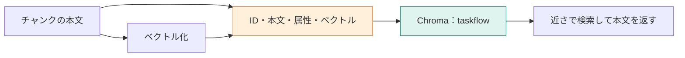

**この章では、近い数値から元の規定を取り出せる索引を作ります。** ベクトルだけでは回答できないため、本文・ID・属性を一緒に保存します。登録できたかを、件数、本文の読み戻し、検索、再登録の四つで確認します。



## 数値だけを保存すると、回答の材料が戻らない

質問に近いベクトルが見つかっても、LLMへ渡すのは元の本文です。そこで、1件のレコードに次の情報を対応させます。

| 項目 | 削除の規定で入るもの | 役割 |
|---|---|---|
| ID | `withdrawal.md#退会後のデータ削除` | 同じ節の識別と更新 |
| 本文 | 「退会」「退会後のデータ削除」と規定 | 回答の根拠 |
| ベクトル | 本文から作った1536次元の数値 | 近さの計算 |
| メタデータ | 見出し、カテゴリ、出典、タイトル | 表示や条件での絞り込み |

保存先はベクトルDBの **Chroma** です。これらのレコードを集める入れ物をコレクションと呼び、名前を `taskflow` とします。

## STEP 1：同じ配列位置の本文とベクトルを登録する

`runIndex` は、全チャンクの本文をまとめてベクトル化し、次のように登録データを作ります。実装は `app/src/commands.ts` です。

```typescript
await upsertChunks(
  collection.id,
  chunks.map((chunk, index) => ({
    id: chunk.id,
    body: chunk.body,
    embedding: embedded.vectors[index],
    metadata: {
      heading: chunk.heading,
      category: chunk.category,
      source: chunk.source,
      title: chunk.title,
    },
  })),
);
```

Chromaへは、同じ位置に対応する `ids`、`documents`、`embeddings`、`metadatas` の配列として送ります。本文だけ新しくして古いベクトルを残すと、検索で使う意味と返す本文が食い違います。同じ入力から組を作る理由です。

`upsert` は、同じIDがあれば更新し、なければ追加する操作です。毎回すべてを追加する方式にはしません。

## STEP 2：登録と読み戻しを一度に試す

[環境構築](./02-setup)後、実行します。分割とベクトル化もこのコマンド内で行います。

```bash
docker compose run --rm app index
```


以下は、マニュアルが15節だった時点の保存ログです。現在の18節で新規に登録すると、`expected_count` は18になります。

```text
collection: taskflow
space: cosine
count: 15
expected_count: 15
readback: match
query: データはいつ削除される？
rank: 1
heading: 退会後のデータ削除
distance: 0.3917
top_cosine_similarity: 0.6083
top_distance_plus_similarity: 1.0000
```

`count` と `expected_count` の一致は、件数の確認です。`readback: match` は、保存した削除の規定をIDで読み直し、元の本文と一致したことを示します。件数が合うだけでは、本文の対応まで合うとは言えないため、両方を見ます。

## STEP 3：質問もベクトル化して検索する

検索では、文書のときと同じEmbeddingモデルを使います。Chromaへ送る処理の抜粋です。

```typescript
const hits = await queryCollection(
  collection.id,
  queryEmbedding.vectors[0],
  3,
);
```

DBへ渡すのは質問の文字列ではなく、そのベクトルです。返るのは、近い3件のID、本文、属性、距離です。ここでは回答モデルを呼びません。

コレクションの距離尺度は `cosine` です。このとき距離は、おおむね `1 - コサイン類似度` なので、**距離は小さい方が近い**と読みます。上のログで和が1.0000なのは、その対応を確かめた結果です。前章の類似度と大小を逆に読まないようにします。

## STEP 4：再登録と再起動で、保存の性質を確認する

同じIDで `index` を再実行しても、15節の保存ログでは件数は15のままでした。現在のマニュアルでも、同じ内容で繰り返したときに件数が増えないことを確かめてください。

```bash
docker compose run --rm app index
docker compose down
docker compose up -d chroma
docker compose run --rm app search --question "データはいつ削除される？"
```

再起動後にも検索できれば、アプリのプロセスのメモリだけに保存しているわけではないと確認できます。保存ログでは、再起動後も15件で、1位は「退会後のデータ削除」でした。

## 更新で気をつけるのは、削除と改名

`upsert` は今回送ったIDを更新するだけです。マニュアルから消した節や、見出しを変えた古いIDを自動で削除する処理はありません。`count` が `expected_count` より多ければ、古いIDの残存を調べます。

また、Embeddingモデルを変えた場合は索引全体を作り直す必要があります。今回のコードは、モデル変更や削除までを同期する仕組みではありません。

:::details 考えてみる：件数が18なら、18件とも正しく保存できた？
件数だけでは分かりません。IDと本文の対応が違っていても件数は同じです。本章は削除の規定1件の読み戻しまでを確認しています。実運用では、更新した節や代表的な質問も検証対象にします。
:::

:::details 計測条件と参考記事
15節の登録ログでは、文書のベクトル化が633トークン・1421ミリ秒、質問が12トークン・701ミリ秒です。モデルは登録・質問とも `openai/text-embedding-3-small`、1536次元です。

- [Chromaを学びたい](https://qiita.com/koji0705/items/d4b35609c182b44f6ab1)
- [図鑑情報をChromaに登録し検索する](https://qiita.com/koji0705/items/488f0a7fd7656b493bb4)
:::
