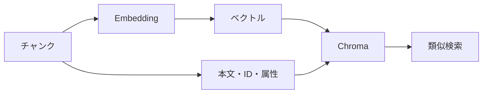

## ベクトルDBとは？

**ベクトルDBとは、文章から生成したベクトルを保存し、意味的に近いデータを検索するためのデータベースです。** 前章ではEmbeddingを使って文章をベクトル化しました。今回は、そのベクトルと元の文章をChromaに登録し、検索できるようにします。

本書では、ベクトルDBとして[Chroma](https://www.trychroma.com/)を使用します。


https://www.trychroma.com/


## ① Chromaには何を保存するのか？

ベクトルだけを保存しても、検索結果から回答の根拠となる文章を取り出せません。そのため、Chromaには次の情報をまとめて登録します。

| 項目 | 内容 | 役割 |
|---|---|---|
| `id` | `withdrawal.md#退会後のデータ削除` | 文書の識別 |
| `document` | 退会後のデータ削除に関する本文 | 回答の根拠 |
| `embedding` | 1536次元のベクトル | 類似検索 |
| `metadata` | 見出し・カテゴリ・出典など | 検索条件や結果の表示 |

これらをまとめて管理する入れ物を**コレクション（Collection）**と呼びます。今回は`taskflow`という名前で作成し、距離の計算方法には`cosine`を指定します。



## ② 実装コードを確認する

実際に登録する処理は、`app/src/commands.ts`の`runIndex()`です。まず全チャンクを読み込み、本文をEmbeddingモデルへ送ります。

```typescript
const chunks = await loadChunks();
const embedded = await embedTexts(chunks.map((chunk) => chunk.body));
const collection = await getOrCreateCollection();
```

続いて、各チャンクと生成されたベクトルを対応させて登録します。

```typescript
await upsertChunks(
  collection.id,
  chunks.map((chunk, index) => ({
    id: chunk.id,
    body: chunk.body,
    embedding: embedded.vectors[index],
    metadata: {
      heading: chunk.heading,
      category: chunk.category,
      source: chunk.source,
      title: chunk.title,
    },
  })),
);
```

ポイントは、`chunks[index]`と`embedded.vectors[index]`が対応していることです。本文とベクトルがずれると、検索結果で別の文章を取り出してしまいます。

### Chromaへの登録リクエスト

`app/src/chroma.ts`の`upsertChunks()`は、次のようにChromaへリクエストします。

```typescript
export async function upsertChunks(
  collectionId: string,
  records: {
    id: string;
    body: string;
    embedding: number[];
    metadata: Record<string, string>;
  }[],
): Promise<void> {
  await postJson(
    `${chromaBase()}/${collectionId}/upsert`,
    {
      ids: records.map((record) => record.id),
      documents: records.map((record) => record.body),
      embeddings: records.map((record) => record.embedding),
      metadatas: records.map((record) => record.metadata),
    },
    {},
  );
}
```

ChromaのAPIには、ID・本文・ベクトル・メタデータをそれぞれ配列で渡します。`upsert`は、同じIDが存在すれば更新し、存在しなければ追加する操作です。

## ③ 登録できたかを確認する

登録した件数と、保存された本文を確認します。`runIndex()`では次の処理を実行しています。

```typescript
const count = await countRecords(collection.id);
field("count", count);
field("expected_count", chunks.length);

const sample = requireChunk(chunks, "退会後のデータ削除");
const stored = await readDocument(collection.id, sample.id);
field("readback", stored === sample.body ? "match" : "mismatch");
```

`count`はChroma内の件数、`expected_count`は今回読み込んだチャンク数です。また、退会後のデータ削除の本文を読み戻し、元の文章と一致するか確認します。

これらは確認結果をログに出力する処理であり、件数や本文が不一致でも、この部分だけでは例外を発生させません。

## ④ 質問をベクトル化して検索する

登録後は、質問も同じEmbeddingモデルでベクトル化し、Chromaで類似検索します。

**質問**

> データはいつ削除される？

`runIndex()`では次の処理を実行しています。

```typescript
const queryEmbedding = await embedTexts([DELETE_QUERY]);

const hits = await queryCollection(
  collection.id,
  queryEmbedding.vectors[0],
  3,
);

for (let index = 0; index < hits.length; index += 1) {
  printHit(index + 1, hits[index]);
}
```

Chromaへの検索リクエストは、`app/src/chroma.ts`で次のように組み立てています。

```typescript
const body: Record<string, unknown> = {
  query_embeddings: [embedding],
  n_results: limit,
  include: ["documents", "metadatas", "distances"],
};

if (category !== undefined) {
  body.where = { category };
}
```

`query_embeddings`に質問のベクトルを渡し、`n_results`で検索件数を指定します。今回は上位3件を取得し、検索結果にはID・本文・メタデータ・距離が含まれます。

**Chromaの距離（distance）は、小さいほど近い**ことを意味します。今回の`cosine`設定では、距離はおおむね`1 - コサイン類似度`に対応します。

## ⑤ 実行して結果を確認する

リポジトリのルートで次のコマンドを実行します。分割・Embedding・登録・読み戻し・検索までを一度に行います。

```bash
docker compose run --rm app index
```


以下は、マニュアルが15チャンクだった時点の保存ログから抜粋した結果です。

```text
collection: taskflow
space: cosine
count: 15
expected_count: 15
readback: match
query: データはいつ削除される？
rank: 1
heading: 退会後のデータ削除
distance: 0.3917
top_cosine_similarity: 0.6083
top_distance_plus_similarity: 1.0000
```

| 確認項目 | 結果 | 分かること |
|---|---|---|
| `count` | 15 | DB内のレコード数 |
| `expected_count` | 15 | 今回読み込んだチャンク数 |
| `readback` | match | 対象の本文が一致 |
| 検索1位 | 退会後のデータ削除 | 質問に関連する規定を取得 |
| `distance` | 0.3917 | コサイン距離 |

質問に関連する「退会後のデータ削除」が検索1位になりました。また、距離0.3917と類似度0.6083を足すと1.0000になり、距離と類似度の関係も確認できます。

※ このログは15チャンク時点のものです。現在のマニュアルは18チャンクのため、空のコレクションに新規登録した場合の`expected_count`は18になります。既存のコレクションに古いIDが残っている場合は、`count`が18と一致しないこともあります。

## 再実行するとどうなる？

同じチャンクを再登録しても、`upsert`では既存IDが更新されるため、同じ文書が重複して増えるわけではありません。また、Chromaのデータをボリュームに保存していれば、コンテナを再起動しても検索を続けられます。

一方で、**マニュアルから削除した節のIDは、今回の`upsert`では自動削除されません。** 見出しの改名や文書削除を行った場合は、古いIDを別途削除する必要があります。Embeddingモデルを変更した場合も、保存済みの文書ベクトルを作り直す必要があります。

## まとめ

今回は、マニュアルの本文・ベクトル・メタデータをChromaへ登録し、質問のベクトルから関連する文書を検索しました。ベクトルDBを使うことで、保存した多数の文章から意味的に近いものを取り出せます。

ただし、**検索で近い文書が見つかっても、その文書が質問への正しい根拠とは限りません。** 次章では、検索結果をLLMに渡して回答を生成する基本形のNaive RAGを実装します。
