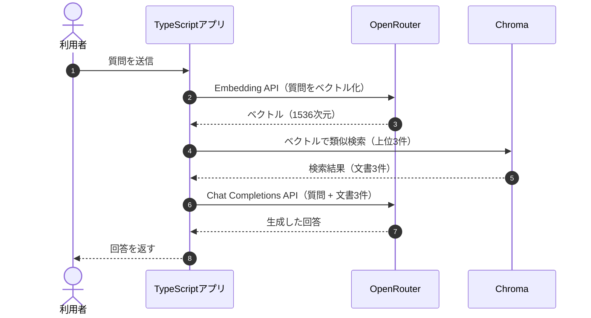

## Naive RAGとは？

**Naive RAGとは、検索した文書をそのままLLMに渡し、回答を生成する基本的なRAGです。** これまでの章では、マニュアルの分割・ベクトル化・Chromaへの登録を行いました。今回は、利用者の質問から関連文書を検索し、その本文を使って回答するところまで実装します。




Naive RAGでは、検索した文書を再評価・並べ替えせず、そのまま回答モデルへ渡します。本書では、Chromaで取得した上位3件を使用します。


## ① 今回の実験内容

TaskFlowに、次の問い合わせが届いたとします。

> Standardプランを月の途中で解約したら、日割りになりますか？

マニュアルには「解約した月の料金は満額です。日割りにはなりません。」という規定が存在します。今回は、**この規定を検索で取得し、LLMが正しく回答できるか**を確認します。

## ② 実装コードを確認する

実際に実行する処理は、`app/src/commands.ts`の`runAnswer()`です。

```typescript
export async function runAnswer(question = ""): Promise<void> {
  const questions =
    question.length > 0 ? [question] : [DELETE_QUESTION, PRORATION_QUESTION];

  for (const item of questions) {
    await answerQuestion(item, 3, "naive");
  }
}
```

質問を指定しなければ「データ削除」と「解約月の日割り」の2問を実行します。`answerQuestion()`では、質問をEmbeddingモデルでベクトル化し、Chromaから上位3件を検索します。

**`app/src/commands.ts`からの抜粋**

```typescript
const embedded = await embedTexts([question]);
const hits = await queryCollection(
  collection.id,
  embedded.vectors[0],
  limit,
);

await printAnswer(label, question, hits);
```

文書側のベクトルは第5章ですでに登録しています。そのため、質問を受け取るたびに全マニュアルをベクトル化する必要はありません。

## ③ 検索結果を確認する

以下は、マニュアルが15チャンクだった時点の保存ログです。

| 順位 | 検索された文書 | distance |
|---|---|---:|
| 1 | プラン変更時の日割り | 0.2862 |
| 2 | Standardプランの月額 | 0.3832 |
| 3 | 退会後の請求 | 0.3869 |

Chromaの`distance`は小さいほど近いことを意味します。今回の質問に最も近いと判断されたのは「プラン変更時の日割り」ですが、**解約月の請求を定めているのは3位の「退会後の請求」**です。

検索順位は意味的な近さを示すもので、回答の根拠として適切かどうかを判定した結果ではありません。

## ④ 検索結果をLLMへ渡す

検索した文書は、`printAnswer()`で質問と組み合わせます。

**`app/src/commands.ts`からの抜粋**

```typescript
const passages = hits
  .map((hit) => `見出し: ${hit.heading}\n${hit.document}`)
  .join("\n\n");

const user =
  hits.length === 0
    ? `質問:\n${question}`
    : `質問:\n${question}\n\n文書:\n${passages}`;

const answer = await completeAnswer(user, instruction);
```

解約に関する質問では、LLMに次のような内容を渡します。

```text
質問:
Standardプランを月の途中で解約したら、日割りになりますか？

文書:
見出し: プラン変更時の日割り
請求
プラン変更時の日割り
月の途中で上位プランへ変更した場合、変更日から月末までを日割りで計算します。下位プランへの変更は、翌月から新しい料金です。

見出し: Standardプランの月額
請求
Standardプランの月額
Standardプランの月額は980円です。年払いの割引はありません。

見出し: 退会後の請求
退会
退会後の請求
解約した月の料金は満額です。日割りにはなりません。
```

重要なのは、**LLMに渡すのは質問と文書の本文であり、ベクトルや距離ではない**ことです。ベクトルは文書を検索するために使い、取得した文章を回答生成に利用します。

## ⑤ OpenRouterへ回答を依頼する

回答生成には、OpenRouter経由で`openai/gpt-4.1-mini`を使用します。`app/src/openrouter.ts`の`completeAnswer()`では、次のリクエストを送信しています。

```typescript
const payload = await postJson(
  "https://openrouter.ai/api/v1/chat/completions",
  {
    model: ANSWER_MODEL,
    messages: [
      { role: "system", content: instruction },
      { role: "user", content: user },
    ],
  },
  bearer("OPENROUTER_API_KEY"),
);
```

`system`には次の指示を設定しています。

```text
渡された文書だけを根拠に答えてください。文書から判断できなければ、「分からない」と答えてください。
```

この指示によって、TaskFlowのマニュアルに書かれていない内容を推測して回答することを抑えます。ただし、指示を与えるだけで、必ず正しい回答になると保証されるわけではありません。

## ⑥ 実行して結果を確認する

まず、現在のマニュアルをChromaへ登録します。

```bash
docker compose run --rm app index
```

続いて、Naive RAGを実行します。

```bash
docker compose run --rm app answer
```

特定の質問だけを実行したい場合は、次のように指定できます。

```bash
docker compose run --rm app answer --question "Standardプランを月の途中で解約したら、日割りになりますか？"
```

**保存ログで得られた回答**

```text
Standardプランを月の途中で解約した場合、料金は満額で、日割りにはなりません。
```

今回は、検索3位にあった「退会後の請求」がLLMに渡され、正しい規定に沿った回答が生成されました。

もう一つの質問と比較すると、次のようになります。

| 質問 | 正しい規定の検索順位 | 回答 |
|---|---:|---|
| 退会後、データはいつ削除されますか？ | 1位 | 退会完了から30日後 |
| Standardプランの途中解約は日割り？ | 3位 | 満額・日割りなし |

どちらも正しく回答できましたが、検索結果の状態は異なります。

※ 上記は15チャンク時点の保存ログに基づく結果です。現在は18チャンクのため、再実行時の検索順位や回答は変わる可能性があります。

## Naive RAGの課題は？

今回の実験では正しく回答できましたが、検索結果を上位2件に絞ったらどうなるでしょうか。

その場合、保存ログ上では「退会後の請求」が検索結果から外れます。残る「プラン変更時の日割り」と「Standardプランの月額」だけでは、解約した月の日割りを判断できません。

つまり、**必要な情報が検索結果に含まれていなければ、LLMに正しい回答の根拠を渡せない**という課題があります。一方、検索件数を増やせば必ず改善するわけでもなく、無関係な文書までLLMへ送ることになります。

この検索件数と回答の関係は、後のReranking RAGで実際に比較します。

## まとめ

Naive RAGは、**質問をベクトル化して関連文書を検索し、その文書をLLMへ渡して回答を生成する仕組み**です。今回の実験では、正しい規定が検索3位でも、上位3件をLLMに渡すことで適切に回答できました。

ただし、検索結果に必要な規定が含まれるとは限りません。次章では、**メタデータを使って検索対象を絞り込む方法**を学びます。

