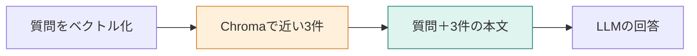

**この章では、質問から検索と回答までを一巡させます。** 検索した上位3件をそのままLLMへ渡す、Naive RAGの実装です。「検索1位が正解か」ではなく、「渡した本文に答えの規定があるか」を確認できるようになります。



## 解約の質問に、プラン変更の規定が近づく

問い合わせは次の1文です。

> Standardプランを月の途中で解約したら、日割りになりますか？

マニュアルの「退会後の請求」には、**解約した月は満額で、日割りにはならない**と書いてあります。検索がこの節を1位にしなくても、上位3件に残っていればLLMへ渡せます。

この章では、検索後に採点し直す処理を入れません。まず基本形のまま、どの本文が回答まで届くかを見ます。[環境構築](./02-setup)後、現在のマニュアルを登録してから実行してください。

```bash
docker compose run --rm app index
docker compose run --rm app answer
```

`answer` は削除時期と解約月の日割りの2問を実行します。以下の比較は、15節だった時点の保存ログです。現在は18節なので、再実行時の順位や数値は変わり得ます。

## STEP 1：質問を数値にし、3件の本文を取り出す

`app/src/commands.ts` の `answerQuestion` は、質問を `openai/text-embedding-3-small` へ送り、返ったベクトルでChromaを検索します。

```typescript
const embedded = await embedTexts([question]);
const hits = await queryCollection(collection.id, embedded.vectors[0], limit);
await printAnswer(label, question, hits);
```

この呼び出しで `limit` は3です。文書のベクトルは事前登録済みなので、質問ごとに全マニュアルをベクトル化し直しません。

保存ログで取れたのは次の3件でした。`distance` はコサイン距離で、小さいほど近い値です。

| 順位 | 見出し | distance | 解約月の日割りを判断できるか |
|---|---|---:|---|
| 1 | プラン変更時の日割り | 0.2862 | 変更の話であり、解約の規定ではない |
| 2 | Standardプランの月額 | 0.3832 | 月額980円だけでは判断できない |
| 3 | 退会後の請求 | 0.3869 | 満額・日割りなしと書いてある |

最後の列は、本文を読んだ人間の確認です。検索APIが返した判定ではありません。

## STEP 2：LLMに渡すユーザー文を組み立てる

`printAnswer` は、各検索結果を「見出し＋本文」にし、質問の後ろへ並べます。解約の質問では、次の文字列になります。

```text
質問:
Standardプランを月の途中で解約したら、日割りになりますか？

文書:
見出し: プラン変更時の日割り
請求
プラン変更時の日割り
月の途中で上位プランへ変更した場合、変更日から月末までを日割りで計算します。下位プランへの変更は、翌月から新しい料金です。

見出し: Standardプランの月額
請求
Standardプランの月額
Standardプランの月額は980円です。年払いの割引はありません。

見出し: 退会後の請求
退会
退会後の請求
解約した月の料金は満額です。日割りにはなりません。
```

距離やベクトルは回答モデルへ渡しません。モデルが読む材料は、この質問と本文です。

## STEP 3：根拠の範囲を指示して回答させる

`app/src/openrouter.ts` の `completeAnswer` は、`openai/gpt-4.1-mini` へ、システム文とユーザー文を送ります。システム文は次のとおりです。

```text
渡された文書だけを根拠に答えてください。文書から判断できなければ、「分からない」と答えてください。
```

「一般に日割りになるか」ではなく、TaskFlowの規定を答えてほしいので、根拠の範囲を限定します。ただし、この指示を書くだけで常に守られると保証するものではありません。

保存ログで返った本文です。

```text
Standardプランを月の途中で解約した場合、料金は満額で、日割りにはなりません。
```

3位の規定を使えば答えられる状態で、回答も満額になりました。「1位が違うから失敗」とせず、**検索結果の集合と、生成された文の両方を見る**ことがポイントです。

## もう一つの質問では、1位がそのまま根拠になった

| 質問 | 1位の見出し | 回答 |
|---|---|---|
| 退会後、データはいつ削除されますか？ | 退会後のデータ削除 | 退会完了から30日後にデータを削除します。 |
| Standardの途中解約は日割りか？ | プラン変更時の日割り | 解約月は満額。日割りにはならない |

前者は1位が直接の規定で、後者は3位が直接の規定です。どちらも答えられていますが、後者には上位件数を減らすと根拠が落ちる弱さがあります。

:::details 考えてみる：解約の検索結果を上位2件にしたら？
上の表では「退会後の請求」が外れます。残った月額とプラン変更の本文だけでは、解約時の日割りを判断できません。

これは入力からの予想です。実際に件数を変えた結果は[第8章](./08-rerank)で確かめます。候補を増やす方法と、候補内を並べ替える方法の違いも比較します。
:::

最初に保存するべき情報は、質問、取得した見出しと本文、回答です。時間やトークン数だけでは、答えられなかった場所を特定できません。

:::details 計測条件と出典
15節時点の `answer` の保存ログです。解約の質問はベクトル化26トークン・706ミリ秒、回答の入力214・出力28トークン・1241ミリ秒。削除時期はベクトル化17トークン・2260ミリ秒、回答の入力201・出力17トークン・1374ミリ秒です。

[Naive RAGの記事](https://qiita.com/koji0705/items/b424ac5432928de95abe)は12チャンク・JSON保存の別実装です。[Rerankingの記事](https://qiita.com/koji0705/items/bc8d87103bae40c8ff90)のNaive側では必要な節が上位3件から漏れ、「解約時の日割りは分からない」となりました。そちらの結果を、本章の実行結果には混ぜていません。
:::
