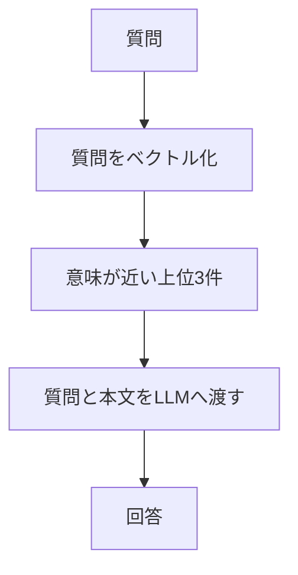

> **この章の要点：** 意味が近い上位3件を、並べ替えも除外もせずに渡します。近い文書と、その質問の根拠になる文書は別です。

**前提知識：** 本文、ベクトル、見出し、所属は、[第5章](./05-vector-db) の1つのコレクションに入っているものとします。近さは、[第4章](./04-embedding) と同じ Embedding モデルで作ったベクトルのコサイン類似度です。Naive RAG は、検索した文書をそのまま回答生成へ渡す基本形です。

**今回の質問：**

- **A：削除時期** — 退会後、データはいつ削除されますか？
- **B：解約月の日割り** — Standardプランを月の途中で解約したら、日割りになりますか？

**今回の問い：** 近い文書をそのまま渡すと、どこまで答えられて、どこで外れるのか。

この章が Naive RAG の基本形です。第8章以降では、各章と同じ条件で実行した Naive RAG を比較相手にします。この章に書いた観測を、条件の違う記事の比較へは流用しません。

## 結果の出典と条件

ここで扱う観測は、末尾の Qiita 記事に掲載された結果です。本書用の Docker と Chroma では再実験していません。

質問Aは、Naive RAG の記事に書かれた結果です。質問Bは、Reranking の記事と Corrective RAG の記事にある、Naive RAG を対照として実行した結果です。2つの記事の対照は、どちらも「必要な規定が上位3件から漏れることがある」ことを示すために使います。処理時間やトークン数は、記事をまたいで1つの計測にはまとめません。この章の表に載せる時間とトークンは、未計測です。

元記事の Naive RAG は、12チャンクを JSON へ保存しています。この本の保存先は Chroma です。保存先が違うため、下の取得結果は Qiita掲載結果であり、本書用の再実験ではありません。

## この章の構成

- Naive RAGとは
- 処理の流れ
- 質問A：削除時期の結果
- 質問B：解約月の日割りの結果
- 比較に使う列
- まとめ

## Naive RAGとは

Naive RAG は、検索した文書を、並べ替えも除外もせず、LLM に渡して回答を作る構成です。元記事の3段は Indexing、Retrieval、Generation です。Indexing は第3章から第5章に分けました。この章は Retrieval と Generation です。

属性では絞りません。カテゴリが分かっているときの絞り込みは [第7章](./07-metadata-filter) です。取れたあとの順位の変更は [第8章](./08-rerank)、回答に渡す前の除外は [第9章](./09-exclude) です。

## 処理の流れ

質問をベクトルにし、意味が近い上位3件の本文を、質問と一緒に LLM へ渡します。取得のあとには、並べ替え、除外、検証を足していません。

図の読みどころは、上位3件から回答までの間に、別の選別が無いことです。

1. 質問を、第4章と同じモデルで数値にします。
2. コレクションから、近い順の上位3件を取ります。この本では、その近さをコサイン類似度として説明します。Chroma が返す距離をこの順に揃える設定は、アプリ実装時に確認します。
3. その本文だけを根拠に答えさせます。
4. マニュアルに無いことは「分からない」と答える、と指示します。

文書を使って答える章では、4の指示を揃えます。[第10章 質問に応じて検索方法を選ぶ](./10-choose-search) の「検索なし」だけは、一般知識による説明に分岐します。その章では、指示の差をその場で書きます。

入力トークンは、特に断りがなければ、最終回答を生成する LLM への入力です。検索用のベクトル化、Jev、追加の検索文の生成は、この数に含めません。この章の基本形には Jev と追加検索は無く、ベクトル化のトークンは回答生成とは別に数えます。この章では、その内訳の数値は未計測です。

## 質問A：削除時期の結果

質問A「退会後、データはいつ削除されますか？」では、1つの規定を取って答えられました。出典は Naive RAG の記事です。

| 見ること | Naive RAG 記事の結果 |
|---|---|
| 必要な規定 | 「退会後のデータ削除」 |
| 取得 | 対応する規定が上位に入る |
| 回答 | 退会完了から30日後 |
| 入力トークン | 未計測 |
| 処理時間 | 未計測 |

この例は、近い順の上位に、質問の根拠になる規定が入った場合です。回答は、退会完了から30日後に削除する、という内容です。

## 質問B：解約月の日割りの結果

質問B「Standardプランを月の途中で解約したら、日割りになりますか？」では、必要な規定が上位3件から漏れることがあります。出典は、Reranking の記事と Corrective RAG の記事に載っている、Naive RAG の対照実行です。Naive RAG 単独の記事の結果としては紹介しません。

上位に来るのは、プラン変更や日割りの計算の節です。質問の根拠である「退会後の請求」が、上位3件から漏れることがあります。漏れた状態の回答は「分からない」です。

規定の側には、解約した月は満額で、日割りにならない、と書いてあります。根拠が回答へ渡っていれば、この結論を材料にできます。渡っていないときの「分からない」は、マニュアルに答えが無いからではありません。検索で、その規定を上位3件に入れられなかったからです。

この漏れが、第8章の並べ替えと、[第11章 検索の失敗を検知して取り直す](./11-retry) の出発点です。

| 見ること | 対照実行での結果 | 出典 |
|---|---|---|
| 必要な規定 | 「退会後の請求」 | はじめにで固定した根拠 |
| 取得 | 上位はプラン変更や日割りの計算。「退会後の請求」が上位3件から漏れることがある | Reranking 記事と Corrective RAG 記事の対照 |
| 回答 | 漏れた状態では「分からない」 | 同じ対照実行 |
| 入力トークン | 未計測 | この章では記事間の数値を1つにまとめていない |
| 処理時間 | 未計測 | 同上 |

2つの記事の対照を、1回の計測の平均としては扱いません。どちらも、同じ種類の漏れを観測した対照として読みます。

## 比較に使う列

第8章以降の結果は、次の列で並べます。

| 列 | 読むこと |
|---|---|
| 質問 | 質問の全文 |
| 取得した見出し | 回答へ渡した文書の見出し |
| 回答 | モデルが返した文の要点 |
| 入力トークン | 最終回答を生成する LLM への入力 |
| 処理時間 | その章で計測した範囲を、表の注記に書く |

数値が元記事に無い列は「未計測」、画像だけで確認できていない値は「ログ未確認」と書きます。空欄や、別の題材から持ってきた数値では埋めません。

「回答生成への入力が減った」ことは、システム全体の費用が下がったこととは分けて読みます。ベクトル化、Jev、追加検索の費用は別に記録します。

## まとめ

- Naive RAG は、意味が近い上位3件を、そのまま LLM へ渡します。
- 質問Aでは、必要な規定が上位に入り、退会完了から30日後と答えられました。出典は Naive RAG の記事です。
- 質問Bでは、「退会後の請求」が上位3件から漏れることがあり、漏れると回答は「分からない」になります。出典は後続記事の対照実行です。
- 近いことと、その質問の答えの根拠であることは別です。この基本構成を、各章で条件をそろえた比較相手にします。

次の [第7章 属性で検索範囲を狭める](./07-metadata-filter) では、意味の近さの前に、属性の条件で範囲を狭めます。第7章は、この章の比較系列を置き換えません。並べ替えは第8章です。

## 参考資料

- [RAGを学びたい(Step0: NaiveRAG)](https://qiita.com/koji0705/items/b424ac5432928de95abe)
- [JevでRAGの検索精度は改善できるのか？ Rerankingを実装して検証してみた](https://qiita.com/koji0705/items/bc8d87103bae40c8ff90) （質問Bの対照実行）
- [JevでRAGの検索失敗を検知・修正する！Corrective RAGを実装してみた](https://qiita.com/koji0705/items/ce8dc8c41ac10b38fc9b) （質問Bの対照実行）
