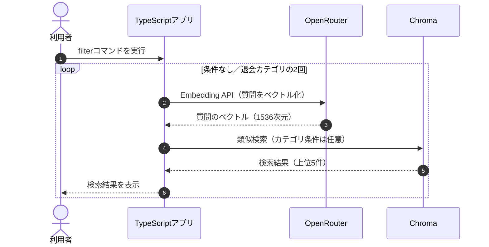

## メタデータフィルタとは？

**メタデータフィルタとは、文書に付けられた属性を条件にして、検索対象を絞り込む方法です。** 例えば、TaskFlowのマニュアルには「請求」「退会」「アカウント」といったカテゴリがあります。質問の対象が退会だと分かっていれば、退会カテゴリの文書だけを検索できます。

前章のNaive RAGでは、すべてのマニュアルを対象に類似検索しました。今回は、検索範囲を限定することで結果がどう変わるかを確認します。


## ① 今回の実験内容

前章と同じ質問を使います。

> Standardプランを月の途中で解約したら、日割りになりますか？

前章では「プラン変更時の日割り」が検索1位でしたが、正しい規定は3位の「退会後の請求」でした。そこで、今回は`category = "退会"`という条件を付けて検索します。

| 文書 | category |
|---|---|
| プラン変更時の日割り | 請求 |
| Standardプランの月額 | 請求 |
| 退会後の請求 | 退会 |
| 退会後のデータ削除 | 退会 |

**メタデータは、検索する前から各文書に付いている属性です。** 今回の実装では、Markdownの文書タイトルからカテゴリを設定しており、LLMにカテゴリを判断させているわけではありません。

## ② 処理の流れ

検索条件の有無による違いを、シーケンス図で確認します。



通常の類似検索と異なるのは、**Chromaへ検索リクエストを送るときに、カテゴリ条件を付けること**です。全件を検索してから不要な結果を削除するのではなく、指定カテゴリの中で類似検索します。

この章では、OpenRouterのEmbedding APIのみを呼び出します。回答生成LLMやJevは使用しません。

## ③ 実装コードを確認する

実際の処理は`app/src/commands.ts`の`runFilter()`です。

```typescript
export async function runFilter(): Promise<void> {
  field("question", PRORATION_QUESTION);

  field("filter", "none");
  await printQuery(await collectionId(), PRORATION_QUESTION, 5);

  field("filter", "退会");
  await printQuery(await collectionId(), PRORATION_QUESTION, 5, "退会");
}
```

同じ質問で「条件なし」と「退会カテゴリに限定」の2回検索しています。どちらも取得件数は5件で、異なるのはカテゴリ条件だけです。

### Chromaへの検索リクエスト

検索条件を設定しているのは、`app/src/chroma.ts`の`queryCollection()`です。

```typescript
const body: Record<string, unknown> = {
  query_embeddings: [embedding],
  n_results: limit,
  include: ["documents", "metadatas", "distances"],
};

if (category !== undefined) {
  body.where = { category };
}
```

カテゴリが指定された場合だけ、リクエストボディに`where`を追加します。今回の条件は次のとおりです。

```json
{
  "where": {
    "category": "退会"
  }
}
```

Chromaは`category`が「退会」と一致する文書を対象に類似検索します。**意味的な近さの計算方法は変えず、検索対象の範囲だけを変更しています。**

## ④ 実行して結果を比較する

第5章でマニュアルをChromaへ登録した状態で、次のコマンドを実行します。

```bash
docker compose run --rm app filter
```

以下は、15チャンクだった時点の保存ログです。

**条件なしの検索結果**

| 順位 | 見出し | category |
|---|---|---|
| 1 | プラン変更時の日割り | 請求 |
| 2 | Standardプランの月額 | 請求 |
| 3 | 退会後の請求 | 退会 |
| 4 | 日割り請求のルール | 請求 |
| 5 | 解約の取り消し | 退会 |

**退会カテゴリで絞り込んだ結果**

退会カテゴリの文書だけが検索され、1位は「退会後の請求」になりました。

| 比較項目 | 条件なし | 退会カテゴリに限定 |
|---|---|---|
| 検索対象 | 全カテゴリ | 退会のみ |
| 検索1位 | プラン変更時の日割り | 退会後の請求 |
| 正しい規定の順位 | 3位 | 1位 |

今回の実験では、カテゴリを限定することで、回答に必要な規定が検索1位になりました。Embeddingモデルを変更したわけではなく、検索する範囲を変更した結果です。

※ この結果は15チャンク時点の保存ログです。現在のマニュアルは18チャンクのため、再実行時の検索順位が変わる可能性があります。

## 検索条件を間違えるとどうなる？

カテゴリを指定すれば必ず良い結果になるわけではありません。例えば、今回の質問に対して「請求」カテゴリだけを検索すると、正しい規定である「退会後の請求」は対象から外れてしまいます。

次のコマンドで確認できます。

```bash
docker compose run --rm app search --question "Standardプランを月の途中で解約したら、日割りになりますか？" --limit 5 --category "請求"
```

今回の分類では「退会後の請求」は退会カテゴリに属するため、請求カテゴリだけを検索しても取得できません。

| 状況 | メタデータフィルタ |
|---|---|
| 対象カテゴリが明確 | 検索範囲を絞りやすい |
| 複数カテゴリの情報が必要 | 必要な文書を取りこぼす可能性がある |
| カテゴリ自体が不明 | 無理に絞らず検索する方がよい場合がある |

このように、**メタデータフィルタは検索対象を制御する仕組みであり、文書が回答の根拠として適切かを評価する仕組みではありません。** 後のFiltering RAGでは、この違いを踏まえてJevによる文書評価を行います。

## まとめ

メタデータフィルタは、文書に付けられた属性を条件にして検索対象を絞る方法です。今回はChromaの`where`を使用し、退会カテゴリに限定することで、必要な規定が検索1位になることを確認しました。

ただし、条件を間違えると必要な文書まで除外してしまいます。次章では、**検索した候補をJevで評価し、回答に役立つ文書を優先するReranking RAG**を学びます。
