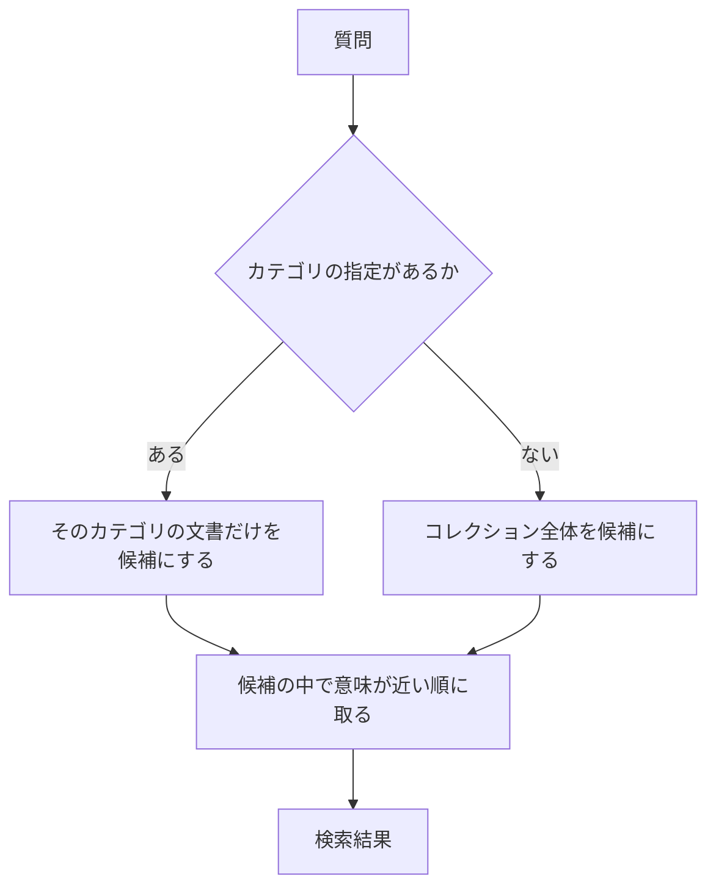

> **この章の要点：** カテゴリなどの属性が分かっていれば、その条件で候補を狭めてから、意味の近さで検索できます。

**前提知識：** 属性は、カテゴリやグループなどの付加情報です。メタデータとも呼びます。[第5章](./05-vector-db) で、本文とベクトルと一緒に保存してあります。近い順に取る基本の検索は [第6章](./06-naive-rag) です。この章は、その近い順の前に条件を足します。

途中から実装する方は、[第2章の環境構築](./02-setup) と第6章の基本構成を確認してください。仕組みは、この章だけでも読めます。

**今回の質問：**

- **A：削除時期** — 退会後、データはいつ削除されますか？
- **B：解約月の日割り** — Standardプランを月の途中で解約したら、日割りになりますか？

**今回の問い：** 検索したい分類を指定できるとき、近い順の前に何をできるのか。

この章は第2部の前提ではありません。第8章以降の比較の列にも入れません。第8章の比較相手は、第6章の Naive RAG のままです。

## この章の構成

- 属性で狭めるとは
- 処理の流れ
- 何が先に減るか
- TaskFlowでの例
- 残ること
- まとめ

## 属性で狭めるとは

属性で狭めるとは、意味が近い順を取る前に、カテゴリやグループが一致する文書だけを候補にすることです。

元記事は、LangChain Step7「Chromaでメタ情報を絞り検索する」です。題材はポケモン151匹で、タイプなどの属性が一致するものだけを類似検索の対象にしています。この本では、その手順を TaskFlow のカテゴリへ移して説明します。全件を取得するスクリプトは、ポケモン図鑑の手順なので再掲しません。

ポケモンでの絞り込み結果を、TaskFlow で同じことが起きた観測としては使いません。TaskFlow の文書に属性条件を付けて検索した実験は、未実験です。

## 処理の流れ

この章の例では、利用者が指定したカテゴリを使います。質問文からカテゴリを自動で決める処理は含めません。自動で決める場合は、抽出方法と、抽出を誤ったときの扱いを別に確認します。

図の読みどころは、近い順の計算の前に、候補の集合が減ることです。この章の完了は検索結果までです。回答生成の比較は第6章のままにします。

1. 利用者がカテゴリを指定していれば、その属性で候補を狭めます。指定が無ければ、コレクション全体を候補にします。
2. 狭めた候補の中で、質問との近さの順に取ります。
3. この章では、取れた見出しを確認するところで止めます。回答の文は作りません。

## 何が先に減るか

先に減るのは、近い順に並べる前の候補数です。候補は、マニュアル全体から、指定したカテゴリの文書へ減ります。意味は近くても、別カテゴリの文書は、この検索の上位には来ません。

| 段階 | 候補 | 別カテゴリで意味が近い文書 |
|---|---|---|
| 第6章の近い順 | コレクション全体 | 上位に入り得る |
| カテゴリを指定したあと | そのカテゴリの文書だけ | 上位に来ない |

この表は、処理の違いです。TaskFlow で件数がいくつからいくつへ減ったかは未計測です。

## TaskFlowでの例

例は、利用者が手動で「カテゴリ＝退会」を指定した場合です。意味の近さを計算する前に、退会カテゴリの文書へ候補を絞ります。質問文から属性を自動で抽出する実験とは分けます。

「退会」という語だけから機械的にカテゴリを決めると、必要な規定の所属が別カテゴリのときに、その規定は候補から外れます。第13章の作業用の木では、「退会後の請求」をカテゴリ「退会」、グループ「退会後」に置いています。この配置のまま利用者が退会を指定すれば、その見出しは候補に残ります。同じ見出しを請求カテゴリに置いた場合は、退会だけを残した時点で外れます。どちらに置くかは、台帳が確定してから固定します。

| 質問 | 期待する確認 | 状態 |
|---|---|---|
| A：退会後、データはいつ削除されますか？ | カテゴリを退会に指定したとき、見出し「退会後のデータ削除」に着くか | 期待する動作。TaskFlow での結果ではない |
| B：Standardプランを月の途中で解約したら、日割りになりますか？ | 属性の指定で、「退会後の請求」の漏れが解消するか | 比較の計画。成功・失敗の結論は未実験 |

質問Aの行は、削除の規定が退会カテゴリにあるときの期待です。質問Bの行は、属性を付けた検索が漏れを直すかどうかの計画です。どちらも、TaskFlow での属性絞り込みとしては未実験です。成功も失敗も、この章では結論にしません。

## 残ること

属性が指定されていないときは、コレクション全体から検索します。自動で属性を抽出する設計では、抽出を誤ったときに必要な文書が候補から消えます。その場合の扱いを、抽出の方法と一緒に決める必要があります。

属性が正しくても、その中で近い文書が、質問の答えとは限りません。カテゴリの中にも、言葉が近い別の規定があります。その穴は [第8章 検索結果を並べ替える](./08-rerank) で扱います。

## まとめ

- 属性が分かっているときは、近い順の前に、その属性の文書へ候補を減らせます。
- 元の手順は、メタデータ付きの類似検索です。この章の例は、利用者がカテゴリを指定する場合です。
- TaskFlow での属性絞り込みは未実験です。質問Bの漏れが解消するかは、結論にしていません。
- この章は、Naive RAG の比較相手を置き換えません。次の第2部は、第6章の取得結果の順位を直すところから始まります。

## 参考資料

- [LangChainを学びたい(Step7:Chromaでメタ情報を絞り検索する)](https://qiita.com/koji0705/items/3638af645474653b76b5)
