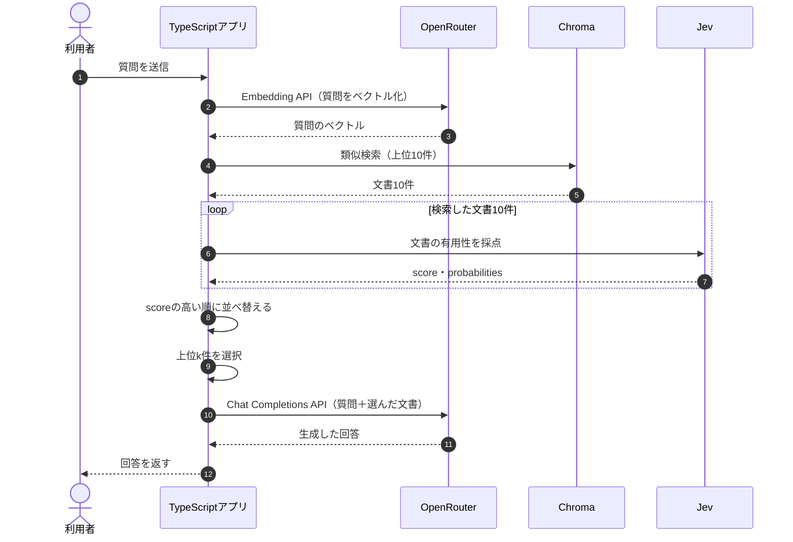

## Reranking RAGとは？

**Reranking RAGとは、検索した文書を質問への関連性や有用性で再評価し、回答に使う文書の順位を並べ替える方法です。** Naive RAGではChromaで検索した上位の文書をそのままLLMへ渡しましたが、意味的に近い文書が、必ずしも回答の根拠として適切とは限りません。

今回は、Chromaで取得した候補をJevで採点し、スコアの高い文書を優先してLLMへ渡します。


## ① 今回の実験内容

前章までと同じ質問を使用します。

> Standardプランを月の途中で解約したら、日割りになりますか？

正しい規定は「退会後の請求」で、解約した月の料金は満額、日割りにはなりません。しかし、Naive RAGでは意味的に近い「プラン変更時の日割り」が検索1位になりました。

今回は、次の条件で比較します。

| 条件 | 設定 |
|---|---|
| 検索対象 | TaskFlowの18チャンク |
| 検索候補 | Chromaの上位10件 |
| 再評価 | Jevによる文書ごとの採点 |
| 回答へ渡す件数 | 1件・2件・3件 |
| 比較対象 | Naive RAGとReranking RAG |

**検索する候補は同じ10件に固定し、回答に渡す文書の選び方だけを変更します。** Jevの採点も1回だけ行い、その結果を使って渡す件数を変えます。

## ② 処理の流れ

Reranking RAGでは、Chromaによる検索とLLMによる回答生成の間に、Jevによる評価処理が追加されます。



処理の役割は明確に分かれています。**Chromaが候補を検索し、Jevが文書を評価し、TypeScriptが並べ替え、OpenRouterの回答生成モデルが回答を作ります。**

## ③ 検索候補を10件取得する

実装は`app/src/commands.ts`の`runRerank()`です。まず質問をEmbeddingし、Chromaから上位10件を取得します。

```typescript
const collection = await getOrCreateCollection();
const embedded = await embedTexts([PRORATION_QUESTION]);

const hits = await queryCollection(
  collection.id,
  embedded.vectors[0],
  10,
);

const ranked = await rankByUsefulness(hits);
```

保存ログでは、類似検索の上位3件が次の結果でした。

| 順位 | 見出し | distance |
|---|---|---:|
| 1 | プラン変更時の日割り | 0.2862 |
| 2 | Standardプランの月額 | 0.3832 |
| 3 | 退会後の請求 | 0.3869 |

距離が最も小さいのは「プラン変更時の日割り」ですが、これはプラン変更の規定であり、解約した月の請求を直接判断できません。そこで、候補の文書をJevに評価してもらいます。

## ④ Jevで文書の有用性を採点する

今回使用するのはJevの`score`機能です。`app/src/jev.ts`の`scoreDocument()`では、次の形式でAPIへリクエストします。

```typescript
const payload = await postJson(
  "https://api.typesafe.ai/v1/systemone",
  {
    model: JEV_MODEL,
    state: document,
    questions: {
      usefulness: {
        type: "score",
        instructions,
        criteria: [...criteria],
      },
    },
  },
  bearer("JEV_API_KEY"),
);
```

今回は「この文書だけで、解約した月の料金が日割りになるか判断できるか」を採点基準にします。この専用基準は残します。

別の質問でも採点するときは、stateに質問と文書を入れます。基準の意味は、0が無関係、1が話題だけ、2が回答の一部を裏付ける、3が求める情報を直接裏付ける、です。満額や30日などの正解は、この汎用基準へ書きません。同じ候補で両方を採点できます。汎用基準の方が常に高い、という結果は、この章の保存ログにはありません。

**Jevへのリクエスト例（退会後の請求）**

```json
{
  "model": "jev-latest",
  "state": "退会\n退会後の請求\n解約した月の料金は満額です。日割りにはなりません。",
  "questions": {
    "usefulness": {
      "type": "score",
      "instructions": "月の途中で解約したとき、この文書だけで料金が日割りになるかを判断できるか",
      "criteria": [
        "解約した月の料金には関係しない",
        "料金や請求には触れるが、日割りか満額かは判断できない",
        "日割りや満額には触れるが、解約時のルールとは限らない",
        "解約した月の料金が日割りか満額かを判断できる"
      ]
    }
  }
}
```

`state`には評価する文書を1件渡し、`instructions`には評価したい内容、`criteria`には0〜3の4段階の基準を設定しています。

**Jevからのレスポンス（抜粋）**

```json
{
  "type": "score",
  "score": 2.98,
  "confidence": 0.99,
  "probabilities": {
    "0": 0,
    "1": 0,
    "2": 0.01,
    "3": 0.99
  }
}
```

`score`は今回設定した基準に対する評価値です。`probabilities`では、最も高い段階の3が0.99になっています。つまり、Jevはこの文書を「解約した月の料金を直接判断できる」ものとして高く評価しました。

ただし、**2.98は回答が正しい確率ではありません。** 今回のアプリでは`score`のみを並べ替えに使用し、`confidence`と`probabilities`は確認用にログへ出力しています。

## ⑤ スコアで文書を並べ替える

10件を同じ基準で採点した結果、主な文書のスコアは次のとおりでした。

| 検索順位 | 文書 | Jevのscore |
|---|---|---:|
| 1 | プラン変更時の日割り | 1.5900 |
| 2 | Standardプランの月額 | 0.9300 |
| 3 | 退会後の請求 | **2.9800** |
| 4 | Proプランの月額 | 0.9400 |
| 5 | 日割り請求のルール | 1.7900 |

ここで重要なのは、**検索3位だった「退会後の請求」が、Jevの評価では最も高くなったこと**です。

`app/src/commands.ts`の`rankByUsefulness()`では、各文書を採点した後、スコアの降順で並べ替えています。

```typescript
for (const hit of hits) {
  const result = await scoreDocument(
    hit.document,
    instructions,
    criteria,
  );
  scored.push({ ...hit, score: result.score });
}

return scored.sort((left, right) => right.score - left.score);
```

並べ替えるのはTypeScriptの処理です。Jevが文書の順位を直接変更するわけではありません。

回答に渡す件数は、`runRerank()`で次のように比較しています。

```typescript
for (const passCount of [1, 2, 3]) {
  await answerSelection("naive", hits.slice(0, passCount));
  await answerSelection("rerank", ranked.slice(0, passCount));
}
```

Naive RAGでは検索順位のまま、Reranking RAGではJevのスコア順に文書を選択します。

## ⑥ LLMに渡して回答を比較する

Reranking後の上位1件を渡す場合、OpenRouterの回答生成モデルへの入力は次のようになります。

```text
質問:
Standardプランを月の途中で解約したら、日割りになりますか？

文書:
見出し: 退会後の請求
退会
退会後の請求
解約した月の料金は満額です。日割りにはなりません。
```

回答モデルは`openai/gpt-4.1-mini`です。回答生成に使う指示はNaive RAGと同じで、Jevのスコア自体はLLMへ渡しません。

**保存ログで得られた回答**

```text
いいえ、Standardプランを月の途中で解約しても、料金は日割りにならず、解約した月の料金は満額です。
```

それでは、回答に渡す件数を変更して比較してみます。

```bash
docker compose run --rm app rerank
```

**実行結果**

| 渡す件数 | Naive RAG | Reranking RAG |
|---|---|---|
| 1件 | 分からない | **満額・日割りなし** |
| 2件 | 文書から判断できない | **満額・日割りなし** |
| 3件 | 満額・日割りなし | 満額・日割りなし |

1件・2件では、Naive RAGが必要な規定を渡せなかったのに対し、Reranking RAGでは「退会後の請求」を優先したことで正しく回答できました。一方、3件ではNaive RAGにも正しい規定が含まれるため、どちらも適切に回答できています。

つまり、**Rerankingは、少ない文書数でも必要な根拠を優先してLLMへ渡せる可能性があります。** ただし、必ず回答品質が改善するわけではありません。

## Reranking RAGの限界は？

Rerankingは検索結果の順位を変更するだけなので、**最初に取得した候補に正しい文書が存在しなければ、並べ替えても正解にはたどり着けません。**

候補10件から「退会後の請求」を外し、残った文書を採点し直しても、その規定は戻るでしょうか。実際に除外して採点した実験では、ほかの文書を並べ替えても解約月の日割りを判断できず、回答は「分からない」となりました。

また、今回の採点では10文書に対してJevを10回呼び出しており、保存ログでは採点に合計4611入力トークン、2680ミリ秒を使用しています。Naive RAGにはない追加コストです。

今回の採点基準は、解約した月の日割りについて判断できるかに特化しています。質問が変われば、評価基準も変更する必要があります。

## まとめ

Reranking RAGは、**検索した候補を再評価し、回答に役立つ文書を優先してLLMへ渡す方法**です。今回の実験では、Jevによって検索3位の正しい規定が評価1位となり、上位1〜2件だけを渡す場合の回答を改善できました。

ただし、候補に存在しない文書は復元できず、再評価にもコストがかかります。次章では、**Jevのスコアを使って不要な文書を除外するFiltering RAG**を学びます。

