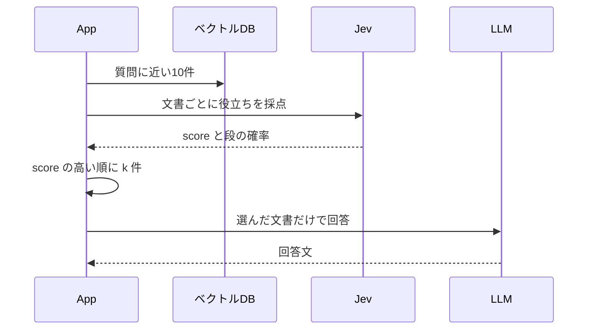

**何をするか。** 検索で取った候補を、質問への役立ちで並べ直し、上位だけを回答へ渡す。

**何を解決するか。** 言葉が近い別の規定が上位をふさぎ、必要な規定が下に残ることがある。

**学ぶこと。** Jev の `score` が何を表すか。その値だけで順位を決めるのは、モデルではなくコードである。

**実験で確認できたこと。** 1件と2件では、近い順は解約月の料金を判断できず、並べ替えは満額だった。3件では両方とも満額。候補から必要な文書を除くと、「分からない」のまま。


近い順の上位を選び直さず渡す基本形を、Naive RAG と呼ぶ。検索して回答する流れは [第6章 近い文書を渡して答える](./06-naive-rag)、起動と API キーは [第2章 環境構築](./02-setup) にある。確認コマンドは `docker compose run --rm app rerank` です。

## 近い順の1位は、解約の規定ではない

質問は、TaskFlow のマニュアルに対する次の1文です。

> Standardプランを月の途中で解約したら、日割りになりますか？

マニュアルの「退会後の請求」には、解約した月は満額で、日割りにはならない、と書いてあります。この実行で近い10件を取ると、1位は別の規定「プラン変更時の日割り」、必要な「退会後の請求」は3位でした。

近い順の上位3件をそのまま渡すと、3位の根拠が回答に入ります。並べ替えても、渡す3件が同じなら材料はほぼ同じです。差が出るのは、渡す件数を2以下にして、3位を近い順の外へ出したときです。

## 役割は、検索・採点・切り出し・回答で分かれる

Reranking は、取り直すのではありません。取れた候補の順位だけを変えます。



この実装では、Jev は文章を書かず、LLM は採点しません。一般に LLM が評価できない、という意味ではありません。順位を決める `sort` は、返った `score` を使うコードです。質問のベクトル化は `openai/text-embedding-3-small`、回答は `openai/gpt-4.1-mini` です。Jev の指定モデルは `jev-latest` で、この実行の応答モデルは `jev-1.14.0` でした。

## 同じ10件を、渡す件数だけ変えて比べる

同じコレクションへの `search` では、登録は18件、空間は cosine でした。質問を1回ベクトル化し、近い10件を採点します。距離は小さいほど近いです。採点は1回だけで、k ごとにやり直していません。k は回答へ渡す件数で、1、2、3 を比べます。

見たい結果は二つです。

1. 近い順では「退会後の請求」が落ちる k で、並べ替え後の回答が満額になる
2. その文書を候補から外すと、並べ替えても満額にならない

k=3 は、近い3件をそのまま渡す基本の渡し方です。ここで答えが変わらなくても、その結果を残します。検索候補、採点基準、回答の指示は固定します。除外の実験だけ、候補から対象の文書を取り除きます。

## STEP 1：近い10件を取る

質問のベクトル化は 26 トークンです。近い順の上位は、次の距離でした。

| 順位 | 見出し | distance |
| --- | --- | --- |
| 1 | プラン変更時の日割り | 0.2862 |
| 2 | Standardプランの月額 | 0.3832 |
| 3 | 退会後の請求 | 0.3869 |

この3件が、近い順で渡すときの材料です。採点する10件の残りは、あとの表にまとめています。

## STEP 2：Jevに、解約月の料金を判断できるか聞く

採点の指示は、この質問専用です。別の質問へ、この文言のまま使う前提ではありません。

Jev へ送る本文は、モデル名、文書1件、`score` 型の質問です。認証ヘッダーは除いてあります。「退会後の請求」のリクエスト本文は、次のとおりです。

```json
{
  "model": "jev-latest",
  "state": "退会\n退会後の請求\n解約した月の料金は満額です。日割りにはなりません。",
  "questions": {
    "usefulness": {
      "type": "score",
      "instructions": "月の途中で解約したとき、この文書だけで料金が日割りになるかを判断できるか",
      "criteria": [
        "解約した月の料金には関係しない",
        "料金や請求には触れるが、日割りか満額かは判断できない",
        "日割りや満額には触れるが、解約時のルールとは限らない",
        "解約した月の料金が日割りか満額かを判断できる"
      ]
    }
  }
}
```

`state` は見出しだけではありません。大見出し、節の見出し、本文をつないだ文字列です。基準の配列は、先頭が0、末尾が3です。

返った `answers.usefulness` は、次のとおりです。`legend` は送った基準の繰り返しなので、ここでは省いています。

```json
{
  "type": "score",
  "score": 2.98,
  "confidence": 0.99,
  "probabilities": { "0": 0, "1": 0, "2": 0.01, "3": 0.99 }
}
```

`probabilities` は、4つの段のどれに近いかの割合です。回答が正しい確率ではありません。この文書は段3が 0.99 で、段3は「解約した月の料金が日割りか満額かを判断できる」です。文書には、満額で日割りにはならない、と書いてあります。

`score` は、その段の位置を一つの数にしたものです。この応答では 2.98 で、段3に近いです。`confidence` は 0.99 でした。これは採点への確からしさとして返った値で、回答の正答率でも、文書が正解である確率でもありません。アプリが順位に使うのは `score` だけで、`probabilities` と `confidence` は読んでいません。

```typescript
if (typeof answer.score !== "number") {
  throw new Error("jev score missing");
}
```

比べるため、1位の「プラン変更時の日割り」も同じ指示で送っています。`state` の本文は、「月の途中で上位プランへ変更した場合、変更日から月末までを日割りで計算する」という規定です。解約した月の満額は書いてありません。

```json
{
  "type": "score",
  "score": 1.59,
  "confidence": 0.58,
  "probabilities": { "0": 0.07, "1": 0.28, "2": 0.65, "3": 0 }
}
```

段2が 0.65 で、段3は 0 です。段2は「日割りや満額には触れるが、解約時のルールとは限らない」です。日割りの計算は書いてあるが、対象はプラン変更なので、解約月の料金を直接は判断できない、という置き方です。`score` は 1.59 で、2.98 より低くなります。

10件の `score` と、いちばん割合の大きい段です。表の `score` は、ログに残した小数第4位です。

| 近い順 | 見出し | distance | score | 割合が最大の段 |
| --- | --- | --- | --- | --- |
| 1 | プラン変更時の日割り | 0.2862 | 1.5900 | 2が 0.65 |
| 2 | Standardプランの月額 | 0.3832 | 0.9300 | 1が 0.93 |
| 3 | 退会後の請求 | 0.3869 | 2.9800 | 3が 0.99 |
| 4 | Proプランの月額 | 0.3954 | 0.9400 | 1が 0.93 |
| 5 | 日割り請求のルール | 0.4586 | 1.7900 | 2が 0.87 |
| 6 | 解約の取り消し | 0.5588 | 0.0900 | 0が 0.92 |
| 7 | 退会後のデータ削除 | 0.5621 | 0.0700 | 0が 0.93 |
| 8 | 請求日 | 0.5862 | 0.9700 | 1が 0.97 |
| 9 | プランの種類 | 0.5882 | 0.3300 | 0が 0.68 |
| 10 | 退会の手続き | 0.5983 | 0.1000 | 0が 0.91 |

「日割り請求のルール」は、契約開始日からの日割りです。段2が 0.87 で、`score` は 1.79 でした。「Standardプランの月額」は金額だけで、段1が 0.93、`score` は 0.93 です。段3が大半だったのは、「退会後の請求」だけでした。

10件の採点は、入力 4611 トークン、2680 ミリ秒です。呼び出しは1件ずつ待っています。

## STEP 3：score の高い順に、コードが切り出す

返ったあとの順位は、モデルではなく並び替えです。

```typescript
scored.sort((left, right) => right.score - left.score);
const passed = scored.slice(0, passCount);
```

この実行の上位3件は、「退会後の請求」2.98、「日割り請求のルール」1.79、「プラン変更時の日割り」1.59 です。近い順の1位は、ここでは3位になります。`slice` より前だけが、次の LLM に渡ります。

## STEP 4：選んだ文書だけを、LLMが読む

回答モデルには、採点結果を渡しません。システム文は1つです。

```text
渡された文書だけを根拠に答えてください。文書から判断できなければ、「分からない」と答えてください。
```

並べ替えの1件を渡すときのユーザー文は、質問と、その文書です。

```text
質問:
Standardプランを月の途中で解約したら、日割りになりますか？

文書:
見出し: 退会後の請求
退会
退会後の請求
解約した月の料金は満額です。日割りにはなりません。
```

モデルは `openai/gpt-4.1-mini` です。返った本文は、次のとおりです。

```text
いいえ、Standardプランを月の途中で解約しても、料金は日割りにならず、解約した月の料金は満額です。
```

近い順の1件は「プラン変更時の日割り」だけで、返った本文は「分からない」でした。プラン変更の日割りは読んでいますが、解約した月の料金は判断できない、という置き方です。

## 1件と2件では結論が分かれ、3件では分かれない

| 渡し方 | 渡した順 | 結論 |
| --- | --- | --- |
| 近い順の1件 | プラン変更時の日割り | 分からない |
| 並べ替えの1件 | 退会後の請求（2.98） | 満額。日割りにならない |
| 近い順の2件 | プラン変更時の日割り、Standardプランの月額 | 文書からは判断できない |
| 並べ替えの2件 | 退会後の請求（2.98）、日割り請求のルール（1.79） | 満額。日割りにならない |
| 近い順の3件 | プラン変更時の日割り、Standardプランの月額、退会後の請求 | 満額。日割りにならない |
| 並べ替えの3件 | 退会後の請求（2.98）、日割り請求のルール（1.79）、プラン変更時の日割り（1.59） | 満額。日割りにならない |

近い順の2件を渡した回答は、プラン変更の規定と、解約の規定が無いことを分けて書いています。

```text
文書によると、プラン変更時の日割りについて記載がありますが、「月の途中で上位プランへ変更した場合は日割りで計算する」「下位プランへの変更は翌月から新しい料金」とあります。解約についての日割り計算の記載はありません。

したがって、Standardプランを月の途中で解約した場合に日割りになるかは文書からは判断できません。

答え：分からない
```

3件ずつ渡した二つの回答は、どちらも満額で、日割りにはならない、という結論でした。文言は一致していません。入れ替わったのは、渡す1位です。

## 候補から除くと、段3に届かない

近い20件から「退会後の請求」を除き、残りの近い10件を同じ基準で採点し直しました。検索が外したのではなく、候補の外を見るために除いています。

上位3件は「日割り請求のルール」1.79、「プラン変更時の日割り」1.64、「請求日」0.98 でした。段3が最大の文書はありません。

```text
文書には「月の途中で解約した場合の日割り」についての記載がありません。そのため、Standardプランを月の途中で解約した場合に日割りになるかどうかは分かりません。
```

同じ「プラン変更時の日割り」の `score` は、最初が 1.59、除いたあとが 1.64 でした。どちらも段3ではありません。この差から、点数のばらつきの幅までは読んでいません。

## 基準はこの質問に固定されている

今回、結論が満額に寄ったのは、次が同時に成り立つときです。

- 「退会後の請求」が、検索した10件に入っている
- 近い順の上位k件には、その文書が入っていない
- 採点基準が、解約した月の料金を判断できるかを表している

k=1 と k=2 では、近い順が判断できなかった回答が、並べ替えでは満額になりました。k=3 では両方とも満額で、差はありませんでした。確認できたのは、この1つの質問を1回実行したときの差です。10件の採点は入力 4611 トークン、2680 ミリ秒でした。回答生成の入力は、近い順の3件が 214 トークン、並べ替えの3件が 224 トークンで、桁は同じです。

汎用の「質問に関係があるか」という基準との比較は、この実行にはありません。今回の `instructions` と `criteria` は、解約した月の日割りに固定しています。質問が変わると、この文言のままでは段の意味がずれます。

コードは `score` だけを見ます。この実行の1位は `confidence` も 0.99 でしたが、`confidence` が低くても `score` が高ければ上位になります。その場合に順位が不安定になるかは、ここからは分かっていません。

採用しやすいのは、必要な規定が候補10件の中にあり、近い順の k 件からは落ちているときです。k をその順位以上にすると、近い順だけでも満額になり、採点の費用が残ります。候補の外にある規定は、並べ替えても戻りません。

代替は、渡す件数を増やすこと、検索文を作り直して取り直すこと、`score` が低い文書を捨てることです。取り直しは [第11章 検索の失敗を検知して取り直す](./11-retry)、低い文書を渡さない処理は [第9章 回答に使わない文書を外す](./09-exclude) にあります。

:::details トークン、時間、出典
10件の採点は入力 4611 トークン、2680 ミリ秒。除外した10件の採点は入力 4609 トークン、1915 ミリ秒。質問のベクトル化は 26 トークンで、この時間には含めていません。

| 回答 | 入力 | 出力 | ミリ秒 |
| --- | --- | --- | --- |
| 近い順の1件 | 133 | 4 | 786 |
| 並べ替えの1件 | 107 | 37 | 986 |
| 近い順の2件 | 173 | 108 | 1343 |
| 並べ替えの2件 | 157 | 37 | 926 |
| 近い順の3件 | 214 | 27 | 1172 |
| 並べ替えの3件 | 224 | 28 | 955 |
| 対象を除いた3件 | 210 | 52 | 1146 |

点数、確率、トークン、時間、回答は、`docker compose run --rm app rerank` のログです。`score` の表は小数第4位、応答 JSON の `score` は返った桁のままです。登録18件と cosine は、同じコレクションへの `search --limit 3` です。

[Rerankingを実装して検証してみた](https://qiita.com/koji0705/items/bc8d87103bae40c8ff90) は、別の候補での対照です。別環境の数値は [第6章 近い文書を渡して答える](./06-naive-rag) の注記にあります。この章の数値は、上の実行だけを使っています。

Reranking 自体は Jev 専用ではありません。この実行の再評価は Jev の `score` です。
:::
