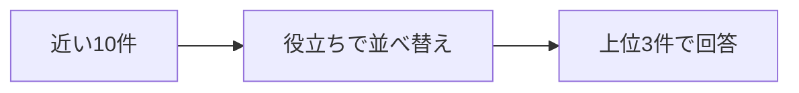

> Standardプランを月の途中で解約したら、日割りになりますか？

近い順の1位は「プラン変更時の日割り」でした。必要な「退会後の請求」は3位です。3件をそのまま渡した回答は、満額になりました。

**近い10件を、質問への役立ちで選び直すと、1位は「退会後の請求」になります。**

## 10件から、役立つ3件を選ぶ



候補の10件は、近い順の検索です。変えるのは、その中から回答へ渡す3件の選び方です。登録のあと、次を実行します。

```bash
docker compose run --rm app rerank
```

並べ替えには Jev を使います。Jevは、自然言語で書いた基準に対して点数を返す評価役です。検索と回答の文章は、これまでどおりアプリとLLMが作ります。点数は基準の何段目に当たったかで、その文書が正解である確率ではありません。

リクエストのモデルは `jev-latest`、応答のモデルは `jev-1.14.0` でした。基準は4段で、低い方から次のとおりです。

1. 解約した月の料金には関係しない
2. 料金や請求には触れるが、日割りか満額かは判断できない
3. 日割りや満額には触れるが、解約時のルールとは限らない
4. 解約した月の料金が日割りか満額かを判断できる

「プラン変更時の日割り」には、日割りの計算が書いてあります。対象はプラン変更なので、解約した月が満額かどうかは決まりません。この文書の点数は 1.6100 でした。

「退会後の請求」には、解約した月は満額で、日割りにならない、と書いてあります。点数は 2.9700 で、10件の中で一番高くなりました。

## 1位が入れ替わった

点数の高い3件を、近い3件のときと同じ指示で回答へ渡します。

|                  | 回答に渡した順                                                                       | 回答                               |
| ---------------- | ------------------------------------------------------------------------------------ | ---------------------------------- |
| 近い順のまま     | プラン変更時の日割り、Standardプランの月額、退会後の請求                             | 満額で、日割りにはならない         |
| 役立ちで選び直す | 退会後の請求（2.9700）、日割り請求のルール（1.8000）、プラン変更時の日割り（1.6100） | 日割りにならない。解約した月は満額 |

選び直したあとの回答は、次のとおりです。

```text
Standardプランを月の途中で解約した場合、料金は日割りになりません。解約した月の料金は満額請求されます。
```

10件の評価は、入力 4599 トークン、1572 ミリ秒です。その後の回答生成は、入力 224 トークン、出力 37 トークン、1210 ミリ秒です。質問のベクトル化 26 トークンは、ここには含めていません。

**意味が近いことと、その質問の根拠になることは別です。** 今回は近い3件にも根拠が入っていたので、並べ替える前から回答は満額でした。入れ替わったのは、回答に渡す1位です。

並べ替えは、すでに取れた文書の順番を変えるだけです。同じ質問で「退会後の請求」を候補から外し、残りの近い10件を同じ基準で選び直すと、回答は「分からない」になりました。この確認は、評価が入力 4604 トークン、1563 ミリ秒、回答生成が入力 210 トークン、出力 120 トークン、2666 ミリ秒です。

:::details 結果の出典と条件
上の点数、トークン、時間、回答は、このリポジトリで `docker compose run --rm app rerank` を実行したログです。小数は第4位までです。点数は0から3の範囲で、段の間の値も取ります。

[Rerankingを実装して検証してみた](https://qiita.com/koji0705/items/bc8d87103bae40c8ff90) は、別の10件での対照です。そちらの Naive RAG の回答は「解約時の日割りは分からない」で、「退会後の請求」の類似度は 0.6800、役立ちの点数は 3.00 でした。本書の15件とは、候補の構成も数値も違います。

Reranking自体はJev専用ではありません。この実行では、再評価に Jev を使っています。
:::
