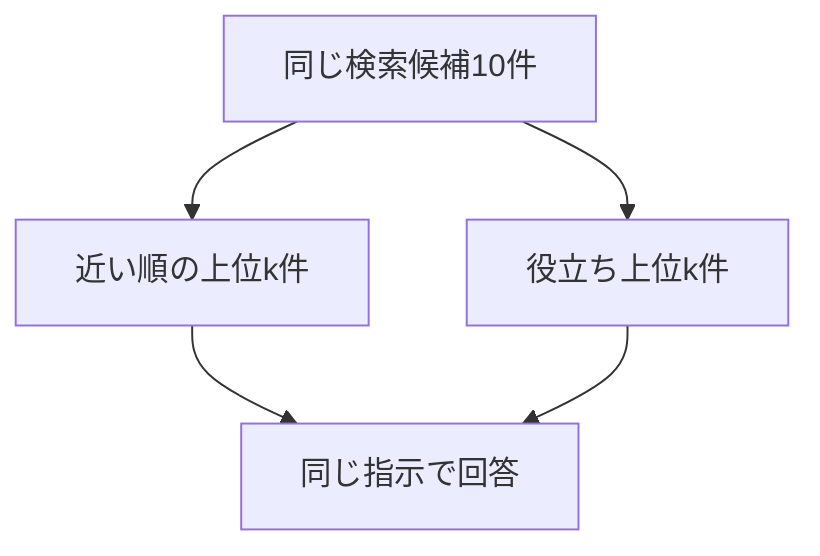

> Standardプランを月の途中で解約したら、日割りになりますか？

マニュアルには、解約した月は満額で、日割りにはならない、と書いてあります。近い順の1位は、別の規定である「プラン変更時の日割り」でした。根拠の「退会後の請求」は3位です。

**近い順の上位1件と2件は、解約した月の料金を判断できないと返しました。同じ10件を役立ちで並べ替えると、1件だけ渡しても満額でした。**

上位3件まで渡すと、近い順にも根拠が入ります。この渡し方では、並べ替える前から満額でした。

近い順の上位を選び直さず渡す基本形を、Naive RAG と呼びます。この章の並べ替えは、取った候補の中だけを、質問の根拠になる順に渡し直します。検索して回答する流れは [第6章 近い文書を渡して答える](./06-naive-rag)、起動と API キーは [第2章 環境構築](./02-setup) にあります。確認コマンドは `docker compose run --rm app rerank` です。

## 3件渡すと、根拠は最初から入っている

この実行で近い3件は、次のとおりです。distance はコサイン距離で、小さいほど近くなります。

| 順位 | 見出し | distance |
| --- | --- | --- |
| 1 | プラン変更時の日割り | 0.2862 |
| 2 | Standardプランの月額 | 0.3832 |
| 3 | 退会後の請求 | 0.3869 |

3位に根拠があるので、この3件をそのまま渡すと、解約した月が満額だと読めます。並べ替えて1位を入れ替えても、渡す3件が同じなら、答えの材料はほぼ同じです。

並べ替えが回答を変えるのは、近い順の上位k件からは根拠が落ちて、検索候補の中には残っているときです。kは、回答へ渡す件数です。今回は k を 1、2、3 にして、同じ10件から比べます。

## 候補の中だけを選び直す

並べ替え（Reranking）は、取得済みの文書を「この質問の答えに使えるか」で付け直す処理です。検索クエリ、ベクトル、候補の集合は同じです。変わるのは、その集合から回答へ渡すk件の選び方です。



似た別の規定が上位をふさいで、必要な規定が候補の下の方にいる問い合わせに向きます。候補に入っていない規定は、並べ替えても出てきません。

## 同じ10件で、渡す件数だけを変える

質問を `openai/text-embedding-3-small` でベクトルにし、Chroma から近い10件を1回だけ取ります。実行時の登録は18件で、空間は cosine です。

採点には Jev を使います。Jev は、自然言語で書いた基準に対して点数を返す評価役です。ここでの点数は、基準のどの段に近いかで、その文書が正解である確率ではありません。

回答モデルは `openai/gpt-4.1-mini` です。指示は、渡された文書だけを根拠にし、判断できなければ「分からない」と返す、です。

```typescript
export const ANSWER_INSTRUCTION =
  "渡された文書だけを根拠に答えてください。文書から判断できなければ、「分からない」と答えてください。";
```

この実行で見たい結果は、次の二つです。

1. 近い順では「退会後の請求」が落ちる k で、並べ替え後の回答が満額になる
2. その文書を候補から外すと、並べ替えても満額にならない

k=3 は、近い順の上位3件をそのまま渡す基本の渡し方です。ここで答えが変わらなくても、その結果を残します。比べるあいだ、検索候補、採点基準、回答の指示は固定します。除外の実験だけ、候補から対象の文書を取り除きます。

## 1件ずつ採点し、高い順に切る

基準は、この質問で「解約した月の料金を判断できるか」に固定しています。

```typescript
export const RERANK_INSTRUCTIONS =
  "月の途中で解約したとき、この文書だけで料金が日割りになるかを判断できるか";

export const RERANK_CRITERIA = [
  "解約した月の料金には関係しない",
  "料金や請求には触れるが、日割りか満額かは判断できない",
  "日割りや満額には触れるが、解約時のルールとは限らない",
  "解約した月の料金が日割りか満額かを判断できる",
] as const;
```

0が1段目、3が4段目です。段の間の値も返ります。この文言は、別の質問へそのまま使う前提ではありません。

Jev へのリクエストは、文書1件が `state` です。モデル名の指定は `jev-latest` です。

```typescript
const payload = await postJson(
  "https://api.typesafe.ai/v1/systemone",
  {
    model: JEV_MODEL,
    state: document,
    questions: {
      usefulness: {
        type: "score",
        instructions,
        criteria: [...criteria],
      },
    },
  },
  bearer("JEV_API_KEY"),
);
```

応答から読むのは `answers.usefulness.score`、`model`、`usage.input_tokens` です。この実行の応答モデルは `jev-1.14.0` でした。

`document` は見出しだけではありません。分割のとき、大見出し、節の見出し、本文をつないで保存しています。

```typescript
body: `${title}\n${section.heading}\n${section.text}`,
```

「退会後の請求」として採点される文字列は、次の形です。

```text
退会
退会後の請求
解約した月の料金は満額です。日割りにはなりません。
```

10件は距離の順に、1件の応答を待ってから次を採点します。そのあと、点数の高い順に並べます。

```typescript
for (const hit of hits) {
  const result = await scoreDocument(hit.document, instructions, criteria);
  tokens += result.inputTokens;
  scored.push({ ...hit, score: result.score });
}
return scored.sort((left, right) => right.score - left.score);
```

全18件は採点していません。近い10件に限ると、呼び出しも10回で済みます。件数を増やすと、このループのトークンと待ち時間も増えます。

採点は1回だけ行い、k ごとにやり直していません。近い順の配列は距離の小さい順、並べ替え後の配列は点数の高い順です。

```typescript
const hits = await queryCollection(collection.id, embedded.vectors[0], 10);
const ranked = await rankByUsefulness(hits);
for (const passCount of [1, 2, 3]) {
  await answerSelection("naive", hits.slice(0, passCount));
  await answerSelection("rerank", ranked.slice(0, passCount));
}
```

回答モデルに渡すユーザー文は、質問と、選んだ文書です。点数そのものは渡していません。

```typescript
const passages = hits
  .map((hit) => `見出し: ${hit.heading}\n${hit.document}`)
  .join("\n\n");
const user = `質問:\n${question}\n\n文書:\n${passages}`;
```

システム文が先ほどの `ANSWER_INSTRUCTION`、ユーザー文が `user` です。

## 2件以下では結論が分かれ、3件では分かれない

登録済みの18件に対して、次を実行します。

```bash
docker compose run --rm app rerank
```

質問のベクトル化は 26 トークンです。10件の採点は、入力 4611 トークン、1684 ミリ秒でした。

| 近い順 | 見出し | distance | 点数 |
| --- | --- | --- | --- |
| 1 | プラン変更時の日割り | 0.2862 | 1.6000 |
| 2 | Standardプランの月額 | 0.3832 | 0.9400 |
| 3 | 退会後の請求 | 0.3869 | 2.9800 |
| 4 | Proプランの月額 | 0.3954 | 0.9400 |
| 5 | 日割り請求のルール | 0.4586 | 1.8100 |
| 6 | 解約の取り消し | 0.5588 | 0.0800 |
| 7 | 退会後のデータ削除 | 0.5621 | 0.0600 |
| 8 | 請求日 | 0.5862 | 0.9800 |
| 9 | プランの種類 | 0.5882 | 0.3700 |
| 10 | 退会の手続き | 0.5983 | 0.0800 |

ログに残った点数の上位3件は、「退会後の請求」2.9800、「日割り請求のルール」1.8100、「プラン変更時の日割り」1.6000 です。

「プラン変更時の日割り」には、上位プランへの変更を、変更日から月末まで日割りで計算すると書いてあります。解約した月が満額かは書いてありません。点数 1.6000 は、2段目と3段目のあいだです。

「退会後の請求」には、解約した月は満額で、日割りにはならない、と書いてあります。点数 2.9800 は10件でいちばん高く、4段目に近い値です。

「日割り請求のルール」は、月の途中で契約を開始したときの日割りです。解約の規定ではないので、1.8100 です。

回答生成だけのトークンと時間です。採点の 4611 トークンは含みません。

| 渡し方 | 渡した順 | 入力 | 出力 | ミリ秒 | 結論 |
| --- | --- | --- | --- | --- | --- |
| 近い順の1件 | プラン変更時の日割り | 133 | 4 | 697 | 分からない |
| 並べ替えの1件 | 退会後の請求（2.9800） | 107 | 36 | 980 | 満額。日割りにならない |
| 近い順の2件 | プラン変更時の日割り、Standardプランの月額 | 173 | 87 | 1193 | 文書からは分かりません |
| 並べ替えの2件 | 退会後の請求（2.9800）、日割り請求のルール（1.8100） | 157 | 32 | 891 | 満額。日割りにならない |
| 近い順の3件 | プラン変更時の日割り、Standardプランの月額、退会後の請求 | 214 | 28 | 747 | 満額。日割りにならない |
| 並べ替えの3件 | 退会後の請求（2.9800）、日割り請求のルール（1.8100）、プラン変更時の日割り（1.6000） | 224 | 33 | 1006 | 満額。日割りにならない |

近い順の2件を渡した回答は、プラン変更の日割りと、解約の規定が無いことを分けて書いています。

```text
文書には、プランを上位または下位に変更した場合の日割り計算についての記載はありますが、「Standardプランを月の途中で解約した場合」の日割りについての記載はありません。

したがって、Standardプランを月の途中で解約したら日割りになるかどうかは文書からは分かりません。
```

並べ替えの1件だけを渡した回答は、次のとおりです。

```text
Standardプランを月の途中で解約した場合でも、料金は日割りにならず、解約した月の料金は満額となります。
```

3件ずつ渡した二つの回答も、どちらも満額で、日割りにはならない、という結論でした。文言は一致していません。入れ替わったのは、回答に渡す1位です。

## 候補から除くと、満額にはならない

近い20件から「退会後の請求」を除き、残りの近い10件を同じ基準で採点し直しました。検索が外したのではなく、候補の外を見るために除いています。

採点は入力 4609 トークン、1558 ミリ秒です。上位3件は「日割り請求のルール」1.7600、「プラン変更時の日割り」1.7000、「請求日」0.9800 でした。

```text
文書には、月の途中で契約を開始した場合やプラン変更時の日割りについての説明がありますが、Standardプランを月の途中で解約した場合の日割りについては記載がありません。したがって、「分からない」となります。
```

回答生成は、入力 210 トークン、出力 62 トークン、1017 ミリ秒です。

同じ「プラン変更時の日割り」は、最初の採点で 1.6000、除いたあとの採点で 1.7000 でした。どちらも、解約した月の満額を直接書く文書より下です。この0.1000の差から、点数のばらつきの幅までは読んでいません。

## 変わったもの、変わらなかったもの

k=1 と k=2 では、近い順は解約月の料金を判断できず、並べ替えは満額でした。必要な文書が候補の3位にあり、渡す件数を2以下にしたときに、選び直しが結論を変えています。

k=3 では、両方とも満額でした。この渡し方では、回答の改善は確認できません。確認できたのは、1位が「プラン変更時の日割り」から「退会後の請求」に替わることと、そのための採点です。

追加の費用は、回答の前に付きます。10件の採点は入力 4611 トークン、1684 ミリ秒でした。回答生成は、近い順の3件が入力 214 トークン、並べ替えの3件が入力 224 トークンで、桁は同じです。

今回のログで、結論が満額に寄ったのは、次が同時に成り立つときです。

- 「退会後の請求」が、検索した10件に入っている
- 近い順の上位k件には、その文書が入っていない
- 採点基準が、解約した月の料金を判断できるかを表している

候補からその文書を除くと、残った最高点は 1.7600 で、回答は「分からない」でした。並べ替えは、検索候補の外にある文書を復元していません。

この1問から、導入時に見ておく点は次のとおりです。

- k を、根拠の近い順の順位以上にすると、近い順だけでも結論は満額になり、採点の費用が残る
- 基準の文言は、この解約の質問に固定している。質問が変わると基準も作り直す
- 採点は1件ずつ待つ。この実行の候補は10件で、18件の全件採点はしていない
- 同じ文書の再採点で 0.1000 動いた。この2回では、上位の判断は入れ替わっていない

## 渡す件数で、差が出るかが変わる

並べ替えは、取得済みの順位を、質問への役立ちの順に変えます。差が出たのは、根拠が候補の中にあり、近い順のk件からは落ちているときです。

代替は、渡す件数を増やすこと、検索文を作り直して取り直すこと、点数が低い文書を捨てることです。取り直しは [第11章 検索の失敗を検知して取り直す](./11-retry)、点数が低い文書を渡さない処理は [第9章 回答に使わない文書を外す](./09-exclude) にあります。

:::details 結果の出典と条件
点数、トークン、時間、回答は、このリポジトリで `docker compose run --rm app rerank` を実行したログです。小数は第4位までです。点数は0から3の範囲です。

登録件数18と、上位3件の見出し・距離は、同じコレクションへの `docker compose run --rm app search --question "Standardプランを月の途中で解約したら、日割りになりますか？" --limit 3` です。距離は、並べ替えログの1件目から3件目と一致しています。

[Rerankingを実装して検証してみた](https://qiita.com/koji0705/items/bc8d87103bae40c8ff90) は、別の候補での対照です。別環境の数値は [第6章 近い文書を渡して答える](./06-naive-rag) の注記にあります。この章の数値は、上の二つの実行だけを使っています。

Reranking自体はJev専用ではありません。この実行では、再評価に Jev を使っています。
:::
