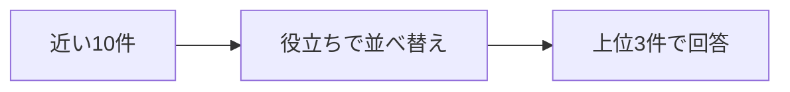

> Standardプランを月の途中で解約したら、日割りになりますか？

近い3件をそのまま渡すと、回答は「分からない」でした。必要な「退会後の請求」は、その3件に入っていません。

**近い順の候補を10件に広げ、質問への役立ちで3件を選び直すと、この例では答えが変わります。**

## 10件から、役立つ3件を選ぶ

候補の10件は、近い順のまま答えるときと同じです。変えるのは、その中から回答へ渡す3件の選び方です。

並べ替えには Jev を使います。Jevは、自然言語で書いた基準に対して点数を返す評価役です。検索と回答の文章は、これまでどおりアプリとLLMが作ります。点数は基準の何段目に当たったかで、その文書が正解である確率ではありません。

この例の基準は、「月の途中で解約したとき、料金が日割りになるかを判断できるか」です。

「プラン変更時の日割り」には、日割りの計算が書いてあります。対象はプラン変更なので、解約した月が満額かどうかは決まりません。

「退会後の請求」には、解約した月は満額で、日割りにならない、と書いてあります。こちらの方が、この質問の根拠になります。

## 1位が入れ替わった

次は、QiitaのReranking記事にある、同じ10件での対照です。

| | 回答に渡した順 | 回答 |
|---|---|---|
| 近い順のまま | プラン変更時の日割り、日割り請求のルール、請求日 | 解約時の日割りは分からない |
| 役立ちで選び直す | 退会後の請求、日割り請求のルール、プラン変更時の日割り | 日割りにならない。解約した月は満額 |

「退会後の請求」の類似度は 0.6800 で、近い順の1位 0.9200 より低い節です。役立ちの点数は 3.00 で、選び直したあとの1位になりました。

**意味が近いことと、その質問の根拠になることは別です。**

並べ替えは、すでに取れた文書の順番を変えるだけです。最初の10件に「退会後の請求」が入っていなければ、この処理では戻せません。

:::details 結果の出典と条件
[Rerankingを実装して検証してみた](https://qiita.com/koji0705/items/bc8d87103bae40c8ff90) の、Naive RAGと並べ替えの対照です。本書用のDocker・Chroma環境での再実行ではありません。

候補は近い順の10件、回答へ渡すのは3件、回答を書くLLMは同じです。変えたのは3件の選び方だけです。

Jevの点数は4段階です。3は「解約した月の料金が日割りか満額かを判断できる」、2は「日割りや満額には触れるが、解約時のルールとは限らない」です。並べ替え後の2位は関連度 2.41 の「日割り請求のルール」、3位は 1.72 の「プラン変更時の日割り」です。

Reranking自体はJev専用ではありません。この記事では、再評価にJevを使っています。
:::
