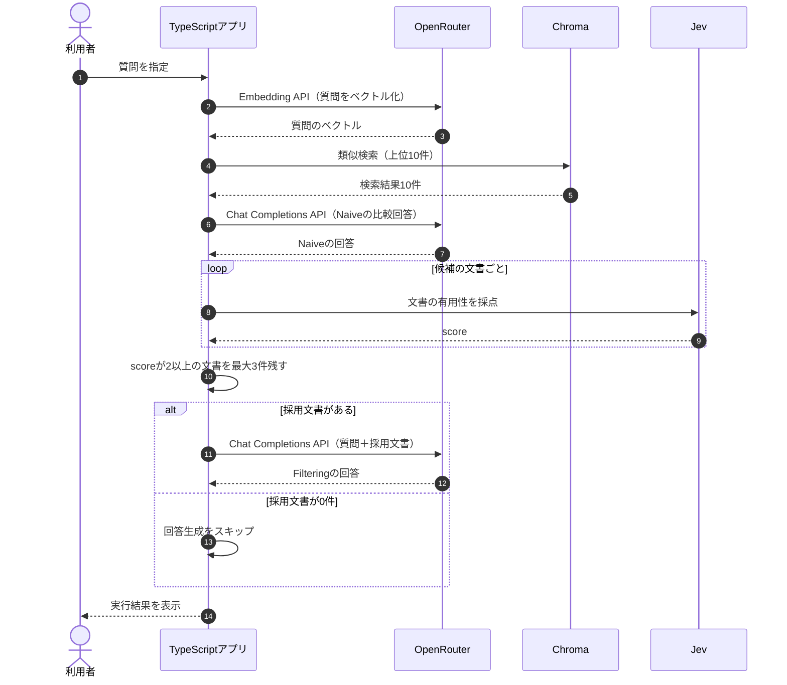

## Filtering RAGとは？

**Filtering RAGとは、検索した文書を評価し、回答の根拠として不十分な文書を除外する方法です。** 前章のReranking RAGではJevのスコアで検索順位を並べ替えました。今回はさらにスコアの下限を設け、一定の基準を満たした文書だけをLLMへ渡します。

| 方法 | 処理 |
|---|---|
| Naive RAG | 検索上位の文書をそのまま渡す |
| Reranking RAG | 評価スコアの高い順に並べ替える |
| Filtering RAG | 評価スコアが基準未満の文書を除外する |

**Filtering RAGでは、基準を満たす文書が0件なら、無理に文書を渡さない**という選択もできます。


## ① 今回の実験内容

今回は、TaskFlowのマニュアルに対する2つの質問を比較します。

| 質問 | マニュアルの状態 |
|---|---|
| 退会後、データはいつ削除されますか？ | 30日後と記載されている |
| 退会後のデータ保存期間を、有料で90日間に延長できますか？ | 延長の可否は記載されていない |

どちらも「退会後のデータ削除」に関連するため、類似検索では同じ文書が取得される可能性があります。しかし、「30日後に削除する」という規定だけでは、90日間への延長が可能かどうかは判断できません。

今回はChromaから上位10件を取得し、Jevで採点します。**スコア2以上の文書だけを残し、最大3件をLLMへ渡す**という条件で検証します。

## ② 処理の流れ

Filtering RAGでは、Jevによる評価後にTypeScriptで文書を除外します。採用する文書が0件なら、回答生成APIを呼び出しません。



今回の実装では、比較のために最初にNaive RAGの回答も生成します。その後Jevで評価し、Filtering側の回答を生成するか判断します。

## ③ 実装コードを確認する

実際に実行するのは、`app/src/commands.ts`の`runExclude()`です。

```typescript
export async function runExclude(): Promise<void> {
  await excludeQuestion(
    DELETE_QUESTION,
    DELETE_SCORE_INSTRUCTIONS,
    DELETE_SCORE_CRITERIA,
  );

  await excludeQuestion(
    EXTEND_QUESTION,
    EXTEND_SCORE_INSTRUCTIONS,
    EXTEND_SCORE_CRITERIA,
  );
}
```

質問ごとに評価の指示と基準を切り替えています。削除時期と保存期間の延長では、判断したい内容が異なるためです。

### Jevへのリクエスト

Jevへの採点リクエストは、前章と同じ`app/src/jev.ts`の`scoreDocument()`を使用します。例えば、削除時期について「退会後のデータ削除」を評価するリクエストは次のとおりです。

```json
{
  "model": "jev-latest",
  "state": "退会\n退会後のデータ削除\n退会完了から30日後にデータを削除します。",
  "questions": {
    "usefulness": {
      "type": "score",
      "instructions": "退会後、データはいつ削除されるか。この文書だけで判断できるか",
      "criteria": [
        "退会後の削除時期には関係しない",
        "退会やデータには触れるが、いつ削除するかは判断できない",
        "削除時期について、回答の一部を裏付ける",
        "退会後にデータをいつ削除するかを直接判断できる"
      ]
    }
  }
}
```

評価基準は0〜3の4段階です。今回の実装では「回答の一部を裏付ける」に相当する2以上を採用条件にしています。

一方、90日間への延長については、「有料で90日間に延長できるか、この文書だけで判断できるか」という別の指示を使用します。**質問に応じた基準で採点しなければ、スコアが高くても必要な根拠を評価したことにはなりません。**

## ④ スコアで文書を除外する

Jevで採点した後、`app/src/commands.ts`の`excludeQuestion()`で採用する文書を決めます。

```typescript
const ranked = await rankByUsefulness(hits, instructions, criteria);

const kept = ranked
  .filter((hit) => hit.score >= EXCLUDE_MIN_SCORE)
  .slice(0, 3);

field("kept", kept.length);

if (kept.length === 0) {
  field("answer_label", "exclude");
  field("answer", "skipped");
  return;
}

await printAnswer("exclude", question, kept);
```

`EXCLUDE_MIN_SCORE`は`app/src/models.ts`で`2`に設定しています。Jevがスコアを返し、TypeScriptが条件に従って文書を残すか判断します。

| 処理 | 役割 |
|---|---|
| `rankByUsefulness()` | Jevで採点し、スコア順に並べる |
| `filter()` | 2未満の文書を除外する |
| `slice(0, 3)` | 最大3件に制限する |
| `kept.length === 0` | 0件なら回答生成を呼ばない |

Reranking RAGとの違いは、**上位3件を必ず確保するのではなく、基準を満たした文書だけを使うこと**です。

## ⑤ 実行して結果を確認する

第5章でマニュアルを登録した状態で、次のコマンドを実行します。

```bash
docker compose run --rm app exclude
```

以下は、15チャンクだった時点の保存ログです。現在のマニュアルは18チャンクのため、再実行時のスコアや採用件数は変わる可能性があります。

### ケースA：回答の根拠がある質問

**質問：退会後、データはいつ削除されますか？**

| 文書 | Jevのscore | 判定 |
|---|---:|---|
| 退会後のデータ削除 | **2.9900** | 採用 |
| 退会前の書き出し | 0.9900 | 除外 |

「退会後のデータ削除」は基準の2を超えたため、回答生成に使用されます。


| 比較項目 | Naive RAG | Filtering RAG |
|---|---|---|
| LLMへ渡した文書 | 3件 | 1件 |
| 回答生成の入力 | 201トークン | 103トークン |
| 回答 | 退会完了から30日後 | 退会完了から30日後 |

必要な文書を残したまま、LLMへ渡す情報を削減できました。ただし、Jevによる採点で別途4482入力トークンを使用しているため、**回答生成の入力が減っても、処理全体のコストが減ったとは限りません。**

### ケースB：回答の根拠がない質問

**質問：退会後のデータ保存期間を、有料で90日間に延長できますか？**

この質問では「退会後のデータ削除」が検索されても、延長の可否までは判断できません。

| 文書 | Jevのscore | 判定 |
|---|---:|---|
| 退会後のデータ削除 | 1.3200 | 除外 |

保存ログでは採用基準の2以上となる文書がなく、結果は0件でした。

```text
kept: 0
answer_label: exclude
answer: skipped
```


Naive RAGでは検索上位3件をLLMへ渡して「分からない」と回答しました。一方、Filtering RAGでは、採用文書が0件となったため、回答生成を呼び出しませんでした。

ここで重要なのは、`skipped`はCLIの実行状態であり、利用者向けの回答ではないことです。実際のサービスに組み込む場合は、「マニュアルからは確認できません」などの応答を返す処理が別途必要です。

## Filtering RAGの課題は？

Filtering RAGには、必要な文書まで除外してしまうリスクがあります。例えば、複数の規定を組み合わせなければ答えられない質問では、単独では評価が低い文書も必要になる可能性があります。

また、採点基準と閾値によって残る文書が変わります。今回の2という閾値は、この実験で設定した評価基準に対応する値であり、すべての質問に最適であると確認した値ではありません。

RerankingとFilteringは、次のように使い分けられます。

| 状況 | 検討する方法 |
|---|---|
| 必要な文書が候補の下位にある | Reranking |
| 無関係な文書を回答から外したい | Filtering |
| 候補の中に必要な文書が存在しない | 検索のやり直しを検討する |

## まとめ

Filtering RAGは、**検索した文書を評価し、基準を満たさない文書を除外する方法**です。今回の実験では、回答の根拠がある質問では1件を残して正しく回答し、根拠がない質問では0件として回答生成をスキップしました。

ただし、除外は新しい情報を見つける処理ではなく、必要な文書まで落としてしまう可能性もあります。次章では、**Jevを使って質問に応じた検索方法を選択するAdaptive RAG**を学びます。