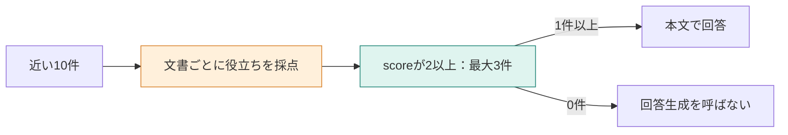

**この章では、検索した候補から、根拠として弱い文書を外します。** 関連文書が毎回見つかっても、そこに答えがあるとは限りません。点数の下限を設け、0件なら回答モデルを呼ばない分岐を作ります。並べ替えとの違いは、件数を埋めるために文書を残さないことです。



## 「削除時期」と「保存期間の延長」は別の質問

次の二つを比べます。

| 問い合わせ | マニュアルで分かること |
|---|---|
| 退会後、データはいつ削除されますか？ | 退会完了から30日後に削除する |
| 退会後のデータ保存期間を、有料で90日間に延長できますか？ | 延長の可否は書いていない |

どちらも「退会後のデータ削除」に近づきます。しかし、「30日後に削除する」は「有料で延長できる」「延長できない」のどちらの規定にもなりません。

上位3件を固定で渡す方法から、**質問の答えを裏付ける文書だけを渡す**方法へ変えます。[環境構築](./02-setup)と登録後、次を実行します。

```bash
docker compose run --rm app exclude
```

以下は15節時点の保存ログです。現在は18節です。各質問で同じ10候補から、近い順の3件と、採点後に残した文書を比べています。

## STEP 1：質問に合わせ、0〜3の意味を決める

Jevには、候補の本文を1件ずつ送ります。削除時期の質問で使うリクエストは次の形です。認証情報を除いた、実装が組み立てる入力です。

```json
{
  "model": "jev-latest",
  "state": "退会\n退会後のデータ削除\n退会完了から30日後にデータを削除します。",
  "questions": {
    "usefulness": {
      "type": "score",
      "instructions": "退会後、データはいつ削除されるか。この文書だけで判断できるか",
      "criteria": [
        "退会後の削除時期には関係しない",
        "退会やデータには触れるが、いつ削除するかは判断できない",
        "削除時期について、回答の一部を裏付ける",
        "退会後にデータをいつ削除するかを直接判断できる"
      ]
    }
  }
}
```

基準の配列は0始まりです。番号2は「回答の一部を裏付ける」段なので、採用の下限を2にします。実行結果を見てから下限を調整した比較ではありません。

延長の質問では、`instructions` を「有料で90日間に延長できるか」に変え、最上段もその可否を直接判断できる基準へ変えます。削除の時期だけを高く評価する基準のままでは、別の問いに対する点数になってしまいます。

## STEP 2：返ったscoreを、採用の条件に使う

保存ログの、判断に使った値です。

| 質問 | 文書 | score |
|---|---|---:|
| 削除時期 | 退会後のデータ削除 | 2.9900 |
| 削除時期 | 退会前の書き出し | 0.9900 |
| 90日への延長 | 退会後のデータ削除 | 1.3200 |

点数は、指示した基準の段に対応します。「正しい文書である確率」ではありません。この実行では `score` のみを採用に使い、`confidence` や段の確率で閾値を切り替えてはいません。保存ログにない応答フィールドも補いません。

`app/src/commands.ts` の `excludeQuestion` の中心です。`ranked` は点数の高い順に並んでいます。

```typescript
const kept = ranked
  .filter((hit) => hit.score >= EXCLUDE_MIN_SCORE)
  .slice(0, 3);
if (kept.length === 0) {
  field("answer_label", "exclude");
  field("answer", "skipped");
  return;
}
await printAnswer("exclude", question, kept);
```

点数を返すのはJev、2以上を採用するのはコードです。Jevが直接、回答モデルを停止しているわけではありません。

## STEP 3：残った本文から、どこまで回答できるか

削除時期では「退会後のデータ削除」1件だけが残ります。回答モデルは `openai/gpt-4.1-mini`、指示は「渡された文書だけを根拠に答える」です。ユーザー文は次の全文です。

```text
質問:
退会後、データはいつ削除されますか？

文書:
見出し: 退会後のデータ削除
退会
退会後のデータ削除
退会完了から30日後にデータを削除します。
```

| 渡し方 | 渡す件数 | 回答 | 回答生成の入力 |
|---|---:|---|---:|
| 近い順の3件 | 3 | 退会完了から30日後にデータを削除します。 | 201トークン |
| 2点以上だけ | 1 | 退会完了から30日後にデータが削除されます。 | 103トークン |


必要な規定は残し、他の2件を渡さずに同じ内容を答えられました。一方、10件を評価する入力が別途4482トークンあります。回答生成の入力が減ったことから、全体の費用も減ったとは言えません。

## 規定のない質問では、0件で止まる

延長の質問は、近い順の3件でも回答は「分からない」でした。除外側では最高点が1.3200なので、2以上は0件です。

```text
kept: 0
answer_label: exclude
answer: skipped
```


この `skipped` は、利用者向けの断り文ではなくCLIの実行状態です。製品にするなら「マニュアルからは確認できません」と返すなど、0件時の表示を用意します。今回は回答生成の呼び出しを省いたところまでを確認しています。

## 下限を上げるほどよい、とは限らない

| 状態 | 除外で起きること |
|---|---|
| 1件で答えを裏付けられる | 不要な周辺文書を減らせる |
| 複数の規定を合わせて答える | 単独では弱いが必要な文書まで落とす可能性がある |
| 最初の10件に根拠がない | 除外しても根拠は増えない |

:::details 考えてみる：延長の質問で、下限を1にすれば答えられる？
削除の規定は残るかもしれませんが、延長の可否が新しく書き足されるわけではありません。残す件数を増やすことと、必要な規定を入手することは違います。
:::

本文を減らす目的が、回答の混乱を減らすことなのか、入力を短くすることなのかでも評価が変わります。採用時は、根拠の取りこぼしと、評価にかかる費用を合わせて見ます。

:::details 計測条件と出典
`exclude` の保存ログです。Jevの指定は `jev-latest`、応答は `jev-1.14.0`。削除時期の評価は4482トークン・2191ミリ秒、延長は4566トークン・2671ミリ秒です。削除時期の回答生成は、3件で957ミリ秒、1件で814ミリ秒でした。1問につき1回の結果です。

[Filtering RAGの記事](https://qiita.com/koji0705/items/ce469e37bed915b30c8e)は別の候補と基準です。そちらでは延長の文書も2.16で残っており、本章の0件とは条件が異なります。
:::
