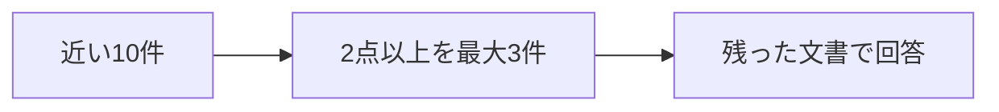

> 退会後のデータ保存期間を、有料で90日間に延長できますか？

マニュアルの15件に、その規定はありません。それでも一番近いのは「退会後のデータ削除」です。この文書の役立ちは 1.3200 で、2には届きませんでした。

**基準に届かない文書は、回答へ渡しません。** この質問では渡す文書が0件になり、回答は作っていません。

## 2点未満を、渡さない



検索の質問文は変えません。変えるのは、取れた文書のうち、どれを回答へ渡すかです。並べ替えのように、低い点の文書も件数を埋めて渡すことはしません。

Jev の点数は、基準の何段目かです。正解である確率ではありません。この章の4段は、低い方から次のとおりです。2は「回答の一部を裏付ける」段の番号なので、採用の下限を2に固定しました。実行後に、この値は変えていません。

登録のあと、次を実行します。近い3件をそのまま渡す回答と、2点以上だけを渡す回答を、同じ10件から作ります。

```bash
docker compose run --rm app exclude
```

リクエストのモデルは `jev-latest`、応答のモデルは `jev-1.14.0` です。

## 削除時期は、1件で足りた

質問は「退会後、データはいつ削除されますか？」です。

| | 渡した文書 | 回答 | 回答生成の入力 |
|---|---|---|---|
| 近い順の3件 | 退会後のデータ削除、退会前の書き出し、解約の取り消し | 退会完了から30日後にデータを削除します。 | 201トークン |
| 2点以上 | 退会後のデータ削除（2.9900） | 退会完了から30日後にデータが削除されます。 | 103トークン |

2点以上は1件だけでした。次に高い「退会前の書き出し」は 0.9900 です。回答の内容はどちらも、退会完了から30日後です。


近い3件の回答生成は、出力 17 トークン、957 ミリ秒です。1件だけ渡した回答生成は、出力 18 トークン、814 ミリ秒です。10件の評価は別に、入力 4482 トークン、2191 ミリ秒です。質問のベクトル化 17 トークンは、どちらにも含めていません。

**回答を保ったまま、回答生成へ渡す文書は減りました。** 評価そのもののトークンは増えています。全体の費用が減った結果ではありません。

## 延長できるとは、書いていない

質問は「退会後のデータ保存期間を、有料で90日間に延長できますか？」です。近い3件は「退会後のデータ削除」「退会後の請求」「退会できる人」で、回答は「分からない」でした。回答生成の入力は 189 トークン、出力は 4 トークン、736 ミリ秒です。

同じ10件を採点すると、最高は「退会後のデータ削除」の 1.3200 です。2点以上は0件で、回答生成は呼び出していません。10件の評価は、入力 4566 トークン、2671 ミリ秒です。


**文書が近いことと、その質問の根拠になることは別です。** 削除の時期が書いてあっても、有料で90日に延ばせるとは書いてありません。

除外は、検索で取れた文書を減らすだけです。最初の10件に無い規定は、この処理では増えません。

:::details 結果の出典と条件
上の点数、トークン、時間、回答は、このリポジトリで `docker compose run --rm app exclude` を実行したログです。小数は第4位までです。採用の下限は2で、質問ごとに採点の文言は変えています。削除の質問の4段目は「いつ削除するかを直接判断できる」、延長の質問の4段目は「有料で90日間に延長できるかを直接判断できる」です。

[Filtering RAGを実装してみた](https://qiita.com/koji0705/items/ce469e37bed915b30c8e) は、別の候補での対照です。そちらの削除の質問は、渡す文書が3件から1件になり、回答生成の入力トークンは 327 から 180 になりました。延長の質問では、近い3件の回答が延長できないという断定で、除外後も「退会後のデータ削除」が評価値 2.16 で残り、回答は「分からない」でした。本書の15件と基準の文言では、延長の質問は2点以上が0件です。
:::
