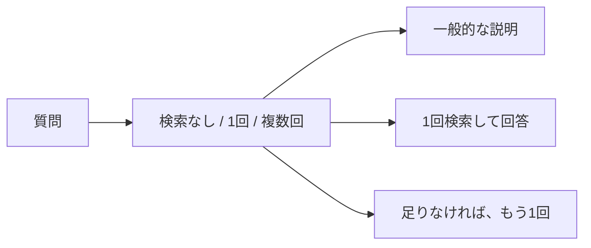

> 「日割り」とはどういう意味ですか？

近い文書は「日割り請求のルール」です。毎回検索する側は、月の途中の契約開始やプラン変更から、日数で金額を出すという説明をしました。検索の前に方法を選ぶ側は、検索なしを選び、料金を1日ごとに分けるという一般的な説明だけを返しました。

**質問によっては、マニュアルを開かずに答えます。** この質問で選ばれたのは「検索なし」で、その確率は 0.7800 でした。

## 検索の前に、3つのどれかを選ぶ



Jev の choice に、質問と3つの基準を渡します。返るのは、選ばれた名前と、各選択肢の確率です。ログには、その名前、confidence、確率を残します。

3つの基準は、次の意味です。

- 検索なし。一般的な言葉の説明で足り、サービスの規定を調べなくてよい
- 1回。サービスの規定を、この質問のまま1回検索すればよい
- 複数回。複数の規定にまたがるので、検索を分けた方がよい

検索なしのときは、一般的な意味だけを説明させます。TaskFlowの料金、日数、手続きは推測させません。文書を使うときは、第6章と同じく、渡した文書に書いてあることだけで答えさせます。

複数回を選んだときは、先に1回検索します。取れた3件を見て、必要な規定が入っているか、まだ足りないかを、もう一度 choice で選びます。足りないときは、検索文を1行だけ書かせ、同じマニュアルをもう1回検索します。追加は最大1回です。同じ id の文書は重ねません。

3つの質問について、毎回検索する回答と、選んだ方法の回答を続けて出します。

```bash
docker compose run --rm app route
```

リクエストのモデルは `jev-latest`、応答のモデルは `jev-1.14.0` です。

## 日割りの意味は、検索しなかった

| | 毎回検索 | 方法を選ぶ |
|---|---|---|
| 検索 | 1回 | なし |
| 回答 | 月の途中の契約開始やプラン変更から、日数で計算する | 料金を1日ごとに分けて計算する、という一般的な説明 |
| 回答生成の入力 | 217トークン | 72トークン |


毎回検索は 996 ミリ秒で、回答生成は出力 57 トークン、1234 ミリ秒です。方法を選ぶ側の判断は、入力 427 トークン、416 ミリ秒です。確率は、検索なし 0.7800、1回 0.2100、複数回 0.0100 で、confidence は 0.6700 です。回答生成は、出力 63 トークン、1025 ミリ秒です。

**省けたのは検索です。** 回答の中身も変わっています。トークンが減ったことだけでは、説明の良し悪しは決まりません。

## 削除時期は、1回のまま

質問は「退会後、データはいつ削除されますか？」です。選ばれたのは1回で、確率は 0.9100 です。検索なしは 0.0100、複数回は 0.0800、confidence は 0.8600 です。判断は、入力 428 トークン、162 ミリ秒です。

取れた3件は、どちらも「退会後のデータ削除」「退会前の書き出し」「解約の取り消し」です。回答もどちらも「退会完了から30日後にデータを削除します。」で、回答生成の入力は 201 トークン、出力は 17 トークンです。毎回検索の回答生成は 796 ミリ秒、方法を選ぶ側は 909 ミリ秒です。検索は 674 ミリ秒と 736 ミリ秒でした。

**文書も回答も同じで、選択の処理が増えています。**

## プラン変更後の退会は、2回検索しても3件のまま

質問は「プラン変更後に退会した場合、請求とデータ削除はどうなりますか？」です。選ばれたのは複数回で、確率は 0.7100 です。1回は 0.2900、検索なしは 0.0000、confidence は 0.5600 です。判断は、入力 441 トークン、183 ミリ秒です。

1回目の3件は「退会後のデータ削除」「退会後の請求」「退会前の書き出し」です。これを見て、まだ足りないが 0.5700、入っているが 0.4300、confidence は 0.1400 でした。追加の判断は、入力 539 トークン、161 ミリ秒です。

追加の検索文は「プラン変更後に退会した場合の請求とデータ削除に関する規定」です。この文を書かせるのに、入力 197 トークン、853 ミリ秒かかりました。2回目の検索も、同じ3つの見出しです。id が重なるので、回答へ渡した文書は3件のままです。


回答生成の入力は、どちらも 200 トークンです。毎回検索は出力 246 トークン、2251 ミリ秒で、プラン変更後の特別な記述は無いとしたうえで、退会した月は満額、データは退会完了から30日後、と書いています。方法を選ぶ側は出力 150 トークン、1480 ミリ秒で、同じ2点を書き、プラン変更後を直接書いた箇所は無いとも残しています。

**検索を2回にしても、渡す文書は増えませんでした。** 2回目の文が1回目の質問に近く、距離も近い見出しが再び上位になったためです。追加が必要という判断の confidence は 0.1400 で、入っているとの差も小さくなっています。

検索の前に回数を選べても、追加の検索が同じ文書へ戻ることがあります。取れた文書が質問の根拠になっているかを見て、外れているときだけ検索文を変える処理は、この次に扱います。

:::details 結果の出典と条件
上の確率、トークン、時間、回答は、このリポジトリで `docker compose run --rm app route` を実行したログです。小数は第4位までです。質問のベクトル化は、日割りの意味が 16 トークン、削除時期が 17 トークン、プラン変更後の退会が 32 トークンです。追加検索のベクトル化は 30 トークン、663 ミリ秒です。追加は最大1回で、同じ id は回答へ重ねて渡しません。

[Jevで質問に応じた検索方法を選ぶ！Adaptive RAGを実装してみた](https://qiita.com/koji0705/items/19ec6134865660a46b6d) は、別の候補での対照です。そちらの日割りの意味は検索なしで、回答生成の入力トークンは 271 と 92、判断は 297 ミリ秒です。削除時期はどちらも同じ3件で、判断は 186 ミリ秒です。プラン変更後の退会は、検索が1回から2回になり、文書は3件から4件に増え、結論はどちらも退会月は満額、データは30日後でした。本書の15件では、2回目も同じ3見出しで、文書数は3件のままです。

手法の参照先は [Adaptive-RAG](https://aclanthology.org/2024.naacl-long.389/) です。原論文は学習済みの分類器で戦略を選びます。この章は、その選択を Jev の choice で行う簡易な実装です。
:::
