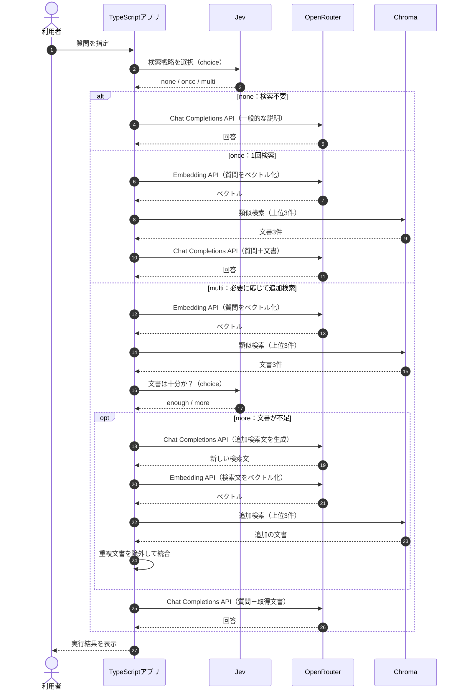

## Adaptive RAGとは？

**Adaptive RAGとは、質問の内容に応じて検索方法を切り替えるRAGです。** これまでのNaive RAGでは、どんな質問でもChromaで類似検索してからLLMへ渡していました。しかし、一般的な用語の説明にはマニュアル検索が不要な場合もあれば、複数の規定を調べる必要がある質問もあります。

今回はJevに質問を評価してもらい、TypeScriptアプリが次の3つの処理を切り替えます。

| 戦略 | 処理 | 想定する質問 |
|---|---|---|
| `none` | 検索せずLLMで回答 | 一般的な用語の説明 |
| `once` | 1回検索して回答 | 1つの規定で答えられる質問 |
| `multi` | 検索し、不足があれば追加検索 | 複数の規定が必要な質問 |


## ① 今回の実験内容

今回はTaskFlowに関する3つの質問を使います。

| 質問 | 期待する戦略 |
|---|---|
| 「日割り」とはどういう意味ですか？ | `none` |
| 退会後、データはいつ削除されますか？ | `once` |
| プラン変更後に退会した場合、請求とデータ削除はどうなりますか？ | `multi` |

これらの質問をJevがどう分類し、アプリの処理がどう変わるのかを確認します。

## ② 処理の流れ

Adaptive RAGでは、検索前にJevへ質問を送り、検索方法を選択します。`multi`の場合は、検索後にもう一度Jevで文書の十分性を判断します。



この図はAdaptive側の処理です。実際の`route`コマンドでは、比較のために各質問で先にNaive RAGも実行しています。

**Jevが担当するのは検索戦略の選択です。** 実際の検索、追加検索文の生成、回答生成はTypeScriptアプリがOpenRouterやChromaを呼び出して実行します。

## ③ Jevに検索方法を選んでもらう

実装は`app/src/commands.ts`の`compareRoute()`です。まず、Jevの`choice`機能を使って検索戦略を選択します。

```typescript
const decision = await chooseOption(
  question,
  STRATEGY_INSTRUCTIONS,
  { ...STRATEGY_CRITERIA },
);
```

`app/src/models.ts`では、選択肢とその判断基準を次のように定義しています。

```typescript
export const STRATEGY_INSTRUCTIONS =
  "この質問に答えるとき、マニュアルをどう検索するか";

export const STRATEGY_CRITERIA = {
  none: "一般的な言葉の説明で足り、サービスの規定を調べなくてよい",
  once: "サービスの規定を、この質問のまま1回検索すればよい",
  multi: "複数の規定にまたがるので、検索を分けた方がよい",
} as const;
```

例えば、「日割りとはどういう意味ですか？」という質問では、Jevへ次のリクエストを送ります。

```json
{
  "model": "jev-latest",
  "state": "「日割り」とはどういう意味ですか？",
  "questions": {
    "decision": {
      "type": "choice",
      "instructions": "この質問に答えるとき、マニュアルをどう検索するか",
      "criteria": {
        "none": "一般的な言葉の説明で足り、サービスの規定を調べなくてよい",
        "once": "サービスの規定を、この質問のまま1回検索すればよい",
        "multi": "複数の規定にまたがるので、検索を分けた方がよい"
      }
    }
  }
}
```

**Jevの判断結果（保存ログからの抜粋）**

```json
{
  "choice": "none",
  "probabilities": {
    "none": 0.78,
    "once": 0.21,
    "multi": 0.01
  },
  "confidence": 0.67
}
```

今回、Jevは`none`を選択しました。`probabilities`は各選択肢に対する値で、回答の正解確率ではありません。アプリでは`choice`だけを使って分岐し、`confidence`や`probabilities`による閾値判定は行っていません。

## ④ 判断結果によって処理を切り替える

Jevから返された`choice`をもとに、TypeScriptアプリが処理を変更します。

### none：検索せず回答する

`none`が選択された場合、Chromaを検索せず、OpenRouterの回答生成APIを呼び出します。

```typescript
if (decision.choice === "none") {
  field("search_count", 0);
  await printAnswer("route", question, [], GENERAL_INSTRUCTION);
  return;
}
```

検索結果を空にするだけでなく、回答生成時のシステム指示も切り替えます。

```text
一般的な言葉の意味だけを説明してください。TaskFlowの料金、日数、手続きは推測しないでください。サービスの規定が必要なら、分からないと答えてください。
```

保存ログでは、次の回答が生成されました。

> 「日割り」とは、一定の料金や費用を1日ごとに分けて計算する方法のことを指します。例えば、1か月分の料金を日数で割って、利用した日数分だけ支払う場合に使われます。

TaskFlow固有のマニュアルを検索せず、一般的な意味を説明できました。

### once：1回検索して回答する

「退会後、データはいつ削除されますか？」という質問では、Jevは`once`を選択しました。

| 選択肢 | probabilities |
|---|---:|
| none | 0.01 |
| **once** | **0.91** |
| multi | 0.08 |

`once`の場合は、これまでのNaive RAGと同じ検索処理を実行します。

```typescript
if (decision.choice === "once") {
  const searched = await searchHits(question, 3);
  await printAnswer("route", question, searched.hits);
  return;
}
```

取得した文書には「退会後のデータ削除」が含まれ、回答は「退会完了から30日後にデータを削除します。」でした。Naive RAGと同じ文書を使い、同じ結論を得ています。このケースでは、Jevによる判断処理が追加されたものの、回答内容は改善していません。

### multi：不足している情報を追加検索する

「プラン変更後に退会した場合、請求とデータ削除はどうなりますか？」という質問では、`multi`が0.71で選択されました。

最初の検索では、次の3件が取得されました。

| 文書 | 分かること |
|---|---|
| 退会後のデータ削除 | 退会完了から30日後に削除 |
| 退会後の請求 | 解約した月は満額 |
| 退会前の書き出し | 退会前にデータを書き出せる |

これらの文書には、プラン変更時の日割り計算についての規定が含まれていません。そこで、Jevへ「現在の文書だけで回答できるか」を確認します。

```typescript
const follow = await chooseOption(
  passageState(question, documents),
  MORE_SEARCH_INSTRUCTIONS,
  { ...MORE_SEARCH_CRITERIA },
);
```

今回は`enough`（十分）と`more`（不足）の2択です。

**Jevの判断結果（保存ログからの抜粋）**

```json
{
  "choice": "more",
  "probabilities": {
    "enough": 0.43,
    "more": 0.57
  },
  "confidence": 0.14
}
```

Jevは`more`を選択したため、アプリは追加検索に進みます。`confidence`は0.14と低い値ですが、今回の実装では`choice`だけを使うため、追加検索は実行されます。

## ⑤ LLMで追加検索文を生成する

不足していると判断された場合、OpenRouterの回答生成APIを使って新しい検索文を作ります。

```typescript
const rewritten = await completeAnswer(
  passageState(question, documents),
  REWRITE_INSTRUCTION,
);

const nextQuery = rewritten.text.split("\n")[0]?.trim() ?? "";
const again = await searchHits(nextQuery, 3);

documents = mergeHits(documents, again.hits);
```

LLMには、元の質問と取得済みの文書を渡し、「足りない点を補う検索文を1つだけ書いてください。検索文以外は書かないでください。」と指示しています。

**生成された検索文**

```text
プラン変更後に退会した場合の請求とデータ削除に関する規定
```

この検索文をEmbeddingしてChromaで再検索します。しかし、保存ログでは最初の検索と同じ3件が返ってきました。`mergeHits()`は同じIDを重複登録しないため、最終的な文書数も3件のままでした。

**Jevが追加検索を必要と判断しても、実際に新しい情報が見つかるとは限りません。** 今回は追加検索が実行されたものの、取得できる情報は増えませんでした。

## ⑥ 実行結果を比較する

次のコマンドで3つの質問をまとめて実行できます。

```bash
docker compose run --rm app route
```

保存ログの結果をまとめます。

| 質問 | Jevの選択 | Naiveの検索回数 | Adaptiveの検索回数 | 結果 |
|---|---|---:|---:|---|
| 日割りの意味 | none | 1 | 0 | 一般的な用語として説明 |
| データ削除の時期 | once | 1 | 1 | 30日後と回答 |
| プラン変更後の退会 | multi | 1 | 2 | 新しい文書は増えなかった |


今回の実験では、`none`によって不要な検索を省けました。一方、`once`では従来と同じ検索結果になり、`multi`では追加検索を行っても新しい文書を取得できませんでした。

※ これらは15チャンク時点の保存ログです。現在のマニュアルは18チャンクのため、再実行時の検索結果やJevの判断は変わる可能性があります。

## Adaptive RAGの課題は？

Adaptive RAGは、質問の内容に応じて処理を切り替えられる一方で、**検索戦略の判断自体が間違う可能性**があります。例えば、TaskFlow固有の規定が必要な質問を`none`にすると、回答に必要なマニュアルを取得できません。

また、今回の`multi`では新しい検索文が元の質問に近く、追加検索しても同じ文書が返ってきました。追加検索の有無だけでなく、**不足している情報を適切な検索文に変換できるか**が重要になります。

今回の実装は、Jevの`choice`を使って検索方針を切り替える簡易的なAdaptive RAGです。すべての質問で精度やコストが改善することを示したものではありません。

## まとめ

Adaptive RAGは、**質問の内容に応じて検索なし・1回検索・複数回検索を切り替える方法**です。今回の実験では、Jevの判断によって処理が変わることを確認できました。

ただし、検索を追加しても必要な情報が見つかるとは限りません。次章では、**検索結果が不十分なことを検知し、検索文を作り直して取り直すCorrective RAG**を学びます。
