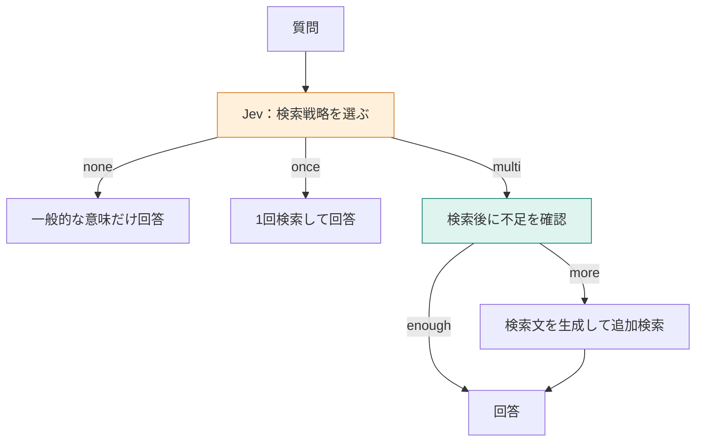

**この章では、質問を見て、検索なし・1回・複数回の処理を選びます。** 一般的な言葉の説明にも毎回マニュアル検索を走らせる必要があるかを考えます。Jevが返す選択肢と、その後に動く検索・LLM・コードの役割を追います。



## 同じ「日割り」でも、必要な材料は違う

次の3問なら、自分ではどれを選ぶでしょう。

| 質問 | 調べる必要があるもの |
|---|---|
| 「日割り」とはどういう意味ですか？ | 一般的な言葉の意味 |
| 退会後、データはいつ削除されますか？ | TaskFlow固有の規定 |
| プラン変更後に退会した場合、請求とデータ削除はどうなりますか？ | 複数の規定の組み合わせ |

Naive RAGは、どの質問も1回検索して上位3件を渡します。Adaptive RAGでは、検索前に戦略を選ぶ処理を加えます。ただし、複雑な質問だから必ず追加検索が役立つとは限りません。実際に文書が増えたかまで確認します。

[環境構築](./02-setup)と登録後、次を実行します。以下は15節時点の保存ログで、現在は18節です。

```bash
docker compose run --rm app route
```

## STEP 1：選択肢を、実行できる処理として定義する

`chooseOption` がJevへ送るのは、質問と次の基準です。1問目のリクエストを示します。認証情報は省いています。

```json
{
  "model": "jev-latest",
  "state": "「日割り」とはどういう意味ですか？",
  "questions": {
    "decision": {
      "type": "choice",
      "instructions": "この質問に答えるとき、マニュアルをどう検索するか",
      "criteria": {
        "none": "一般的な言葉の説明で足り、サービスの規定を調べなくてよい",
        "once": "サービスの規定を、この質問のまま1回検索すればよい",
        "multi": "複数の規定にまたがるので、検索を分けた方がよい"
      }
    }
  }
}
```

`none` などの名前は、アプリ側が決めた分岐のキーです。Jevが検索機能を実行するわけではありません。

保存ログにある返り値を、`chooseOption` が取り出した形で示します。API全体のJSONではありません。

```json
{
  "choice": "none",
  "probabilities": { "none": 0.78, "once": 0.21, "multi": 0.01 },
  "confidence": 0.67
}
```

`probabilities` は戦略の選択肢に対する値で、回答の正解確率ではありません。`confidence` も別の値です。この実装は、どちらの閾値も見ず、`choice` の名前で分岐します。

## STEP 2：noneなら、回答の指示も変える

`app/src/commands.ts` の `compareRoute` には、次の分岐があります。

```typescript
if (decision.choice === "none") {
  field("search_count", 0);
  await printAnswer("route", question, [], GENERAL_INSTRUCTION);
  return;
}
```

文書を空にするだけでなく、回答モデルへのシステム文を切り替えます。

```text
一般的な言葉の意味だけを説明してください。TaskFlowの料金、日数、手続きは推測しないでください。サービスの規定が必要なら、分からないと答えてください。
```

ユーザー文の全文です。検索文書はありません。

```text
質問:
「日割り」とはどういう意味ですか？
```

`openai/gpt-4.1-mini` が返した回答は次のとおりでした。

```text
「日割り」とは、一定の料金や費用を1日ごとに分けて計算する方法のことを指します。例えば、1か月分の料金を日数で割って、利用した日数分だけ支払う場合に使われます。
```

TaskFlowの契約規定を検索せず、一般的な説明をしています。製品固有の問い合わせを誤って `none` にすると根拠が届かないので、戦略選択の誤りも評価対象です。

## STEP 3：onceなら、基本の検索へ進む

削除時期の質問では、`once` が0.9100、`none` が0.0100、`multi` が0.0800で、`confidence` は0.8600でした。

1回検索して取れた3件は「退会後のデータ削除」「退会前の書き出し」「解約の取り消し」です。毎回検索する側も同じ文書を取得し、両方とも「退会完了から30日後にデータを削除します。」と返しました。

この分岐の回答入力の組み立ては[第6章](./06-naive-rag)と同じです。検索結果も回答も変わらず、戦略選択の呼び出しが増えた例です。

## STEP 4：multiでは、検索後にもう一つ判断する

プラン変更後の退会の質問では、`multi` が0.7100で選ばれました。1回目の検索結果は次の3件です。

| 文書 | 分かること |
|---|---|
| 退会後のデータ削除 | 退会完了から30日後 |
| 退会後の請求 | 解約月は満額 |
| 退会前の書き出し | 完了前に書き出せる |

この3件には、プラン変更時の計算はありません。そこで、質問と取得済みの本文を `state` にし、Jevへ次の基準を送ります。

```json
{
  "instructions": "渡された文書だけで、この質問に答えられるか",
  "criteria": {
    "enough": "必要な規定が渡された文書に入っている",
    "more": "必要な規定がまだ足りない"
  }
}
```

これは `questions.decision` 内の指示と基準の抜粋です。返った値は次のとおりでした。

```json
{
  "choice": "more",
  "probabilities": { "enough": 0.43, "more": 0.57 },
  "confidence": 0.14
}
```

差は小さくても、コードは `choice === "more"` なら追加へ進みます。低い `confidence` を理由に中止する処理はありません。

## STEP 5：不足を受けて、LLMが検索文を書く

Jevは検索文を書きません。LLMへ、同じ質問と3件の本文を渡し、次のシステム文で依頼します。

```text
足りない点を補う検索文を1つだけ書いてください。検索文以外は書かないでください。
```

このときのユーザー文の全文は、折りたたみに載せます。

:::details 追加検索文を作るときのユーザー文
```text
質問:
プラン変更後に退会した場合、請求とデータ削除はどうなりますか？

文書:
見出し: 退会後のデータ削除
退会
退会後のデータ削除
退会完了から30日後にデータを削除します。

見出し: 退会後の請求
退会
退会後の請求
解約した月の料金は満額です。日割りにはなりません。

見出し: 退会前の書き出し
退会
退会前の書き出し
退会が完了する前であれば、登録したデータを書き出せます。
```
:::

返った検索文は、次の1行でした。

```text
プラン変更後に退会した場合の請求とデータ削除に関する規定
```

この文をベクトル化してもう一度検索します。ところが、取得したのは同じ3見出しでした。同じIDを重複させないため、蓄積した文書は3件のままです。追加は最大1回で、ここから繰り返し続けません。

## 3問を並べると、選ぶ効果と費用が分かれる

| 質問 | 選択 | 検索回数 | 変わったこと |
|---|---|---:|---|
| 日割りの意味 | none | 1→0 | 製品規定を使う説明から、一般的な説明へ変わった |
| 削除時期 | once | 1→1 | 文書も回答も同じで、判断処理だけ増えた |
| プラン変更後の退会 | multi | 1→2 | 文書は3件のまま。両方とも満額と30日後を回答した |


**検索を追加すべきという判断と、有効な追加検索を作れることは別です。** 今回の追加文は元の質問に近い表現で、同じ見出しへ戻りました。検索文が原因である可能性はありますが、文言を変えた比較をしていないため、原因をそれだけに断定はしません。

:::details 考えてみる：いつもonceになるサービスでも、この選択を置く？
文書と回答が同じなら、選択のAPI呼び出し分が増えます。一般的な質問と製品固有の質問が混在するかを、実際の問い合わせで確かめてから採用します。戦略の種類を増やすだけでは改善しません。
:::

:::details 計測条件と参照先
`route` 保存ログの1回の結果です。Jevの指定は `jev-latest`、応答は `jev-1.14.0`。日割りの意味は判断427トークン・416ミリ秒、回答入力は毎回検索217に対し検索なし72トークンです。削除は判断428トークン・162ミリ秒、回答入力は両方201。複合質問は戦略441トークン・183ミリ秒、不足判定539トークン・161ミリ秒、検索文生成197トークン・853ミリ秒、追加ベクトル化30トークン・663ミリ秒です。回答入力は両方200トークンでした。

[著者のAdaptive RAG記事](https://qiita.com/koji0705/items/19ec6134865660a46b6d)では、追加検索で4件に増えています。本章の3件のままという結果とは分けます。[Adaptive-RAG原論文](https://aclanthology.org/2024.naacl-long.389/)は学習した分類器で戦略を選びます。本章はその役をJevの `choice` にした簡易実装です。
:::
