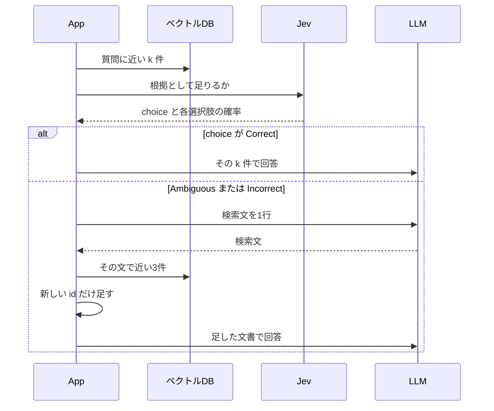

**何をするか。** 取れた文書が質問の根拠として足りるかを選び、足りないときだけ検索文を1行作り直して、同じマニュアルをもう1回探す。

**何を解決するか。** 必要な規定が近い順のすぐ下に残っていると、渡した件数の中では答えられない。

**学ぶこと。** Jev の `choice` は、3つの基準から1つを選ぶ値である。検索文を書くのは LLM で、文書を足すのはコードである。

**実験で確認できたこと。** 解約の質問は、3件だと Correct で検索は1回のまま。2件だと Incorrect になり、「退会後の請求」が足されて、回答は「分からない」から満額になった。有料の90日延長は Incorrect で取り直しても、判断できないままだった。


近い順の上位を選び直さず渡す基本形を、Naive RAG と呼ぶ。検索して回答する流れは [第6章 近い文書を渡して答える](./06-naive-rag)、起動と API キーは [第2章 環境構築](./02-setup) にある。確認コマンドは `docker compose run --rm app retry` です。

## 根拠が3位だと、2件では答えられない

質問は、TaskFlow のマニュアルに対する次の1文です。

> Standardプランを月の途中で解約したら、日割りになりますか？

マニュアルの「退会後の請求」には、解約した月は満額で、日割りにはならない、と書いてあります。この実行で近い順を取ると、1位は「プラン変更時の日割り」、2位は「Standardプランの月額」、必要な「退会後の請求」は3位でした。

3件を渡すと、3位の根拠が回答に入ります。判定の対象を2件にすると、その根拠は判定の外です。毎回検索の2件は「分からない」と返しました。取り直しは、この2件を見たあとに始まります。

## この実装では、選ぶ役と書く役が分かれる

Corrective RAG と呼ぶ処理のうち、今回実装する範囲は、同じマニュアルへの追加検索を1回だけです。原論文には Web 検索と、文書を短くする処理があります。どちらもこの章にはありません。



この実装では、Jev は文章を書かず、LLM は Correct かどうかを選びません。一般に LLM が評価できない、という意味ではありません。追加の検索へ進むかは、返った `choice` の名前を見るコードです。質問のベクトル化は `openai/text-embedding-3-small`、検索文と回答は `openai/gpt-4.1-mini` です。Jev の指定モデルは `jev-latest` で、この実行の応答モデルは `jev-1.14.0` でした。

## 同じコレクションで、最初の件数だけ変える

登録は18件、空間は cosine です。件数は `retry` のログには無く、同じコレクションへの `search` のログです。見出しはアカウント、請求、退会で、支払いの失敗、Proの月額、SSO を含みます。第6章の15件や、支払いの失敗を足した直後の16件とは件数が違います。距離が同じ上位があっても、条件を揃えた比較としては扱いません。この実行では再登録していません。

最初の件数 k は、支払いの失敗が3、解約の日割りが3と2、有料の90日延長が3です。追加の検索は、どの場合も3件です。追加は1回で、同じ id は重ねません。

見たい結果は二つです。

1. 必要な規定が最初の k 件の外にあるとき、Correct 以外になり、足した文書で結論が変わる
2. マニュアルに規定が無いとき、取り直しても結論は判断できないままである

k=3 の解約は、必要な規定が最初の3件に入っています。ここで取り直しが起きなくても、その結果を残します。

## STEP 1：解約の質問で、近い2件を取る

質問のベクトル化は 26 トークンです。2件の距離は、次のとおりです。

| 順位 | 見出し | distance |
| --- | --- | --- |
| 1 | プラン変更時の日割り | 0.2862 |
| 2 | Standardプランの月額 | 0.3832 |

3位の「退会後の請求」は 0.3869 で、この2件には入っていません。毎回検索の回答は「分からない」でした。

## STEP 2：Jevに、この2件で根拠が足りるか選ばせる

判定の指示は、質問の主題を解約の日割りに固定していません。渡された文書に、その質問の根拠があるかを3つから選びます。

Jev へ送る本文は、モデル名、質問と2件の文書、`choice` 型の質問です。認証ヘッダーは除いてあります。

```json
{
  "model": "jev-latest",
  "state": "質問:\nStandardプランを月の途中で解約したら、日割りになりますか？\n\n文書:\n見出し: プラン変更時の日割り\n請求\nプラン変更時の日割り\n月の途中で上位プランへ変更した場合、変更日から月末までを日割りで計算します。下位プランへの変更は、翌月から新しい料金です。\n\n見出し: Standardプランの月額\n請求\nStandardプランの月額\nStandardプランの月額は980円です。年払いの割引はありません。",
  "questions": {
    "decision": {
      "type": "choice",
      "instructions": "渡された文書は、この質問の根拠として足りるか",
      "criteria": {
        "Correct": "必要な規定が、渡された文書に入っている",
        "Ambiguous": "関連する情報はあるが、根拠として十分か判断しにくい",
        "Incorrect": "話題は近いが、答えの規定が入っていない"
      }
    }
  }
}
```

`state` の各文書は、大見出し、節の見出し、本文をつないだ文字列です。その前に「見出し:」と節の見出しがもう一度付きます。

ログに残した応答フィールドは、次のとおりです。小数は第4位までです。応答 JSON の全文は、この実行では残していません。

```json
{
  "choice": "Incorrect",
  "confidence": 0.7900,
  "probabilities": {
    "Correct": 0.0100,
    "Ambiguous": 0.1300,
    "Incorrect": 0.8600
  }
}
```

`probabilities` は、3つの基準のどれに近いかの割合です。回答が正しい確率ではありません。この応答は Incorrect が 0.8600 で、Incorrect は「話題は近いが、答えの規定が入っていない」です。2件はプラン変更の日割りと月額で、解約した月の満額は書いてありません。

`choice` は、その割合から選ばれた名前です。`confidence` は 0.7900 でした。選択とは別に返った値で、回答の正答率でもありません。アプリが分岐に使うのは `choice` だけで、`probabilities` と `confidence` は読んでいません。

```typescript
if (decision.choice === "Correct") {
  await printAnswer("retry", question, first.hits);
  return;
}
```

Correct 以外で受け付けるのは Ambiguous と Incorrect です。この実行で選ばれたのは Incorrect だけで、Ambiguous が選ばれた例はありません。二つの名前は、その後の動きが同じです。

同じ質問を3件で判定すると、3位に「退会後の請求」が入ります。ログの値は Correct 0.9800、Ambiguous 0.0100、Incorrect 0.0100、`confidence` 0.9700 でした。ここで関数は return し、検索文の生成は呼ばれていません。

## STEP 3：LLMが、検索文を1行書く

検索文のモデルには、判定結果を渡しません。システム文は1つです。

```text
足りない点を補う検索文を1つだけ書いてください。検索文以外は書かないでください。
```

ユーザー文は、STEP 2 と同じ質問と2件です。モデルは `openai/gpt-4.1-mini` です。コードは、返った本文の1行目だけを次の検索に使います。この実行で使った1行は、次のとおりです。

```text
Standardプラン 解約 日割り払い ルール
```

「日割り払い」は、マニュアルの見出しにはありません。検索に渡したのは、この文字列です。

## STEP 4：コードが、新しい id だけを足す

作り直した文で近い3件を取ると、次の距離でした。

| 順位 | 見出し | distance |
| --- | --- | --- |
| 1 | プラン変更時の日割り | 0.3652 |
| 2 | 退会後の請求 | 0.4166 |
| 3 | Standardプランの月額 | 0.4194 |

先の2件と id が重なるので、新しく残ったのは「退会後の請求」だけです。回答へ渡す順は、最初の2件の後ろに、この1件を足した順です。距離 0.4166 は、作り直した検索文での距離です。

```typescript
const documents = mergeHits(first.hits, again.hits);
```

## STEP 5：足した文書だけを、LLMが読む

回答のシステム文は、次の1つです。

```text
渡された文書だけを根拠に答えてください。文書から判断できなければ、「分からない」と答えてください。
```

ユーザー文は、質問と、足したあとの3件です。

```text
質問:
Standardプランを月の途中で解約したら、日割りになりますか？

文書:
見出し: プラン変更時の日割り
請求
プラン変更時の日割り
月の途中で上位プランへ変更した場合、変更日から月末までを日割りで計算します。下位プランへの変更は、翌月から新しい料金です。

見出し: Standardプランの月額
請求
Standardプランの月額
Standardプランの月額は980円です。年払いの割引はありません。

見出し: 退会後の請求
退会
退会後の請求
解約した月の料金は満額です。日割りにはなりません。
```

返った本文は、次のとおりです。

```text
Standardプランを月の途中で解約した場合、料金は日割りにはならず、解約した月の料金は満額請求されます。
```

## 2件では結論が変わり、3件では取り直しが無い

| 質問 | 最初の件数 | choice | 検索 | 結論 |
| --- | --- | --- | --- | --- |
| 支払いの失敗 | 3 | Correct 0.9900 | 1回 | 14日を過ぎると読み取り専用 |
| 解約の日割り | 3 | Correct 0.9800 | 1回 | 満額。日割りにならない |
| 解約の日割り | 2 | Incorrect 0.8600 | 2回 | 満額。日割りにならない |
| 有料の90日延長 | 3 | Incorrect 0.9700 | 2回 | 文書からは判断できない |

支払いの質問は「クレジットカードの決済に失敗したままだと、いつタスクを編集できなくなりますか？」です。1位は「支払いの失敗」0.2616 で、本文には、14日を過ぎるとタスクは読み取り専用になる、と書いてあります。毎回検索も判定後も、その結論でした。検索文は作っていません。

解約の3件は、毎回検索も判定後も満額でした。文言は一致していません。2件の毎回検索だけが「分からない」で、取り直しのあと満額に変わっています。

## 規定が無い質問は、取り直しても判断できない

有料で90日延長できるか、という質問の近い3件は「退会後のデータ削除」「退会後の請求」「退会できる人」です。毎回検索の回答は「分からない」でした。

判定は Incorrect 0.9700、Ambiguous 0.0200、Correct 0.0100、`confidence` 0.9600 です。作り直した1行は、次のとおりです。

```text
退会後のデータ保存期間延長の有料オプションについて
```

追加の3件で新しかったのは「退会前の書き出し」だけです。退会前にデータを書き出せる規定で、有料の90日延長ではありません。回答へ渡したのは4件です。

```text
退会後のデータ保存期間を有料で90日間に延長できるかについては、文書からは判断できません。
```

検索は2回になり、結論は判断できないままです。

## 取り直しが結論を変えた条件

今回、結論が「分からない」から満額に変わったのは、次が同時に成り立つときです。

- 最初の k 件に「退会後の請求」が入っていない
- `choice` が Correct 以外になる
- 作り直した1回の検索で、その文書が新しい id として足される

k=3 の支払いと解約では、必要な規定が最初の結果にあり、Correct で第2の検索を止めています。回答の結論は毎回検索と変わっていません。増えたのは判定です。解約の2件で確認できたのは、この1つの質問を1回実行したときの差です。

検索文の「日割り払い」は見出しと一致していません。それでも追加の2位に「退会後の請求」が入っています。なぜその文が2位になったかまでは、このログからは分かっていません。

採用しやすいのは、1回目の検索が別の規定に寄り、必要な規定が同じマニュアルの下位に残っているときです。最初の k 件に根拠があるとき、またはマニュアルにその規定が無いときは、判定と追加検索の費用が残ります。追加は1回で、足りなければもう一度探すループはありません。Ambiguous が選ばれたときの差は、この実行では見ていません。

代替は、最初の件数を増やすこと、候補を並べ替えてから渡すことです。並べ替えは [第8章 Reranking：検索結果を並べ替える](./08-rerank) にあります。生成した回答が文書の記載から外れるかは、[第12章 回答が文書に基づいているか確認する](./12-verify) で扱います。

:::details トークン、時間、出典
小数は第4位までです。質問のベクトル化は、支払いが 39 トークン、解約が 26 トークン、延長が 28 トークンです。検索時間には、そのベクトル化を含みます。追加検索のベクトル化は、解約の作り直しが 16 トークン、638 ミリ秒、延長が 26 トークン、630 ミリ秒です。

| 処理 | 入力トークン | ミリ秒 |
| --- | --- | --- |
| 支払いの判定 | 631 | 184 |
| 解約3件の判定 | 625 | 190 |
| 解約2件の判定 | 577 | 184 |
| 解約2件の検索文 | 170 | 815 |
| 延長の判定 | 576 | 173 |
| 延長の検索文 | 186 | 886 |

| 回答 | 入力 | 出力 | ミリ秒 |
| --- | --- | --- | --- |
| 支払いの毎回検索 | 214 | 42 | 1465 |
| 支払いの判定後 | 214 | 37 | 1681 |
| 解約3件の毎回検索 | 214 | 37 | 1388 |
| 解約3件の判定後 | 214 | 31 | 878 |
| 解約2件の毎回検索 | 173 | 4 | 574 |
| 解約2件の取り直し後 | 214 | 37 | 899 |
| 延長の毎回検索 | 189 | 4 | 700 |
| 延長の取り直し後 | 236 | 33 | 1000 |

点数、確率、トークン、時間、回答は、`docker compose run --rm app retry` のログです。登録18件と cosine は、同じコレクションへの `search --limit 3` です。

[Corrective RAGを実装してみた](https://qiita.com/koji0705/items/ce8dc8c41ac10b38fc9b) は、別の候補での対照です。この章の数値は、上の実行だけを使っています。

手法の参照先は [Corrective Retrieval Augmented Generation](https://arxiv.org/abs/2401.15884) です。
:::
