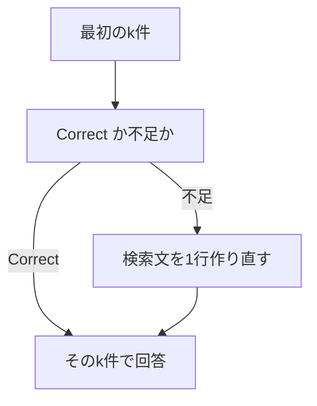

> クレジットカードの決済に失敗したままだと、いつタスクを編集できなくなりますか？

1位は「支払いの失敗」でした。取れた3件を判定すると Correct の確率は 0.9900 で、検索は1回のままです。回答は、14日を過ぎるとタスクが読み取り専用になる、です。

解約の日割りは、3件渡すと3位に「退会後の請求」が入り、判定は Correct 0.9800 です。検索の作り直しは起きません。同じ質問を2件だけにすると、判定は Incorrect 0.8600 になり、作り直した検索で「退会後の請求」が足されました。回答は「分からない」から満額に変わっています。

有料で90日延長できるかは、Incorrect 0.9700 で取り直しても、マニュアルにその規定は無く、判断できないままでした。

## 3件の中に根拠があると、取り直しは始まらない

第6章の Naive RAG は、近い文書を選び直さず、そのまま回答へ渡します。この章の Corrective RAG は、渡す前に「この文書で質問に答えられるか」を選びます。Correct ならその文書で答えます。Ambiguous か Incorrect なら、検索文を1行だけ作り、同じマニュアルをもう1回検索します。

支払いの失敗も、解約の日割りの3件も、必要な規定が最初の結果に入っていました。判定が Correct なので、第2の検索は呼ばれません。取り直しの分岐を見るには、最初に渡す件数を減らして、根拠を判定の外へ出す必要があります。今回は、解約の質問だけ最初の件数を2にしています。



向くのは、1回目の検索語が別の規定に寄って、必要な規定が候補の下に残っている問い合わせです。マニュアルに規定が無い質問は、取り直しても材料が増えるだけです。

## 判定してから、足りなければ1回だけ足す

最初の検索件数 k は、支払いの失敗と延長が3、解約の日割りが3と2です。取り直しの検索は、どの場合も3件です。回答の指示は第6章と同じで、渡された文書だけを根拠にします。

判定は Jev の choice です。質問と、取れた文書を `state` にして、3つの基準から1つを選ばせます。

```typescript
export const RETRIEVAL_INSTRUCTIONS =
  "渡された文書は、この質問の根拠として足りるか";

export const RETRIEVAL_CRITERIA = {
  Correct: "必要な規定が、渡された文書に入っている",
  Ambiguous: "関連する情報はあるが、根拠として十分か判断しにくい",
  Incorrect: "話題は近いが、答えの規定が入っていない",
} as const;
```

リクエストの形は、点数ではなく選択です。モデル名の指定は `jev-latest` です。

```typescript
const payload = await postJson(
  "https://api.typesafe.ai/v1/systemone",
  {
    model: JEV_MODEL,
    state,
    questions: {
      decision: {
        type: "choice",
        instructions,
        criteria,
      },
    },
  },
  bearer("JEV_API_KEY"),
);
```

応答から読むのは `answers.decision.choice`、各選択肢の `probabilities`、`confidence`、`model`、`usage.input_tokens` です。この実行の応答モデルは `jev-1.14.0` でした。確率は、その選択肢が選ばれる度合いとしてログに残し、回答が正しい確率とは分けます。

Correct のときは、そこで回答します。それ以外は Ambiguous と Incorrect だけを受け、検索文の生成へ進みます。

```typescript
if (decision.choice === "Correct") {
  field("search_count", 1);
  await printAnswer("retry", question, first.hits);
  return;
}
const rewritten = await completeAnswer(
  passageState(question, first.hits),
  REWRITE_INSTRUCTION,
);
const nextQuery = rewritten.text.split("\n")[0]?.trim() ?? "";
const again = await searchHits(nextQuery, 3);
const documents = mergeHits(first.hits, again.hits);
await printAnswer("retry", question, documents);
```

検索文を書くのは、回答と同じ `openai/gpt-4.1-mini` です。Jev は選び、検索文は書きません。指示は次の1つです。

```typescript
export const REWRITE_INSTRUCTION =
  "足りない点を補う検索文を1つだけ書いてください。検索文以外は書かないでください。";
```

返った本文の1行目だけを次の検索に使います。追加は1回で、同じ id は重ねません。

```typescript
function mergeHits(current: Hit[], extra: Hit[]): Hit[] {
  const seen = new Set(current.map((hit) => hit.id));
  const merged = [...current];
  for (const hit of extra) {
    if (!seen.has(hit.id)) {
      seen.add(hit.id);
      merged.push(hit);
    }
  }
  return merged;
}
```

見たい結果は二つです。最初のk件に根拠が無いとき、判定が Correct 以外になり、足した文書で結論が変わること。マニュアルに規定が無いとき、取り直しても結論は判断できないままであることです。k=3 の解約で取り直しが起きなくても、その結果は残します。

## 根拠が3位にあると、2件にしたときだけ取り直す

登録済みのコレクションで、次を実行します。この実行では、マニュアルの再登録はしていません。

```bash
docker compose run --rm app retry
```

### 支払いは Correct で、検索は1回

近い3件は「支払いの失敗」0.2616、「支払い方法」0.5635、「退会後のデータ削除」0.6743 です。最初の検索は 39 トークン、890 ミリ秒でした。この時間には、質問のベクトル化と検索が含まれます。

判定は Correct、確率は Correct 0.9900、Ambiguous 0.0000、Incorrect 0.0100、confidence は 0.9800 です。入力 631 トークン、184 ミリ秒です。

毎回検索の回答も、判定後の回答も、14日を過ぎると読み取り専用になる、という結論でした。判定後の回答生成は、入力 214 トークン、出力 37 トークン、1681 ミリ秒です。検索回数は1のままです。

### 解約を3件渡すと Correct、2件だと Incorrect

質問は「Standardプランを月の途中で解約したら、日割りになりますか？」です。近い順は、第6章と同じく「プラン変更時の日割り」0.2862、「Standardプランの月額」0.3832、「退会後の請求」0.3869 です。

3件の判定は Correct 0.9800、Ambiguous 0.0100、Incorrect 0.0100、confidence 0.9700 です。入力 625 トークン、190 ミリ秒です。毎回検索も判定後も、解約した月は満額で、日割りにはならない、と答えています。作り直しは呼ばれていません。

2件だけにすると、毎回検索の回答は次のとおりです。入力 173 トークン、出力 4 トークン、574 ミリ秒です。

```text
分からない
```

判定は Incorrect です。確率は Incorrect 0.8600、Ambiguous 0.1300、Correct 0.0100、confidence は 0.7900 です。入力 577 トークン、184 ミリ秒です。

作り直した検索文は、次の1行でした。生成は入力 170 トークン、815 ミリ秒です。

```text
Standardプラン 解約 日割り払い ルール
```

この文での近い3件は「プラン変更時の日割り」0.3652、「退会後の請求」0.4166、「Standardプランの月額」0.4194 です。追加の検索は 16 トークン、638 ミリ秒です。先の2件と id が重なるので、新しく足されたのは「退会後の請求」だけです。回答へ渡したのは3件です。

```text
Standardプランを月の途中で解約した場合、料金は日割りにはならず、解約した月の料金は満額請求されます。
```

回答生成は、入力 214 トークン、出力 37 トークン、899 ミリ秒です。

### 延長は取り直しても、規定が増えない

質問は「退会後のデータ保存期間を、有料で90日間に延長できますか？」です。近い3件は「退会後のデータ削除」0.3577、「退会後の請求」0.4828、「退会できる人」0.5375 です。毎回検索の回答は「分からない」で、入力 189 トークン、出力 4 トークン、700 ミリ秒です。

判定は Incorrect 0.9700、Ambiguous 0.0200、Correct 0.0100、confidence 0.9600 です。入力 576 トークン、173 ミリ秒です。

作り直した検索文は「退会後のデータ保存期間延長の有料オプションについて」です。生成は入力 186 トークン、886 ミリ秒です。追加の3件のうち、新しい見出しは「退会前の書き出し」だけで、回答へ渡したのは4件です。追加の検索は 26 トークン、630 ミリ秒です。

```text
退会後のデータ保存期間を有料で90日間に延長できるかについては、文書からは判断できません。
```

回答生成は、入力 236 トークン、出力 33 トークン、1000 ミリ秒です。90日延長を認める文にはなっていません。

## 検知できたことと、取り直しても埋まらないこと

支払いと、解約の3件では、必要な規定が最初の結果にあり、Correct で第2の検索を止めています。この2問では、回答の結論は毎回検索と変わっていません。増えたのは判定のトークンと時間で、支払いは入力 631 トークン、184 ミリ秒、解約の3件は入力 625 トークン、190 ミリ秒です。

解約の2件では、根拠が判定の外に出て、Incorrect から作り直しに進みました。足された「退会後の請求」によって、結論は「分からない」から満額に変わっています。作り直しの検索文には「日割り払い」とあり、マニュアルの見出しとは一致していません。それでも追加の2位に、必要な規定が入りました。

延長では、判定と作り直しは動きました。足された「退会前の書き出し」は、退会前にデータを書き出せる規定で、有料の90日延長ではありません。結論は判断できないままです。マニュアルに無い規則は、検索文を変えても出てきていません。

この実行で、取り直しが結論を変えたのは、次が同時に成り立つときです。

- 最初のk件に、必要な規定が入っていない
- 判定が Correct 以外になる
- 作り直した1回の検索で、その規定が新しい id として足される

判定が Correct のときは、第2の検索は走りません。規定がマニュアルに無いときは、走っても結論は判断できないままです。追加は1回で、足りなければもう一度探すループはありません。

この実行の範囲で、導入時に見ておく点は次のとおりです。

- 最初のk件に根拠があると、判定の費用だけが残り、回答は毎回検索と同じ結論になる
- k を小さくすると取り直しは起きやすくなる。今回の解約では、3件だと Correct、2件だと Incorrect だった
- 検索文は回答モデルが書く。Jev は3つの基準から1つを選ぶ
- 1回の追加で見つからなければ、そこで終わる。延長は4件になっても判断できていない

次の第12章では、検索結果ではなく、生成した回答が文書の記載から外れていないかを見ます。

:::details 結果の出典と条件
上の確率、トークン、時間、回答は、このリポジトリで `docker compose run --rm app retry` を実行したログです。小数は第4位までです。この実行では `index` はしていません。同じコレクションへの `search` では、登録は18件でした。

[Corrective RAGを実装してみた](https://qiita.com/koji0705/items/ce8dc8c41ac10b38fc9b) は、別の候補での対照です。この章の数値は、上の実行だけを使っています。

手法の参照先は [Corrective Retrieval Augmented Generation](https://arxiv.org/abs/2401.15884) です。原論文には Web 検索と、文書を精練する処理があります。この章は、同じマニュアルをもう1回検索する部分だけを、Jev の choice で行う簡易な実装です。
:::
