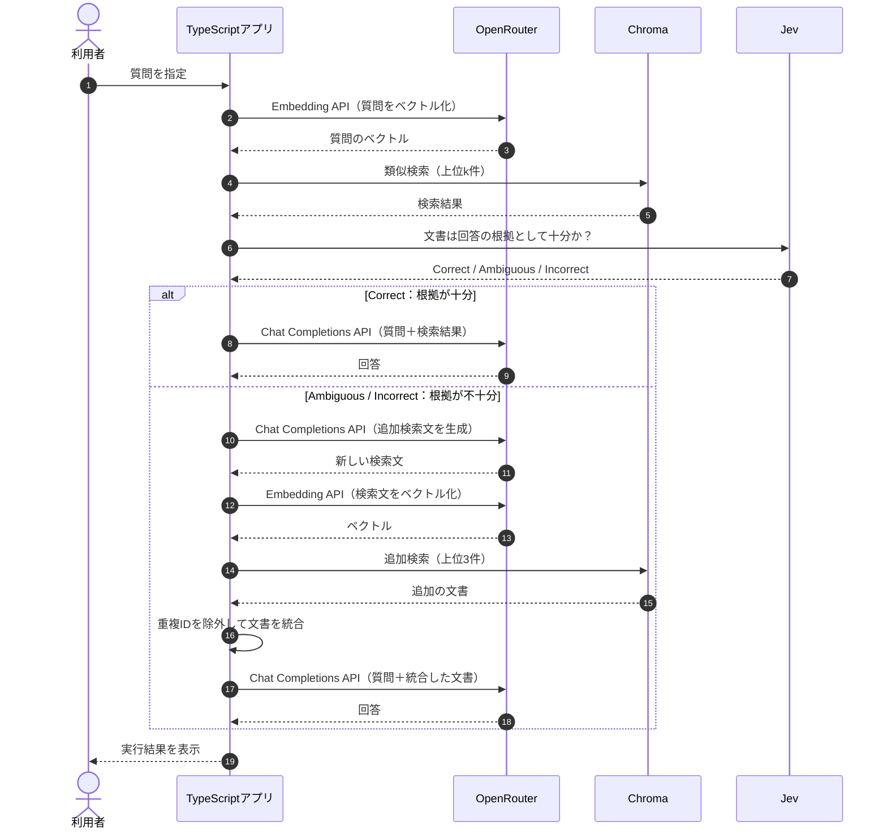

## Corrective RAGとは？

**Corrective RAGとは、検索結果が回答の根拠として十分かを評価し、不十分な場合に検索を改善するRAGです。** これまでのReranking RAGやFiltering RAGでは、最初に取得した候補を並べ替えたり、除外したりしていました。しかし、必要な文書が候補に含まれていなければ、どちらの方法でも正しい根拠を追加できません。

今回は、Jevで検索結果の十分性を判断し、不足している場合はOpenRouterで新しい検索文を生成して、Chromaをもう一度検索します。


## ① 今回の実験内容

次の質問を使用します。

> Standardプランを月の途中で解約したら、日割りになりますか？

正しい規定は「退会後の請求」で、解約月は満額、日割りにはなりません。しかし、Chromaで検索した上位2件には、この規定が含まれていません。

| 検索順位 | 文書 | distance |
|---|---|---:|
| 1 | プラン変更時の日割り | 0.2862 |
| 2 | Standardプランの月額 | 0.3832 |
| 3 | 退会後の請求 | 0.3869 |

今回は、最初の検索結果を2件に制限し、**必要な文書を取得できなかった状態から、検索し直すことで回答できるか**を確認します。あわせて、そもそもマニュアルに規定が存在しない質問も検証します。

## ② 処理の流れ

Corrective RAGでは、検索結果をJevが評価し、その判断に応じてアプリが処理を切り替えます。



この図は検索の修正処理を示しています。実際の`retry`コマンドでは、比較用のNaive RAGも先に実行します。

**Jevは検索結果の十分性を判断し、OpenRouterは検索文と回答を生成します。** 判断結果から再検索に進むかどうかを決めるのはTypeScriptアプリです。

## ③ 実装コードを確認する

実際に実行する処理は、`app/src/commands.ts`の`runRetry()`です。

```typescript
export async function runRetry(): Promise<void> {
  await compareRetry(PAYMENT_QUESTION, 3);
  await compareRetry(PRORATION_QUESTION, 3);
  await compareRetry(PRORATION_QUESTION, 2);
  await compareRetry(EXTEND_QUESTION, 3);
}
```

4つのケースを実行します。特に今回は、同じ解約の質問について、最初に取得する文書数を3件と2件に変えて比較します。

`compareRetry()`では最初に検索し、Jevへ十分性の判断を依頼します。

```typescript
const first = await searchHits(question, limit);

const decision = await chooseOption(
  passageState(question, first.hits),
  RETRIEVAL_INSTRUCTIONS,
  { ...RETRIEVAL_CRITERIA },
);
```

ここで使う`chooseOption()`は、第10章と同じJevの`choice`機能です。今回は検索戦略ではなく、**取得した文書が回答の根拠として十分か**を判断させます。

## ④ Jevで検索結果を評価する

`app/src/models.ts`では、次の3つの判断基準を定義しています。

```typescript
export const RETRIEVAL_INSTRUCTIONS =
  "渡された文書は、この質問の根拠として足りるか";

export const RETRIEVAL_CRITERIA = {
  Correct: "必要な規定が、渡された文書に入っている",
  Ambiguous: "関連する情報はあるが、根拠として十分か判断しにくい",
  Incorrect: "話題は近いが、答えの規定が入っていない",
} as const;
```

Jevへは質問と検索結果をまとめて渡します。以下は上位2件で評価したときのリクエストです。

```json
{
  "model": "jev-latest",
  "state": "質問:\nStandardプランを月の途中で解約したら、日割りになりますか？\n\n文書:\n見出し: プラン変更時の日割り\n請求\nプラン変更時の日割り\n月の途中で上位プランへ変更した場合、変更日から月末までを日割りで計算します。下位プランへの変更は、翌月から新しい料金です。\n\n見出し: Standardプランの月額\n請求\nStandardプランの月額\nStandardプランの月額は980円です。年払いの割引はありません。",
  "questions": {
    "decision": {
      "type": "choice",
      "instructions": "渡された文書は、この質問の根拠として足りるか",
      "criteria": {
        "Correct": "必要な規定が、渡された文書に入っている",
        "Ambiguous": "関連する情報はあるが、根拠として十分か判断しにくい",
        "Incorrect": "話題は近いが、答えの規定が入っていない"
      }
    }
  }
}
```

**Jevの判断結果（保存ログからの抜粋）**

```json
{
  "choice": "Incorrect",
  "confidence": 0.79,
  "probabilities": {
    "Correct": 0.01,
    "Ambiguous": 0.13,
    "Incorrect": 0.86
  }
}
```

Jevは`Incorrect`を選択しました。2件とも請求に関連する文書ですが、解約月の料金を直接判断できる規定がないためです。

アプリは`choice`を使い、次のように分岐します。

```typescript
if (decision.choice === "Correct") {
  await printAnswer("retry", question, first.hits);
  return;
}

if (
  decision.choice !== "Ambiguous" &&
  decision.choice !== "Incorrect"
) {
  throw new Error(`unknown retrieval choice: ${decision.choice}`);
}
```

`Correct`ならそのまま回答し、`Ambiguous`または`Incorrect`なら追加検索へ進みます。今回も`confidence`や`probabilities`による閾値判定は行っていません。

## ⑤ OpenRouterで検索文を作り直す

検索結果が不十分と判断された場合、OpenRouterの回答生成APIに新しい検索文を作らせます。

```typescript
const rewritten = await completeAnswer(
  passageState(question, first.hits),
  REWRITE_INSTRUCTION,
);

const nextQuery = rewritten.text.split("\n")[0]?.trim() ?? "";
const again = await searchHits(nextQuery, 3);
const documents = mergeHits(first.hits, again.hits);
```

LLMへのシステム指示は次のとおりです。

```text
足りない点を補う検索文を1つだけ書いてください。検索文以外は書かないでください。
```

**実際に生成された検索文**

```text
Standardプラン 解約 日割り払い ルール
```

生成された検索文をEmbeddingし、Chromaからもう一度上位3件を取得します。

**追加検索の結果**

| 順位 | 文書 | distance |
|---|---|---:|
| 1 | プラン変更時の日割り | 0.3652 |
| 2 | 退会後の請求 | 0.4166 |
| 3 | Standardプランの月額 | 0.4194 |

最初の検索では取得できなかった「退会後の請求」が、追加検索の2位に現れました。`mergeHits()`はIDが重複する文書を追加しないため、最終的には「最初の2件＋新しい1件」の合計3件になります。

## ⑥ 追加した文書を使って回答する

最終的にLLMへ渡す文書は次の3件です。

| 文書 | 取得元 |
|---|---|
| プラン変更時の日割り | 最初の検索 |
| Standardプランの月額 | 最初の検索 |
| 退会後の請求 | 追加検索 |

ここで重要なのは、**再検索によって、最初にはなかった回答の根拠が追加されたこと**です。LLMには元の質問と統合した3件を渡します。

**再検索後の回答（保存ログ）**

```text
Standardプランを月の途中で解約した場合、料金は日割りにはならず、解約した月の料金は満額請求されます。
```

最初の2件を使ったNaive RAGでは「分からない」でしたが、再検索後は必要な規定が追加され、正しく回答できました。

## ⑦ 実行して結果を比較する

次のコマンドで実験を実行します。

```bash
docker compose run --rm app retry
```

以下は、18チャンクのコレクションを使った保存ログに基づく結果です。

| 質問 | 最初の件数 | Jevの判断 | 検索回数 | 最終結果 |
|---|---:|---|---:|---|
| 支払い失敗後の編集制限 | 3 | Correct | 1 | 14日を過ぎると読み取り専用 |
| 解約月の日割り | 3 | Correct | 1 | 満額・日割りなし |
| 解約月の日割り | 2 | Incorrect | 2 | **再検索で満額と回答** |
| 有料の90日延長 | 3 | Incorrect | 2 | 分からない |

3件で検索した場合は、最初から必要な規定が含まれているため、Jevが`Correct`を選択して追加検索を行いません。一方、2件では必要な規定が含まれず、Jevが`Incorrect`を選び、再検索によって回答できるようになりました。

### 規定が存在しない場合は？

「退会後のデータ保存期間を、有料で90日間に延長できますか？」という質問でも、Jevは`Incorrect`を選択しました。

OpenRouterが生成した検索文は次のとおりです。

```text
退会後のデータ保存期間延長の有料オプションについて
```

追加検索では「退会前の書き出し」という文書が新たに取得されました。しかし、その文書にも有料で90日間延長できるかは書かれていません。

**最終回答（保存ログ）**

```text
退会後のデータ保存期間を有料で90日間に延長できるかについては、文書からは判断できません。
```

再検索によって文書数が増えても、回答に必要な規定が含まれるとは限りません。今回は、検索をやり直しても回答できないことが確認できました。

## Corrective RAGの課題は？

今回の実験では、最初の検索で必要な文書が漏れていても、検索文を作り直すことで取り戻せました。ただし、再検索で必ず改善するわけではなく、マニュアル自体に情報が存在しない場合は回答できません。

また、Jevによる判断、LLMによる検索文の生成、追加のEmbeddingと検索が必要になるため、Naive RAGより処理が増えます。今回の実装では追加検索を最大1回に制限しており、繰り返し検索を改善し続ける仕組みではありません。

なお、原論文のCorrective RAGにはWeb検索や取得文書の精製も含まれますが、**本章はJevによる判定と、同じChromaへの再検索に絞った簡易実装**です。

## まとめ

Corrective RAGは、**検索結果が回答の根拠として十分かを評価し、不十分な場合に検索をやり直す方法**です。今回の実験では、Jevが不足を検知し、OpenRouterで生成した検索文を使って必要な規定を追加することで、回答を「分からない」から「満額・日割りなし」に改善できました。

ただし、検索をやり直しても根拠が見つかるとは限りません。次章では、**検索結果ではなく、LLMが生成した回答そのものが文書の根拠に基づいているかを確認する方法**を学びます。
