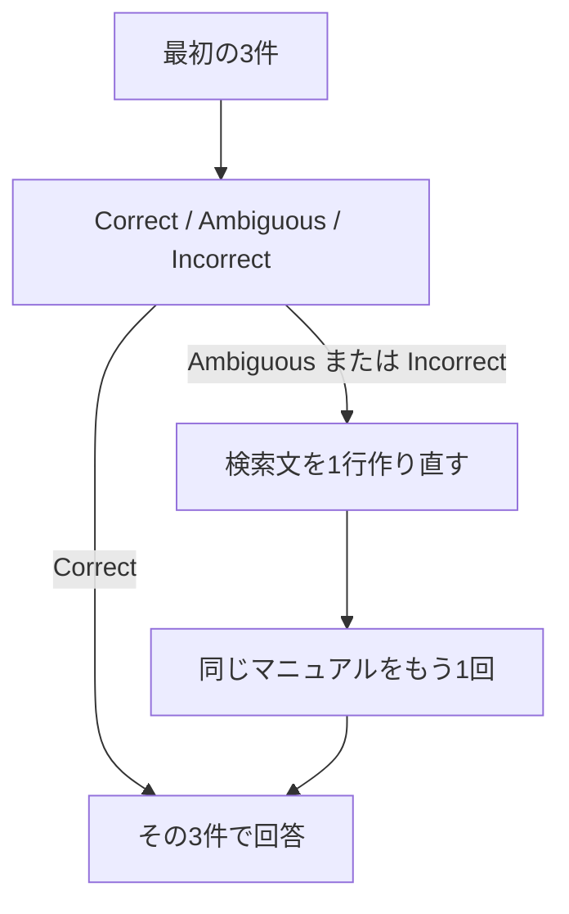

> クレジットカードの決済に失敗したままだと、いつタスクを編集できなくなりますか？

この章のために、マニュアルへ「支払いの失敗」を1件足しました。再登録した件数は 16 です。近い3件の1位は、その「支払いの失敗」で、距離は 0.2616 です。

渡した3件が質問の根拠になるかを選ぶと、Correct の確率は 1.0000 でした。検索は1回のままです。回答は、決済に失敗したまま14日を過ぎると、タスクが読み取り専用になる、です。

## 3件を見てから、足すかを決める



Jev の choice に、質問と取れた3件、3つの基準を渡します。返るのは、選ばれた名前と、各選択肢の確率です。

- Correct。必要な規定が、渡された文書に入っている
- Ambiguous。関連する情報はあるが、根拠として十分か判断しにくい
- Incorrect。話題は近いが、答えの規定が入っていない

Correct なら、その3件で答えます。Ambiguous か Incorrect なら、検索文を1行だけ書かせ、同じマニュアルをもう1回検索します。id が新しい文書だけを足してから答えます。追加は1回です。Jev は選ぶ役で、検索文は書きません。

第10章の、検索の前に回数を選ぶ処理とは別です。こちらは、検索したあとの3件を見ます。

マニュアルを再登録してから、2つの質問を実行します。

```bash
docker compose run --rm app index
docker compose run --rm app retry
```

リクエストのモデルは `jev-latest`、応答のモデルは `jev-1.14.0` です。再登録は 16 件で、読み戻しも一致しています。

## 支払いの失敗は、最初の3件で足りた

足した規定は、次の文です。

> クレジットカードの決済に失敗したまま14日を過ぎると、タスクは読み取り専用になります。支払いが完了すると、編集できるように戻ります。

| | 毎回検索 | 判定あり |
|---|---|---|
| 検索 | 1回 | 1回 |
| 判定 | なし | Correct（1.0000） |
| 回答 | 14日を過ぎると読み取り専用 | 同じ内容 |
| 回答生成の入力 | 214トークン | 214トークン |


毎回検索は 650 ミリ秒で、回答生成は出力 39 トークン、1164 ミリ秒です。判定は、入力 631 トークン、207 ミリ秒です。Ambiguous と Incorrect の確率は、どちらも 0.0000 で、confidence は 1.0000 です。判定ありの回答生成は、出力 37 トークン、1682 ミリ秒です。

**必要な規定が1位にあったので、検索の作り直しは呼ばれていません。**

## 解約月の日割りも、3位に入っていた

質問は「Standardプランを月の途中で解約したら、日割りになりますか？」です。1位は「プラン変更時の日割り」で距離 0.2862、3位は「退会後の請求」で距離 0.3869 です。

判定は Correct で、確率は 0.9800 です。Ambiguous は 0.0100、Incorrect は 0.0100、confidence は 0.9700 です。判定は、入力 625 トークン、151 ミリ秒です。

| | 毎回検索 | 判定あり |
|---|---|---|
| 検索 | 1回 | 1回 |
| 渡した文書 | 上の3件 | 同じ3件 |
| 回答 | 日割りにならず、解約した月は満額 | 同じ内容 |
| 回答生成の入力 | 214トークン | 214トークン |


毎回検索の回答生成は、出力 35 トークン、842 ミリ秒です。判定ありは、出力 37 トークン、1103 ミリ秒です。検索は 649 ミリ秒と 717 ミリ秒でした。

**3位に「退会後の請求」が入っていたので、こちらも検索は1回のままです。** 1位が別の日割り規定でも、必要な規定が3件の中にあれば Correct になります。

この2問では、作り直しの分岐には入っていません。最初の3件を足りると判定したためです。足りないときに別の見出しを足せるかは、この実行では分かっていません。見る対象は、生成した文の前にある3件です。生成した回答が文書の記載から外れるかは、この次に扱います。

:::details 結果の出典と条件
上の確率、トークン、時間、回答は、このリポジトリで `docker compose run --rm app retry` を実行したログです。小数は第4位までです。その前の `docker compose run --rm app index` では、ベクトル化が 715 トークン、1638 ミリ秒、件数は 16、期待値も 16、読み戻しは一致でした。第10章までの実行は、この1件を足す前の15件です。質問のベクトル化は、支払いの失敗が 39 トークン、解約の日割りが 26 トークンです。

[JevでRAGの検索失敗を検知・修正する！Corrective RAGを実装してみた](https://qiita.com/koji0705/items/ce8dc8c41ac10b38fc9b) は、別の候補での対照です。そちらの支払い失敗は Correct で、選択確率は Correct 0.43、Incorrect 0.36、回答生成の入力トークンはどちらも 308 でした。解約の日割りは Incorrect で、作り直した検索文は「解約した月の料金はどうなりますか」です。追加されたのは「退会後の請求」で、回答は「分からない」から満額へ変わり、入力トークンは 287 と 367 でした。本書の16件では、解約の日割りも最初の3件に「退会後の請求」があり、判定は Correct 0.9800 です。作り直しは実行していません。

手法の参照先は [Corrective Retrieval Augmented Generation](https://arxiv.org/abs/2401.15884) です。原論文には Web 検索と、文書を精練する処理があります。この章は、同じマニュアルをもう1回検索する部分だけを、Jev の choice で行う簡易な実装です。
:::
