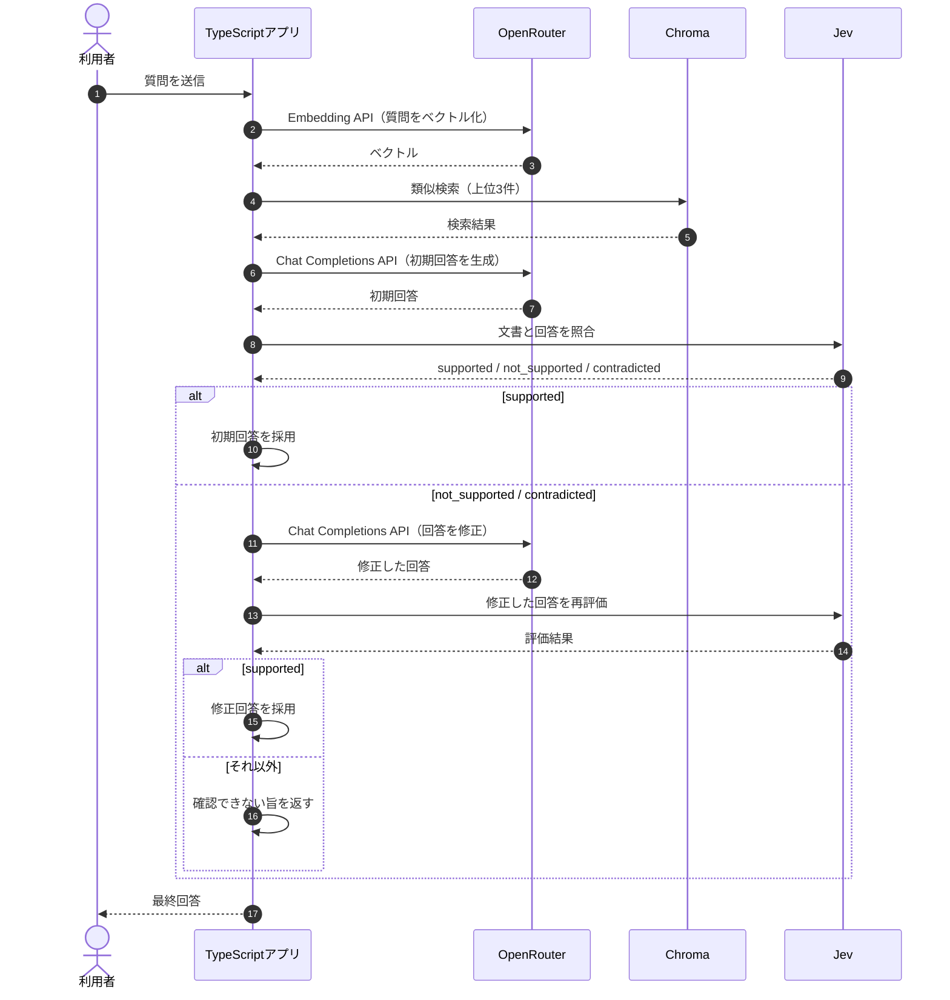

## Self-RAGとは？

**Self-RAG（Self-Reflective Retrieval-Augmented Generation）とは、検索した文書や生成した回答を評価し、その結果を生成処理に反映するRAGです。** 通常のRAGでは検索結果をLLMへ渡して回答を生成しますが、Self-RAGでは検索の必要性や取得文書の関連性、回答が根拠に基づいているかなども判断します。

原論文では、LLM自身がReflection Tokenと呼ばれる特殊なトークンを生成し、検索や回答の評価を制御します。本書ではモデルを追加学習せず、**Jevに回答の評価を任せ、必要に応じてOpenRouterで書き直す簡易版**を実装します。


## ① 今回の実験内容

TaskFlowのマニュアルには、次の規定があります。

> 退会完了から30日後にデータを削除します。

しかし、LLMが「退会完了から90日後に削除します」と回答したら、マニュアルの内容と矛盾します。今回は、このような回答をJevで検出し、修正できるかを確認します。

| 項目 | 内容 |
|---|---|
| 質問 | 退会後、データはいつ削除されますか？ |
| マニュアル | 退会完了から30日後 |
| 初期回答 | 退会完了から90日後 |
| 期待する結果 | 矛盾を検出し、30日後に修正 |

※ 初期回答の「90日後」は、検証のために固定した誤答です。実際のLLMが生成した誤答ではありません。自然に誤答が発生するのを待たず、修正処理を確実に検証するために用意しました。

## ② 処理の流れ

今回の実装では、回答を生成した後、Jevに文書との整合性を評価させます。根拠がない、または矛盾している場合はOpenRouterで一度だけ修正し、再評価します。



Jevは回答を評価し、OpenRouterは回答の生成・修正を担当します。評価結果から処理を切り替えるのはTypeScriptアプリです。なお、今回の固定誤答実験ではChroma検索と初期回答の生成を省略し、文書と固定誤答を直接Jevへ渡します。

## ③ Jevで回答を評価する

`app/src/models.ts`では、次の判断基準を定義しています。

```typescript
export const SUPPORT_INSTRUCTIONS =
  "生成した回答は、渡された文書の記載に基づいているか";

export const SUPPORT_CRITERIA = {
  supported: "回答の主張が、渡された文書の記載で裏付けられる",
  not_supported: "回答の主張を、渡された文書から裏付けられない",
  contradicted: "回答の主張が、渡された文書の記載と食い違う",
} as const;
```

| 評価結果 | 意味 |
|---|---|
| `supported` | 文書に根拠がある |
| `not_supported` | 文書から裏付けられない |
| `contradicted` | 文書と回答が矛盾している |

実装は`app/src/verify-fixture.ts`です。Jevには質問・文書・回答をまとめて渡します。

```typescript
const result = await chooseOption(
  `${user}\n\n回答:\n${answer}`,
  SUPPORT_INSTRUCTIONS,
  { ...SUPPORT_CRITERIA },
);
```

**Jevへのリクエスト**

```json
{
  "model": "jev-latest",
  "state": "質問:\n退会後、データはいつ削除されますか？\n\n文書:\n見出し: 退会後のデータ削除\n退会\n退会後のデータ削除\n退会完了から30日後にデータを削除します。\n\n回答:\n退会完了から90日後にデータを削除します。",
  "questions": {
    "decision": {
      "type": "choice",
      "instructions": "生成した回答は、渡された文書の記載に基づいているか",
      "criteria": {
        "supported": "回答の主張が、渡された文書の記載で裏付けられる",
        "not_supported": "回答の主張を、渡された文書から裏付けられない",
        "contradicted": "回答の主張が、渡された文書の記載と食い違う"
      }
    }
  }
}
```

**Jevの判断結果（保存ログからの抜粋）**

```json
{
  "choice": "contradicted",
  "probabilities": {
    "supported": 0,
    "not_supported": 0.01,
    "contradicted": 0.99
  },
  "confidence": 0.98
}
```

Jevは`contradicted`を選択しました。マニュアルは30日後なのに、回答は90日後としているためです。`probabilities`は評価の選択肢に対する値であり、回答の正解確率ではありません。

## ④ OpenRouterで回答を書き直す

`contradicted`または`not_supported`の場合、アプリはOpenRouterへ修正を依頼します。

```typescript
const revised = await completeAnswer(
  `${user}\n\n直前の回答:\n${VERIFY_FIXTURE_ANSWER}`,
  REVISE_INSTRUCTION,
);
```

LLMへのシステム指示は次のとおりです。

```text
渡された文書の記載に合うように、回答を1回だけ書き直してください。文書に無いことは書かず、確認できなければ「マニュアルからは確認できません」と書いてください。
```

ユーザー文には、質問・マニュアル・直前の回答を渡します。

```text
質問:
退会後、データはいつ削除されますか？

文書:
見出し: 退会後のデータ削除
退会
退会後のデータ削除
退会完了から30日後にデータを削除します。

直前の回答:
退会完了から90日後にデータを削除します。
```

**修正後の回答**

```text
退会完了から30日後にデータを削除します。
```

マニュアルと一致する回答になりました。ただし、書き直しただけでは採用せず、再度Jevで評価します。

## ⑤ 修正した回答を再評価する

修正後の回答をJevへ送った結果、次の評価が返ってきました。

```json
{
  "choice": "supported",
  "probabilities": {
    "supported": 1,
    "not_supported": 0,
    "contradicted": 0
  },
  "confidence": 1
}
```

実際のコードでは、再評価が`supported`だった場合だけ修正文を採用します。

```typescript
const second = await judge(revised.text, "second");

field("final_source", second === "supported" ? "revised" : "unconfirmed");
field(
  "final_answer",
  second === "supported" ? revised.text : UNCONFIRMED_ANSWER,
);
```

| 段階 | 回答 | Jevの判断 |
|---|---|---|
| 初期回答（固定誤答） | 90日後 | contradicted |
| 修正後の回答 | 30日後 | supported |

**Jevによる評価 → OpenRouterによる修正 → Jevによる再評価**という処理を確認できました。修正は最大1回で、再評価でも根拠を確認できなければ「マニュアルからは確認できません」を返します。

## ⑥ 実行して結果を確認する

固定した誤答を使った検証は、次のコマンドで実行できます。

```bash
docker compose run --rm app verify-fixture
```

このコマンドでは、実際のマニュアルから「退会後のデータ削除」を読み込み、初期回答だけを90日後に固定します。Chromaへの登録は不要ですが、JevとOpenRouterのAPIキーは必要です。

一方、通常のRAGで回答を生成してから検証する場合は、次のコマンドを使います。

```bash
docker compose run --rm app verify
```

こちらはChromaへのマニュアル登録が必要です。通常の`verify`では、検索した文書からOpenRouterが初期回答を生成し、その回答をJevで評価します。

**通常の回答検証の保存ログ（16チャンク時点）**

| 質問 | 初期回答 | Jevの判断 | 処理 |
|---|---|---|---|
| 退会後のデータ削除 | 30日後 | supported | 修正なし |
| 有料で90日間延長できるか | 分からない | not_supported | 1回修正 |


削除時期の質問では、最初の回答がマニュアルと一致していたため修正は行われませんでした。一方、保存期間の延長については、最初の「分からない」が`not_supported`と判定され、「マニュアルからは確認できません。」という回答に修正されました。

しかし、元の回答も延長の可否を断定していません。**評価器の判断によって、必ずしも修正が必要ではない回答まで書き直す可能性がある**ことも確認できました。

## 原論文のSelf-RAGとは何が違う？

今回の実装は、Self-RAGの「回答を評価して生成結果を改善する」という考え方に焦点を当てています。ただし、原論文の仕組みをそのまま再現したものではありません。

| 項目 | 原論文のSelf-RAG | 今回の簡易実装 |
|---|---|---|
| 評価の仕組み | 学習済みモデルがReflection Tokenを生成 | 外部のJevが`choice`を返す |
| 検索の制御 | 生成中に検索の必要性を判断できる | 最初にChromaを検索する |
| 回答の評価 | 生成内容の関連性・根拠などを評価 | 文書による裏付けを評価 |
| 改善方法 | 評価を生成・選択に反映する | 不十分ならLLMで1回書き直す |

つまり、本章は**Self-RAGの自己評価・改善の考え方を、JevとOpenRouterで実現した学習用の構成**です。

参考：[Self-RAG原論文・公式サイト](https://selfrag.github.io/)

## Self-RAGで回答の正しさは保証できる？

今回の検証では、90日後という誤答を検出し、30日後へ修正できました。しかし、これだけでさまざまな誤答の検出率が高いと判断できるわけではありません。

また、今回の基準は「回答が文書に裏付けられるか」です。「満額・30日後」と書けていても、質問がプランと金額も求めていたら、回答として十分でしょうか。書かれた内容に根拠があることと、必要な項目をすべて答えていることは別です。

人間が分けておきたいケースは次のとおりです。これは期待する区別であり、この表の行を実モデルが判定した件数ではありません。90日を30日へ直した行だけが、既存の `verify-fixture` で確認済みです。

| ケース | 文書と回答 | 分けたいこと |
|---|---|---|
| 削除30日を30日と答える | 一致 | 根拠あり。修正しない |
| 本文30日に90日と答える | 矛盾 | 既存の固定誤答 |
| 延長の規定がないのに延長できると断定する | 裏付けなし | 断定した誤答 |
| 規定がないので確認できないと答える | 適切な断り | 断定とは別 |
| 4つの情報があるのに金額を書かない | 金額が欠ける | 書いた部分の根拠と、網羅は別 |
| 980円をProの料金として答える | 対応が違う | 本文にある金額でも、対象が違えば誤り |
| 「12,000円ではありません」 | 否定 | 文字を含むだけでは根拠ありにしない |
| 30日と書けるのに確認できないと答える | 不適切な断り | 答えられるのに答えていない |

## まとめ

今回は、**Self-RAGの考え方を取り入れ、Jevで回答を評価し、必要ならOpenRouterで書き直す簡易実装**を検証しました。固定した誤答では、90日後という矛盾を検出し、30日後へ修正できました。

ただし、評価器自体が判断を誤る可能性があり、回答の完全性も保証されません。次章では、**文書の階層をたどりながら必要な情報を探すDecisionRAG**を学びます。
