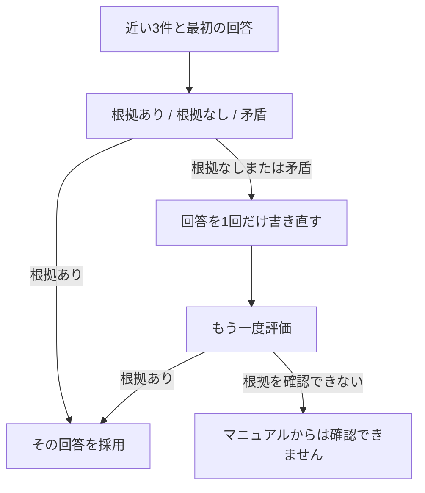

> 退会後のデータ保存期間を、有料で90日間に延長できますか？

マニュアルに、その規定はありません。近い3件の1位は「退会後のデータ削除」で、距離は 0.3577 です。最初の回答は「分からない」でした。

その回答を文書と一緒に渡すと、選ばれたのは根拠なしで、確率は 0.8900 です。1回だけ書き直すと「マニュアルからは確認できません。」になり、再評価では根拠ありが 0.5300、根拠なしが 0.4200 でした。confidence は 0.3000 です。

**断り方を変えただけで、判定は割れています。** 90日に延長できる、という断定はこの実行には出ていません。

## 回答を作ったあとで、記載と照らす



Jev の choice に、質問、渡した3件、生成した回答を渡します。3つの基準は、次の意味です。

- 根拠あり。回答の主張が、渡された文書の記載で裏付けられる
- 根拠なし。回答の主張を、渡された文書から裏付けられない
- 矛盾。回答の主張が、渡された文書の記載と食い違う

根拠ありなら、その回答を採用します。それ以外は、文書に合うように1回だけ書き直させ、もう一度同じ基準で評価します。2回目も根拠ありでなければ、書き直した文は採用せず、「マニュアルからは確認できません」を返します。検索の取り直しはしません。

第11章が見るのは、検索した3件に必要な規定があるかです。この章が見るのは、そのあとで生成した文です。

```bash
docker compose run --rm app verify
```

リクエストのモデルは `jev-latest`、応答のモデルは `jev-1.14.0` です。

## 延長の質問は、断りが2回とも残った

近い3件は「退会後のデータ削除」「退会後の請求」「退会できる人」です。

| | 最初の回答 | 書き直し |
|---|---|---|
| 文 | 分からない | マニュアルからは確認できません。 |
| 判定 | 根拠なし 0.8900 | 根拠あり 0.5300 |
| 回答生成の入力 | 189トークン | 219トークン |


最初の回答生成は、出力 4 トークン、928 ミリ秒です。評価は、入力 590 トークン、217 ミリ秒です。根拠ありは 0.0800、矛盾は 0.0300、confidence は 0.8300 でした。書き直しは、出力 10 トークン、892 ミリ秒です。再評価は、入力 601 トークン、178 ミリ秒で、矛盾は 0.0500 です。

採用したのは書き直した文です。検索結果には延長の規定が無いので、書き直しても「延長できる」は出てきていません。再評価の confidence は 0.3000 で、根拠なしとの差は小さくなっています。

## 削除時期は、30日後のまま

質問は「退会後、データはいつ削除されますか？」です。1位は「退会後のデータ削除」で、距離は 0.1920 です。最初の回答は「退会完了から30日後にデータを削除します。」でした。

判定は根拠ありで、確率は 1.0000 です。根拠なしと矛盾は 0.0000、confidence は 1.0000 です。評価は、入力 617 トークン、155 ミリ秒です。書き直しは呼ばれていません。


回答生成は、入力 201 トークン、出力 17 トークン、818 ミリ秒です。

**文書に書いてある30日後は、この評価ではそのまま残ります。** 見る対象は生成した文なので、最初の3件に無い規定を、この処理で増やすことはありません。

:::details 結果の出典と条件
上の確率、トークン、時間、回答は、このリポジトリで `docker compose run --rm app verify` を実行したログです。小数は第4位までです。質問のベクトル化は、延長が 28 トークン、895 ミリ秒、削除時期が 17 トークン、729 ミリ秒です。書き直しは最大1回です。2回目の判定が根拠ありのときだけ、書き直した文を採用します。

[JevでRAGの回答を自己評価する！Self-RAGを実装してみた](https://qiita.com/koji0705/items/805b1c5260df06477449) は、別の候補での対照です。そちらの本文は、判定ログの確認を残しています。本書では、その数値をこの実行の結果としては使いません。

手法の参照先は [Self-RAG](https://selfrag.github.io/) です。原論文は、検索や評価を制御するトークンを学習します。この章は、生成した回答の根拠を Jev の choice で見る簡易な実装です。
:::
