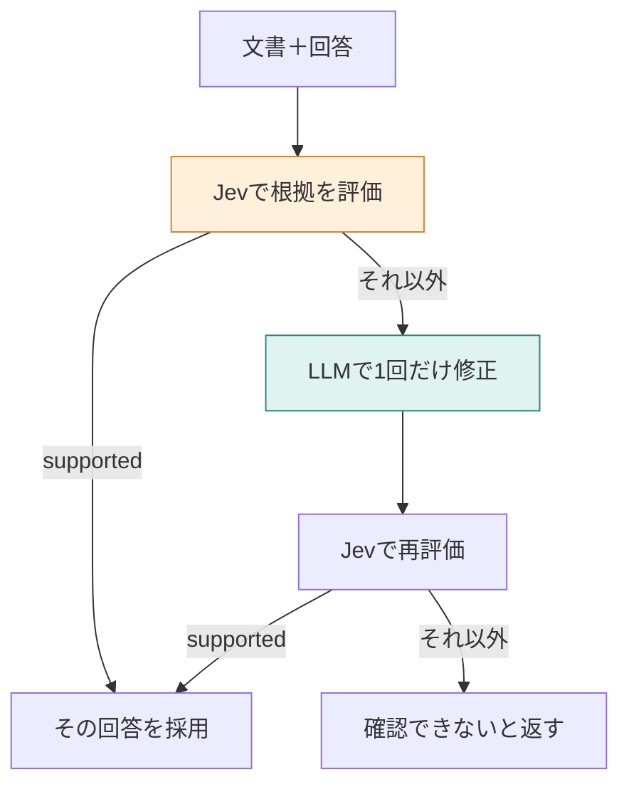

**この章では、検索後に作った回答を、元の文書と照合します。** 根拠の文書が取れていても、生成した文がその内容と合うとは限りません。誤答を意図的に与える実験と、通常の回答を確認する実験で、評価・書き直し・再評価の分岐を追います。



## 文書は正しくても、回答だけが間違う場合を作る

質問は「退会後、データはいつ削除されますか？」です。文書には「退会完了から30日後」とあります。もし回答が「90日後」なら、文書と食い違っています。

自然に誤答が出るのを待つと、検証したい分岐を毎回試せません。そこで、**初期回答だけを固定した検証用データ**を使います。LLMがこの誤答を生成した実験ではありません。

| 入力 | 内容 | 出所 |
|---|---|---|
| 文書 | 退会完了から30日後にデータを削除します。 | 実際のマニュアル |
| 初期回答 | 退会完了から90日後にデータを削除します。 | 検証用に固定した誤答 |
| 期待する動き | 矛盾を検出 → 書き直す → 30日後を採用 | 実験の成功条件 |

[環境構築](./02-setup)後、次で再現できます。外部APIは使いますが、検索を挟まず1件の文書を使うので、Chromaへの登録は不要です。

```bash
docker compose run --rm app verify-fixture
```

実装は `app/src/verify-fixture.ts` です。通常の `verify` と同じ評価基準・修正指示を使い、初期回答だけを固定しています。

## STEP 1：回答の主張と文書の記載を比較させる

Jevに送るリクエストです。認証情報を除きます。

```json
{
  "model": "jev-latest",
  "state": "質問:\n退会後、データはいつ削除されますか？\n\n文書:\n見出し: 退会後のデータ削除\n退会\n退会後のデータ削除\n退会完了から30日後にデータを削除します。\n\n回答:\n退会完了から90日後にデータを削除します。",
  "questions": {
    "decision": {
      "type": "choice",
      "instructions": "生成した回答は、渡された文書の記載に基づいているか",
      "criteria": {
        "supported": "回答の主張が、渡された文書の記載で裏付けられる",
        "not_supported": "回答の主張を、渡された文書から裏付けられない",
        "contradicted": "回答の主張が、渡された文書の記載と食い違う"
      }
    }
  }
}
```

検索結果が十分かを見るときと違い、`state` に**実際に採用しようとしている回答文**を含めています。同じ文書でも、回答の内容が変われば評価対象が変わります。

2026年11月11日の実行ログから、使った値を取り出すと次のとおりでした。

```json
{
  "choice": "contradicted",
  "probabilities": { "supported": 0, "not_supported": 0.01, "contradicted": 0.99 },
  "confidence": 0.98
}
```

`contradicted` が選ばれたので修正へ進みます。0.99はこの基準での選択肢の値で、システム全体が99%正答するという意味ではありません。`confidence` の閾値で修正するかを決める実装でもありません。

## STEP 2：LLMへ、文書と直前の回答を渡す

修正するモデルは `openai/gpt-4.1-mini` です。システム文を次に切り替えます。

```text
渡された文書の記載に合うように、回答を1回だけ書き直してください。文書に無いことは書かず、確認できなければ「マニュアルからは確認できません」と書いてください。
```

ユーザー文の全文です。

```text
質問:
退会後、データはいつ削除されますか？

文書:
見出し: 退会後のデータ削除
退会
退会後のデータ削除
退会完了から30日後にデータを削除します。

直前の回答:
退会完了から90日後にデータを削除します。
```

返った修正文は次のとおりです。

```text
退会完了から30日後にデータを削除します。
```

Jevに文章を書かせたのではありません。Jevは評価、LLMは書き直し、コードは呼び出す順番を担当します。一般にLLMが評価できないという意味ではなく、このアプリでの役割分担です。

## STEP 3：書き直しただけで採用せず、もう一度評価する

同じ質問・文書に、修正文を組み合わせて再評価します。

```json
{
  "choice": "supported",
  "probabilities": { "supported": 1, "not_supported": 0, "contradicted": 0 },
  "confidence": 1
}
```

コードは `supported` のときだけ修正文を採用します。もう一度修正するループはありません。

```typescript
field("final_source", second === "supported" ? "revised" : "unconfirmed");
field(
  "final_answer",
  second === "supported" ? revised.text : UNCONFIRMED_ANSWER,
);
```

| 段階 | 回答 | 判定 | コードの動き |
|---|---|---|---|
| 固定した初期回答 | 90日後 | contradicted | 修正を依頼 |
| LLMの修正後 | 30日後 | supported | 修正文を採用 |

この実験では、日数の矛盾を検出し、文書にある30日へ直して採用するまで動きました。既知の誤答1件を使った動作確認であり、自然な誤答全般の検出率を測った結果ではありません。

## 通常の回答では、直す必要のない文まで評価が割れる

通常の検索から確認するコマンドも残しています。登録後、次を実行します。

```bash
docker compose run --rm app verify
```

こちらは16節時点の保存ログです。現在の18節や、先ほどの固定誤答実験とは分けます。

| 質問 | 最初の回答 | 初回の判定 | その後 |
|---|---|---|---|
| 削除時期 | 退会完了から30日後にデータを削除します。 | supported 1.0000 | 修正しない |
| 有料で90日延長できるか | 分からない | not_supported 0.8900 | 「マニュアルからは確認できません。」へ修正 |

延長の規定はマニュアルにありません。最初の「分からない」も、延長できるとは断定していません。それでも根拠なしとなり、書き直した断り文は `supported` 0.5300、`not_supported` 0.4200、`contradicted` 0.0500でした。`confidence` は0.3000です。


この場合、事実の誤りを直したわけではなく、断り方が変わっただけです。**評価器も、確認できないという回答をどう扱うかで揺れます。** この基準をそのまま採用すると、適切な断りにも余分な修正をかける可能性があります。

## 根拠があることと、質問に十分答えたことを分ける

この判定は、書いた主張を文書で裏付けられるかを見ます。質問が複数項目を求めているときに、すべて答えたかを直接確認する基準ではありません。

例えば、料金と削除時期を聞かれて「30日後に削除」とだけ回答した場合、書かれた文は正しくても、金額が抜けています。[第14章](./14-hop)では、根拠文書に12000円があっても、回答から金額が抜ける例を見ます。

:::details 考えてみる：修正後がnot_supportedなら、もっと書き直す？
本章のコードは一度で止め、固定文「マニュアルからは確認できません」を返します。文書にない事実を、修正回数を増やして埋めることはできません。情報の不足なら検索側、書き落としなら完全性の確認、と原因に合わせて変えます。
:::

採用を考えるなら、正しい回答、矛盾する回答、根拠のない回答、適切な断り、項目が抜けた回答を分けて評価します。今回確認したのは固定誤答1件の修正と、通常の2問の挙動までです。

:::details 計測条件と出典
追加実験のログはリポジトリの `docs/logs/verify-fixture.txt` に保存しています。Jevは指定 `jev-latest`、応答 `jev-1.14.0`。初回・再評価とも入力501トークン。修正は `openai/gpt-4.1-mini`、入力146・出力17トークンでした。検索と最初の回答生成を省いた実験なので、通常のRAG全体の費用とは比較しません。

通常の `verify` 保存ログでは、延長の初回評価590トークン・217ミリ秒、修正219入力・10出力トークン・892ミリ秒、再評価601トークン・178ミリ秒です。削除時期の評価は617トークン・155ミリ秒でした。

[Self-RAG原論文の公式解説](https://selfrag.github.io/)では、検索や評価を制御する特殊トークンを学習します。本章は、外部のJevで回答を評価する簡易な構成です。[著者のSelf-RAG記事](https://qiita.com/koji0705/items/805b1c5260df06477449)の結果を、本章の追加実験には使っていません。
:::
