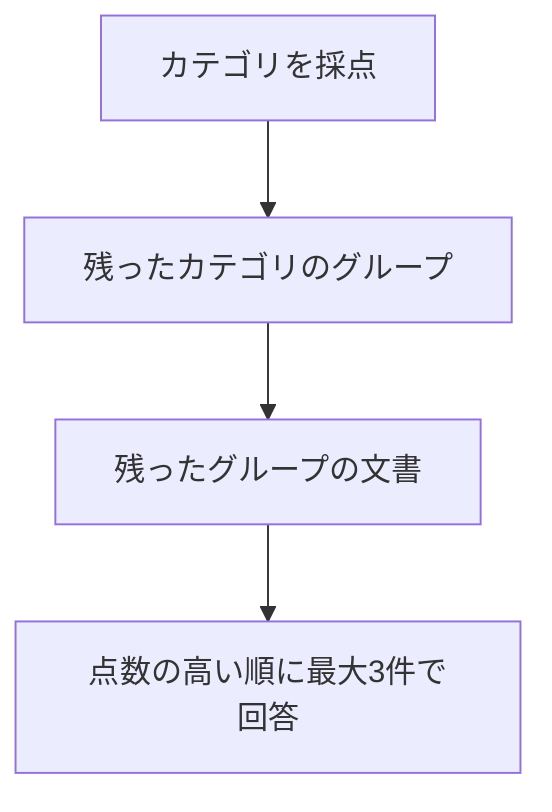

> Standardプランを月の途中で解約したら、日割りになりますか？

近い3件で答えると、3位に「退会後の請求」があり、回答は満額です。階層を上から降りると、残ったカテゴリは「請求」で 1.2700、「退会」は 1.2600 でした。差は 0.0100 です。「退会後の請求」には届かず、回答は「分からない」になりました。

**上の段で残らなかった枝の文書は、そのあと採点されません。**

## カテゴリ、グループ、文書の順に残す



階層は、見出しへ手で付けたものです。モデルには作らせていません。

- アカウント: 認証
- 請求: 請求時期、日割り、プラン、支払い
- 退会: 手続き、退会後

各段の点数は、基準の何段目かです。4段の3段目、番号でいう 2 は「答えの一部を裏付ける」です。カテゴリとグループは 2 以上を残します。2以上が0件なら、その段で一番高い候補を1件だけ残します。同点のときは、マニュアルの並びで先の1件です。この実行に同点はありません。文書の段は、2未満でも落とさず、高い順に最大3件を渡します。

```bash
docker compose run --rm app descend
```

リクエストのモデルは `jev-latest`、応答のモデルは `jev-1.14.0` です。

## 削除時期は、一番高い枝で届いた

質問は「退会後、データはいつ削除されますか？」です。カテゴリは、アカウント 0.8700、請求 0.2300、退会 1.2800 で、どれも 2 未満です。残したのは一番高い「退会」です。その中のグループも 2 未満で、手続き 1.0800、退会後 1.3100 のうち「退会後」を残しました。

文書は「退会後のデータ削除」が 3.0000、「退会前の書き出し」が 0.9700、「退会後の請求」が 0.6400 です。回答は「退会完了から30日後にデータが削除されます。」で、近い3件の「退会完了から30日後にデータを削除します。」と同じ内容です。


近い3件の回答生成は、入力 201 トークン、出力 17 トークン、773 ミリ秒です。階層の回答生成は、入力 191 トークン、出力 18 トークン、980 ミリ秒です。評価は別に、カテゴリが 1367 トークン・485 ミリ秒、グループが 871 トークン・314 ミリ秒、文書が 1291 トークン・474 ミリ秒です。

**2以上が無い段でも、一番高い候補を1件残したので、削除の規定まで降りられました。**

## 解約の日割りは、0.0100 で枝が分かれた

近い3件は「プラン変更時の日割り」「Standardプランの月額」「退会後の請求」です。回答生成は、入力 214 トークン、出力 35 トークン、919 ミリ秒で、日割りにならず満額、と答えています。

階層のカテゴリは、アカウント 0.5500、請求 1.2700、退会 1.2600 です。2以上は無く、残ったのは「請求」です。「退会」の 1.2600 はここで止まります。請求のグループも 2 未満で、残ったのは「日割り」の 1.2400 です。その文書は「プラン変更時の日割り」1.1300 と「日割り請求のルール」1.0600 の2件で、回答は「分からない」です。回答生成は、入力 183 トークン、出力 4 トークン、599 ミリ秒です。


評価は、カテゴリが 1394 トークン・691 ミリ秒、グループが 1746 トークン・632 ミリ秒、文書が 929 トークン・310 ミリ秒です。

渡した2件は、契約開始とプラン変更の日割りです。解約した月が満額だとは書いてありません。必要な「退会後の請求」は、カテゴリの 0.0100 の差で採点対象から外れています。

:::details 結果の出典と条件
上の点数、トークン、時間、回答は、このリポジトリで `docker compose run --rm app descend` を実行したログです。小数は第4位までです。採用の下限は2で、実行後に変えていません。質問のベクトル化は、削除時期が 17 トークン、860 ミリ秒、解約の日割りが 26 トークン、663 ミリ秒です。階層の評価には含めていません。

[Jevで文書の階層構造を探索する！DecisionRAGを実装してみた](https://qiita.com/koji0705/items/b07a635fe9f2c448febf) は、別の候補での対照です。そちらの削除時期は、退会から退会後を経てデータ削除に届き、回答生成の入力トークンは 343 と 272 でした。解約の日割りでは、カテゴリ「退会」が 1.94 で基準の2を下回り、別の呼び出しでは 2.01 でした。どちらの回答も「分からない」で、入力トークンは 303 と 240 です。本書の16件では、解約の日割りの近い3件に「退会後の請求」があり、毎回検索の回答は満額です。階層では請求 1.2700、退会 1.2600 で、退会の文書は採点していません。
:::
