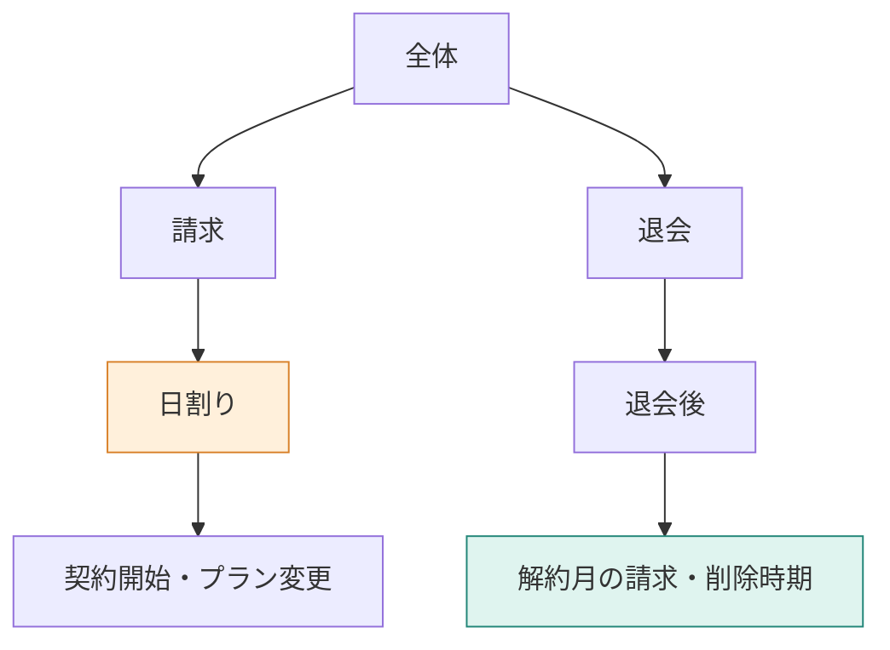

**この章では、カテゴリ、グループ、本文の順に探索する範囲を決めます。** 全文を一度に評価する代わりに、上位の案内から必要そうな枝へ降ります。削除の規定に届く例と、解約の規定を途中で失う例から、階層の便利さと枝を捨てる判断の難しさを学びます。



## 資料の目次から、読む場所を決める

分厚いマニュアルなら、最初から全ページを読む代わりに「退会 → 退会後 → データ削除」と目次をたどれます。この章では、その選択をJevによる採点で行います。

階層は `app/src/hierarchy.ts` の `MANUAL_GROUPS` に手で定義しています。モデルが自動で分類したものではありません。

| カテゴリ | グループ |
|---|---|
| アカウント | 認証 |
| 請求 | 請求時期、日割り、プラン、支払い |
| 退会 | 手続き、退会後 |

問い合わせは「退会後、データはいつ削除されますか？」と「Standardプランを月の途中で解約したら、日割りになりますか？」の2問です。成功条件は、それぞれの規定へ届き、30日後・満額と回答できることです。

[環境構築](./02-setup)と登録後、次を実行します。比較用のベクトル検索はChromaを使い、階層側はローカルのマニュアルをたどります。以下は16節時点の保存ログです。現在は18節で、プランのグループにも追加があります。

```bash
docker compose run --rm app descend
```

## STEP 1：カテゴリの採点には、本文を渡さない

上位で読むのは、カテゴリ名、グループ名、見出しの一覧です。削除時期の質問で「退会」を採点するときの `state` の全文は次のとおりです。

```text
質問:
退会後、データはいつ削除されますか？

カテゴリ: 退会
- 手続き: 退会できる人、退会の手続き、解約の取り消し
- 退会後: 退会後の請求、退会後のデータ削除、退会前の書き出し
```

Jevには `score` 型で、次の指示と基準を送ります。各段で同じ基準を使います。

```json
{
  "instructions": "この質問の答えは、渡された範囲にあるか",
  "criteria": [
    "この質問の答えには関係しない",
    "話題は近いが、答えの規定はここに無い",
    "答えの一部を裏付ける",
    "この質問への答えを直接判断できる"
  ]
}
```

ここでモデルが見ているのは「削除の規定がありそうな見出し」であり、30日という本文ではありません。本文を渡さないまま「裏付ける」という基準を使う点には、上位の採点が低くなりやすい可能性があります。

保存ログで返った `score` は次の値でした。

| カテゴリ | score |
|---|---:|
| アカウント | 0.8700 |
| 請求 | 0.2300 |
| 退会 | 1.2800 |

点数は0〜3の基準に対する値で、正答率ではありません。このログには段ごとの確率や `confidence` は記録していないので、補って解釈しません。

## STEP 2：2点以上がなければ、最高の1件を残す

カテゴリとグループの採用処理は次のとおりです。実装は `app/src/commands.ts` の `keepLevel` です。

```typescript
const passed = items.filter((item) => item.score >= HIERARCHY_MIN_SCORE);
const kept = passed.length > 0 ? passed : [highest(items)];
```

`HIERARCHY_MIN_SCORE` は2です。今回は全カテゴリが2未満なので、コードは最高点の「退会」を1件残します。モデルが1.2800を採用可と判断したのではなく、**0件で探索が止まらないよう、コードが最高点を残した**結果です。

この代替処理をフォールバックと呼びます。同点なら、並び順で先の1件です。

## STEP 3：グループ、本文へと、渡す情報を変える

「退会」の中の「退会後」を採点する `state` は次のとおりです。

```text
質問:
退会後、データはいつ削除されますか？

カテゴリ: 退会
グループ: 退会後
見出し: 退会後の請求、退会後のデータ削除、退会前の書き出し
```

「手続き」は1.0800、「退会後」は1.3100でした。また全候補が2未満なので、最高の「退会後」を残します。そこで初めて、残った3文書の本文を1件ずつ採点します。

```text
質問:
退会後、データはいつ削除されますか？

文書:
退会
退会後のデータ削除
退会完了から30日後にデータを削除します。
```

| 文書 | score |
|---|---:|
| 退会後のデータ削除 | 3.0000 |
| 退会前の書き出し | 0.9700 |
| 退会後の請求 | 0.6400 |

本文の段は2未満でも除外せず、点数順に最大3件を採用します。上位の枝を残す処理と、最後の文書を渡す処理は違います。

回答は「退会完了から30日後にデータが削除されます。」でした。ベクトル検索の上位3件で答えた側も、同じ30日後でした。

## 解約の質問では、最初の枝分かれで根拠を失った

解約月の日割りでは、カテゴリの点数が次のようになりました。

| カテゴリ | score | コードの動き |
|---|---:|---|
| アカウント | 0.5500 | 外す |
| 請求 | 1.2700 | 全候補2未満なので、最高点を1件残す |
| 退会 | 1.2600 | 外す。その下の文書も対象外 |

差は0.0100です。その後は請求の「日割り」グループへ降り、「プラン変更時の日割り」1.1300と「日割り請求のルール」1.0600の2件で答えます。解約の規定はないので、回答は「分からない」でした。


一方、ベクトル側では「退会後の請求」が上位3件に入り、満額と回答しています。**同じ資料でも、根拠へ到達する経路が変わると、使える本文が変わります。**

## 失敗の原因を、モデルとコードに分ける

| 観測したこと | そこから言えること |
|---|---|
| 上位の入力は見出しだけ | その時点では本文の満額・30日を直接読めない |
| 全候補が2未満 | 閾値での採用ではなく、フォールバックが働いた |
| 最高の1件だけを残した | 小さな点差で「退会」の枝が失われた |
| 後続は残った枝だけを採点 | 文書の段で順位を直しても、外した枝は戻らない |

見出しと評価基準の噛み合わせが、低い点数の一因かもしれません。ただし、本文や要約を渡した対照実験はないので断定しません。確実なのは、この採点値を最高1件へ切り詰めるコードが「退会」を落としたことです。

:::details 考えてみる：全候補2未満のとき、上位2カテゴリを残したら？
このログの値をそのまま使えば、「請求」と「退会」が残り、退会後の請求を採点する経路は復活します。ただし、下位の点数や回答がどう変わるかは未実行です。読む範囲が広がる分、評価量も増えます。
:::

階層が安定し、目次や要約で所在を判断できる資料には検討の余地があります。複数カテゴリへまたがる質問が多いなら、最高1件に固定しないことや、ベクトル検索へ戻る経路を考えます。本章の短い16文書では、検索の基本形より優れているとは確認できていません。

:::details LLMへ渡した削除時期のユーザー文
回答モデルは `openai/gpt-4.1-mini`、指示は「渡された文書だけを根拠に答える」です。

```text
質問:
退会後、データはいつ削除されますか？

文書:
見出し: 退会後のデータ削除
退会
退会後のデータ削除
退会完了から30日後にデータを削除します。

見出し: 退会前の書き出し
退会
退会前の書き出し
退会が完了する前であれば、登録したデータを書き出せます。

見出し: 退会後の請求
退会
退会後の請求
解約した月の料金は満額です。日割りにはなりません。
```
:::

:::details 計測条件と出典
`descend` の16節時点の保存ログです。Jev指定 `jev-latest`、応答 `jev-1.14.0`。削除時期の評価入力はカテゴリ1367、グループ871、文書1291トークン。解約は1394、1746、929です。回答生成の入力は削除で基本形201・階層191、解約で基本形214・階層183トークンでした。回答入力の減少と、評価込みの総費用を分けて見ます。

[著者のDecisionRAG記事](https://qiita.com/koji0705/items/b07a635fe9f2c448febf)とは候補と点数が異なります。本章は手で定義した階層を使う簡易な探索です。
:::
