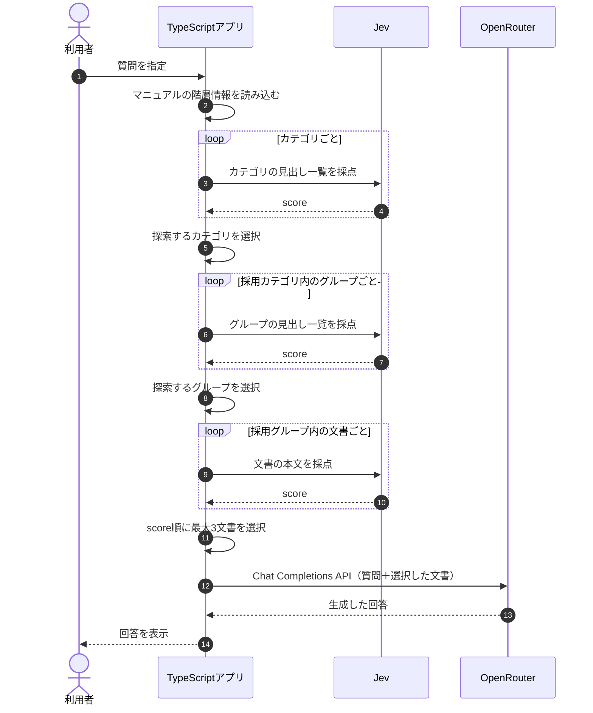

## DecisionRAGとは？

**DecisionRAGとは、文書を階層的に整理し、各階層で判断しながら必要な情報へたどり着く検索方法です。** これまでのRAGでは、質問をEmbeddingし、ベクトルDBから意味的に近い文書を取得していました。今回は、マニュアルの目次をたどるように、Jevでカテゴリやグループを評価しながら検索範囲を絞ります。

本書では、文書の階層をあらかじめTypeScriptで定義し、Jevの`score`機能で探索する場所を選ぶ簡易的なDecisionRAGを実装します。


## ① 今回の実験内容

TaskFlowのマニュアルを、次の3階層で管理します。

| 階層 | 内容 | 例 |
|---|---|---|
| 第1階層 | カテゴリ | 退会 |
| 第2階層 | グループ | 退会後 |
| 第3階層 | 文書 | 退会後のデータ削除 |

例えば、「退会後、データはいつ削除されますか？」という質問なら、**退会 → 退会後 → 退会後のデータ削除**とたどることで、必要な規定に到達できます。

今回は、次の2つの質問で検証します。

| 質問 | 正しい回答 |
|---|---|
| 退会後、データはいつ削除されますか？ | 退会完了から30日後 |
| Standardプランを月の途中で解約したら、日割りになりますか？ | 満額・日割りなし |

この階層は`app/src/hierarchy.ts`の`MANUAL_GROUPS`で手動定義しています。Jevが階層構造そのものを自動生成しているわけではありません。

## ② 処理の流れ

今回の実装では、最初にカテゴリを評価し、採用したカテゴリのグループを評価します。その後、残ったグループの文書を評価してLLMへ渡します。



今回は比較のために、通常のNaive RAGも先に実行します。Naive側ではOpenRouterのEmbedding APIとChromaを使用しますが、**DecisionRAG側の階層探索ではChromaを検索せず、ローカルのマニュアルとJevを使用します。**

## ③ Jevでカテゴリを評価する

実装は`app/src/commands.ts`の`descendQuestion()`です。まずマニュアルを階層に配置し、カテゴリごとの情報を作ります。

```typescript
const placed = placeChunks(await loadChunks());

const categories = uniqueNames(
  placed.map((item) => ({
    name: item.category,
    state: categoryState(question, item.category, placed),
  })),
);

const scoredCategories = await scoreLevel("category", categories);
const keptCategories = keepLevel("category", scoredCategories);
```

カテゴリを評価する段階では、本文の内容をJevへ渡しません。カテゴリ名、グループ名、文書の見出しを使って、その場所に答えがありそうか判断します。

例えば「退会」カテゴリを評価する場合、Jevに渡す`state`は次のとおりです。

```text
質問:
退会後、データはいつ削除されますか？

カテゴリ: 退会
- 手続き: 退会できる人、退会の手続き、解約の取り消し
- 退会後: 退会後の請求、退会後のデータ削除、退会前の書き出し
```

Jevへの採点基準は`app/src/models.ts`で定義しています。

```typescript
export const HIERARCHY_INSTRUCTIONS =
  "この質問の答えは、渡された範囲にあるか";

export const HIERARCHY_CRITERIA = [
  "この質問の答えには関係しない",
  "話題は近いが、答えの規定はここに無い",
  "答えの一部を裏付ける",
  "この質問への答えを直接判断できる",
] as const;
```

ここで重要なのは、**Jevは本文の「30日後」という規定をまだ読んでいない**という点です。見出しだけを手がかりに、どのカテゴリを詳しく調べるか判断しています。

## ④ スコアから探索するカテゴリを選ぶ

削除時期の質問では、Jevの評価結果は次のとおりでした。

| カテゴリ | Jevのscore |
|---|---:|
| アカウント | 0.8700 |
| 請求 | 0.2300 |
| **退会** | **1.2800** |

今回の採用基準は`score >= 2`です。しかし、すべてのカテゴリが2未満になりました。この場合、探索が完全に止まらないよう、スコアが最も高いカテゴリを1つ残します。

**`app/src/commands.ts`の`keepLevel()`からの抜粋**

```typescript
const passed = items.filter(
  (item) => item.score >= HIERARCHY_MIN_SCORE,
);

const kept = passed.length > 0
  ? passed
  : [highest(items)];
```

`HIERARCHY_MIN_SCORE`は`2`です。今回は2以上のカテゴリがなかったため、最高点の「退会」だけが残りました。

つまり、**Jevが1.28点を合格と判定したのではなく、TypeScriptのフォールバック処理が最高点のカテゴリを選んだ**ということです。

## ⑤ グループから文書へ進む

次に、「退会」カテゴリ内のグループを評価します。

| グループ | Jevのscore |
|---|---:|
| 手続き | 1.0800 |
| **退会後** | **1.3100** |

今回も2以上のグループがないため、最高点の「退会後」が選ばれました。続いて、このグループ内の文書を1件ずつJevへ送ります。

文書を評価する段階では、初めて本文の内容を渡します。

```text
質問:
退会後、データはいつ削除されますか？

文書:
退会
退会後のデータ削除
退会完了から30日後にデータを削除します。
```

**Jevの評価結果**

| 文書 | score |
|---|---:|
| **退会後のデータ削除** | **3.0000** |
| 退会前の書き出し | 0.9700 |
| 退会後の請求 | 0.6400 |

文書の段階では、スコアの高い順に最大3件を選びます。カテゴリやグループで使用した2点以上の条件は適用していません。

選択された文書をOpenRouterの回答生成APIへ渡した結果、次の回答が生成されました。

> 退会完了から30日後にデータが削除されます。

今回は、正しい文書までたどり着くことができました。

## ⑥ うまくいかなかったケースを確認する

次に、もう一つの質問を確認します。

> Standardプランを月の途中で解約したら、日割りになりますか？

正しい規定は「退会後の請求」ですが、カテゴリの評価結果は次のようになりました。

| カテゴリ | Jevのscore | 判定 |
|---|---:|---|
| アカウント | 0.5500 | 除外 |
| **請求** | **1.2700** | **採用** |
| 退会 | 1.2600 | 除外 |

「請求」と「退会」の差は、わずか**0.01**でした。しかし、すべて2点未満だったため、フォールバック処理によって最高点の「請求」だけが残りました。

その結果、アプリは「請求 → 日割り」の階層へ進み、次の文書を評価しました。

| 文書 | score |
|---|---:|
| プラン変更時の日割り | 1.1300 |
| 日割り請求のルール | 1.0600 |

どちらも解約した月の料金を定めた規定ではありません。そのため、最終回答は「分からない」になりました。


一方、Naive RAGでは「退会後の請求」が検索結果に含まれ、満額・日割りなしと回答できています。

**このケースでは、階層の最初の判断によって正しい文書が探索対象から外れてしまいました。**

## ⑦ 実行結果を比較する

次のコマンドで、2つの質問を実行します。

```bash
docker compose run --rm app descend
```

以下は16チャンク時点の保存ログです。

| 質問 | Naive RAG | DecisionRAG |
|---|---|---|
| 退会後のデータ削除 | 30日後 | 30日後 |
| 解約月の日割り | 満額・日割りなし | **分からない** |

削除時期の質問では、どちらの方法でも正しく回答できました。一方、解約月の日割りでは、DecisionRAGが最初の階層選択を誤り、必要な規定に到達できませんでした。

※ 現在のマニュアルは18チャンクです。上記は16チャンク時点の保存ログであり、再実行時のJevの評価値や結果は変わる可能性があります。

## DecisionRAGの課題は？

DecisionRAGでは、探索範囲を段階的に絞ることができます。しかし、**上位階層で正しいカテゴリを除外すると、その下にある文書には到達できなくなります。**

今回の実験では、特に次の2点が重要でした。

1. カテゴリやグループの評価には見出ししか渡していないため、本文を読まずに探索先を判断している
2. 2点以上の候補がない場合、最高点の1件だけを残す設計になっている

同じカテゴリ点数のまま2枝を残すと、何が増えるでしょうか。保存ログの点数（アカウント0.55、請求1.27、退会1.26）だけを使い、2点未満のときの残し方をオフラインで比べました。これは16チャンク時点の点数であり、18節で採点し直した値ではありません。

| 残し方 | 残るカテゴリ |
|---|---|
| 最高1件 | 請求 |
| 上位2件 | 請求、退会 |

上位2件なら退会の枝も残ります。その下の文書を採点し、回答が変わるかは、この確認では分かっていません。APIの再実行はしていません。探索範囲を広げるほど、追加で採点する文書も増えます。

今回の実装では、階層化によってNaive RAGより回答品質が改善することは確認できませんでした。むしろ、**Jevの判断だけでなく、そのスコアをどう扱うかというアプリ側の設計が重要**だと分かります。

## まとめ

DecisionRAGは、**文書の階層をたどり、各段階で評価しながら必要な情報を探す方法**です。今回の実験では、削除時期の規定には正しく到達できましたが、解約月の日割りでは0.01のスコア差によって正しいカテゴリを除外してしまいました。

階層を使えば探索範囲を絞れますが、途中の判断によって必要な情報を失う可能性もあります。次章では、**質問に答えるために不足している情報を順番に探していくMulti-hop RAG**を学びます。
