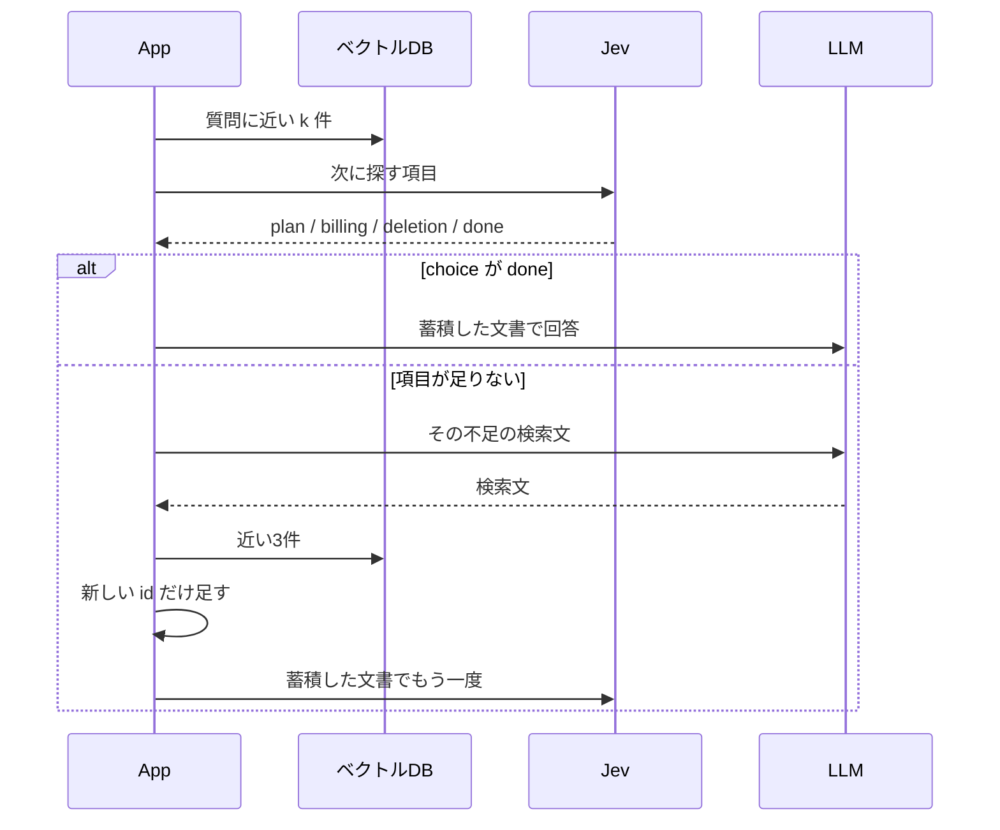

この章では、取得した文書から不足項目を選び、追加検索で根拠を蓄積します。一つの質問がプラン、金額、請求、削除にまたがると、近い3件だけでは足りないためです。**次に探す項目と、探索を終える条件の設計を学びます。** 条件を4情報へ具体化すると通常の3件からProと月額の文書まで集まりましたが、回答には12000円が抜けました。文書の充足と回答の充足を分けて確認します。


近い順の上位を選び直さず渡す基本形を、Naive RAGと呼びます。検索して回答する流れは [第6章 近い文書を渡して答える](./06-naive-rag)、起動と API キーは [第2章 環境構築](./02-setup) にあります。確認コマンドは `docker compose run --rm app hop` です。完了条件を4つの情報に変えた実行は `docker compose run --rm app hop-facts` で、数値は混ぜません。

## 近い3件には、プランの規定が無い

質問は、TaskFlow のマニュアルに対する次の1文です。

> SSOが使えるプランを月の途中で退会した場合、当月の請求額とデータ削除までの日数は？

マニュアルには、SSO が使えるのは Pro だけ、Pro の月額は 12000円（税別）、解約した月は満額、データは退会完了から30日後、と別々の見出しに書いてあります。この実行で近い3件を取ると、「退会後のデータ削除」「退会後の請求」「プラン変更時の日割り」でした。SSO の見出しも、Pro の月額も入っていません。

この3件を判定すると done でした。回答は満額と30日後で、どのプランが SSO かも、12000円かも書いていません。追加の検索は呼ばれていません。

1件だけにすると、残るのは「退会後のデータ削除」です。毎回検索は、請求額は文書から判断できない、削除は30日後、と分けて返しました。追加の検索は、この1件のあとで始まります。

## この実装では、次の項目を選ぶ役と、文を書く役が分かれる

Multi-hop RAG と呼ぶ処理のうち、今回実装する範囲は、同じマニュアルの中で、プラン、請求、削除の不足を探すことです。質問を任意の事実へ分解する処理も、別の情報源への検索もありません。基準は、この4つに固定しています。



この実装では、Jev は検索文も回答も書きません。LLM は、次の項目を選びません。一般に LLM が評価できない、という意味ではありません。検索を続けるかは、返った `choice` の名前を見るコードです。`done` ならそこで回答し、それ以外なら、その項目の説明を不足として渡して検索文を書かせます。検索は最初を含めて最大3回です。3回目が `done` でなければ、確認できない項目は推測させない指示に切り替えます。`hop` の実行は、最大回数に達していません。

質問のベクトル化は `openai/text-embedding-3-small`、検索文と回答は `openai/gpt-4.1-mini` です。Jev の指定モデルは `jev-latest` で、この実行の応答モデルは `jev-1.14.0` でした。

## 18件のマニュアルで、最初の件数を変える

この実行のログは、登録 18 件、空間 cosine です。見出しはアカウント、請求、退会で、支払いの失敗、Pro の月額、SSO を含みます。第6章の15件や、支払いの失敗を足した16件とは件数が違います。距離が近い質問があっても、条件を揃えた比較としては扱いません。この実行では再登録していません。

最初の件数は、SSO の質問が3と1、削除時期の質問が3です。追加の検索は、どの場合も3件です。同じ id は重ねません。

見たい結果は二つです。

1. 必要な項目が最初の件数の外にあるとき、`done` 以外が選ばれ、足した文書で回答の一部が変わる
2. 1項目の質問では `done` で止まり、追加の検索が走らない

1件は、通常使う検索件数ではありません。必要な文書を判定の外に出して、追加検索の分岐が動くかを見ています。近い3件をそのまま渡す回答より優れている、という比較ではありません。3件で done になった結果は、その失敗として残します。

:::details 先に予想する：doneの確率が高ければ、金額も答えられる？
モデルがdoneを選んだことと、文書に月額があることは別です。最初の3件には、Proの月額がありません。

この章では、まず曖昧な完了条件で何が起きるかを見てから、必要な4情報を明示した条件へ変えます。本文を読むときは「次の検索で増えた見出し」と「最終回答で増えた情報」を別々に追ってください。
:::

## STEP 1：SSO の質問で、近い1件を取る

質問のベクトル化は 44 トークンです。1件は「退会後のデータ削除」で、距離は 0.3957 です。本文は、退会完了から30日後にデータを削除する、です。

毎回検索の回答は、次のとおりです。

```text
SSOが使えるプランを月の途中で退会した場合の当月の請求額については文書から判断できません。
データ削除までの日数は、退会完了から30日後です。
```

削除の日数は書いてあり、請求額は判断できない、という分け方です。

## STEP 2：Jevに、次に探す項目を選ばせる

判定の指示は、この質問の3項目に固定しています。別の種類の不足は、この4つの名前では表せません。

Jev へ送る本文は、モデル名、質問と1件の文書、`choice` 型の質問です。認証ヘッダーは除いてあります。

```json
{
  "model": "jev-latest",
  "state": "質問:\nSSOが使えるプランを月の途中で退会した場合、当月の請求額とデータ削除までの日数は？\n\n文書:\n見出し: 退会後のデータ削除\n退会\n退会後のデータ削除\n退会完了から30日後にデータを削除します。",
  "questions": {
    "decision": {
      "type": "choice",
      "instructions": "この質問に答えるために、次に探す情報はどれか",
      "criteria": {
        "plan": "使えるプランや機能の規定が、まだ足りない",
        "billing": "料金や請求の規定が、まだ足りない",
        "deletion": "データ削除の規定が、まだ足りない",
        "done": "質問に必要な規定は、渡された文書に揃っている"
      }
    }
  }
}
```

ログに残した応答フィールドは、次のとおりです。小数は第4位までです。応答 JSON の全文は、この実行では残していません。

```json
{
  "choice": "billing",
  "confidence": 0.9500,
  "probabilities": {
    "plan": 0.0300,
    "billing": 0.9600,
    "deletion": 0.0100,
    "done": 0.0000
  }
}
```

`probabilities` は、4つの項目のどれに近いかの割合です。回答が正しい確率ではありません。この応答は billing が 0.9600 で、billing は「料金や請求の規定が、まだ足りない」です。渡した文書は削除の日数だけで、請求額は書いてありません。

`choice` は、その割合から選ばれた名前です。`confidence` は 0.9500 でした。選択とは別に返った値で、回答の正答率でもありません。アプリが分岐に使うのは `choice` だけで、`probabilities` と `confidence` は読んでいません。

```typescript
if (choice === "done" || searches >= MAX_HOPS) {
  break;
}
```

`done` 以外なら、その名前の説明を不足として次の LLM に渡します。この応答の不足は「料金や請求の規定が、まだ足りない」です。

同じ質問を3件で判定すると、近い順は「退会後のデータ削除」0.3958、「退会後の請求」0.4097、「プラン変更時の日割り」0.4587 です。ログの値は done 0.9400、plan 0.0400、billing 0.0100、deletion 0.0100、`confidence` 0.9200 でした。ここでループは break し、検索文の生成は呼ばれていません。SSO と Pro の月額は、この3件の外に残ったままです。

## STEP 3：LLMが、不足の検索文を1行書く

検索文のモデルには、確率を渡しません。システム文は1つです。

```text
不足している項目を探す検索文を1つだけ書いてください。検索文以外は書かないでください。
```

ユーザー文は、質問と1件の文書のあとに、不足の1行を足したものです。モデルは `openai/gpt-4.1-mini` です。

```text
質問:
SSOが使えるプランを月の途中で退会した場合、当月の請求額とデータ削除までの日数は？

文書:
見出し: 退会後のデータ削除
退会
退会後のデータ削除
退会完了から30日後にデータを削除します。

不足:
料金や請求の規定が、まだ足りない
```

コードは、返った本文の1行目だけを次の検索に使います。この実行の1行目は、次のとおりです。出力は 25 トークンでした。

```text
SSO対応プランの月途中退会時の請求額規定とデータ削除期間について
```

不足として渡したのは請求だけです。検索文には、データ削除期間も入っています。質問文の方に削除日数があるので、モデルは不足の1行より質問全体を検索文に残しています。このあと新しく足された見出しは、請求の2件だけでした。

## STEP 4：コードが、新しい id だけを足す

作り直した文で近い3件を取ると、次の距離でした。

| 順位 | 見出し | distance |
| --- | --- | --- |
| 1 | 退会後のデータ削除 | 0.3844 |
| 2 | 退会後の請求 | 0.4309 |
| 3 | 日割り請求のルール | 0.4757 |

先の1件と id が重なるので、新しく残ったのは「退会後の請求」と「日割り請求のルール」です。回答へ渡す順は、最初の1件の後ろに、この2件を足した順です。あとの距離は、作り直した検索文での距離です。

```typescript
documents = mergeHits(documents, again.hits);
```

「退会後の請求」は、解約した月は満額で、日割りにはならない、という規定です。「日割り請求のルール」は、契約を開始した月の日割りです。Pro の月額も、SSO が Pro だけだという規定も、この3件にはありません。

## STEP 5：足した3件で、もう一度選ぶ

2回目の `state` は、質問と、蓄積した3件です。基準は1回目と同じです。ログに残したフィールドは、次のとおりです。

```json
{
  "choice": "done",
  "confidence": 0.7200,
  "probabilities": {
    "plan": 0.1800,
    "billing": 0.0200,
    "deletion": 0.0100,
    "done": 0.7900
  }
}
```

`choice` は done です。plan は 0.1800 で、4つのうち done の次に大きい割合でした。コードは割合を見ないので、plan の検索には進みません。検索は2回で止まっています。

## STEP 6：蓄積した文書で、LLMが答える

2回目が done だったので、回答のシステム文は次の1つです。最大回数で done にならなかったときの、推測しない指示は、この実行では使っていません。

```text
渡された文書だけを根拠に答えてください。文書から判断できなければ、「分からない」と答えてください。
```

返った本文は、次のとおりです。

```text
SSOが使えるプランを月の途中で退会した場合の請求額は、解約した月の料金が満額で、日割り請求にはならないため、当月の請求額は1か月分の全額となります。

データ削除までの日数は、退会完了から30日後に削除されます。
```

満額は「退会後の請求」、30日は「退会後のデータ削除」にあります。12000円も、SSO が Pro だけだという文も、ありません。

## 1件では請求の結論が変わり、3件では検索が増えない

| 質問 | 最初の件数 | 1回目の choice | 検索 | 結論に入ったこと |
| --- | --- | --- | --- | --- |
| SSO の退会 | 3 | done 0.9400 | 1回 | 満額。削除は30日後 |
| 削除時期 | 3 | done 0.9800 | 1回 | 退会完了から30日後 |
| SSO の退会 | 1 | billing 0.9600 | 2回 | 満額。削除は30日後。毎回検索では請求額を判断できない |

削除時期の質問は「退会後、データはいつ削除されますか？」です。1位は「退会後のデータ削除」0.1920 で、plan と billing の割合は 0.0000、deletion は 0.0200、done は 0.9800、`confidence` は 0.9700 でした。毎回検索も判定後も、退会完了から30日後に削除する、という結論です。検索文は作っていません。

SSO の質問を3件渡した回答も、満額と30日後でした。1件だけの毎回検索は、請求額を判断できないと書いています。追加のあとは、その部分が満額に変わっています。プラン名と月額は、どちらの件数でも入っていません。

## done でも、必要な情報は揃っていない

この質問で、人間が回答の前に揃っているか見る情報は4つです。1件から追加したあとの文書で確認すると、半分だけです。

| 必要な情報 | 追加後の文書 |
| --- | --- |
| SSO が使えるのは Pro だけ | 無し |
| Pro の月額は 12000円（税別） | 無し |
| 解約した月は満額 | 「退会後の請求」 |
| データ削除は退会完了から30日後 | 「退会後のデータ削除」 |

2回目の `choice` は done、割合は 0.7900 でした。plan は 0.1800 で、done の次に大きい割合です。コードは名前が done なら探索を終えます。割合も `confidence` も見ていません。`confidence` は 0.7200 で、回答の正答率でもありません。

ここが、この実験で見る完了の意味です。`done` の基準は「質問に必要な規定は、渡された文書に揃っている」です。何が必要かは、基準の文に列挙されていません。人間が上の4行で見ると、プラン名と月額は外に残っています。コードには、その4行と見出しを突き合わせる処理はありません。

3件で最初から done になった場合も同じです。満額と削除日数は最初の3件にあり、SSO と Pro の月額はありません。削除時期だけの質問では、必要な1件が1位にあるので、done で止まることと、人間の確認は揃っています。

1件の実行で確認できたのは、文書を意図的に減らしたとき、追加検索の分岐が1回動くことです。通常の3件より良い回答になる、という結果ではありません。3件の毎回検索も、3件の判定後も、満額と30日後でした。

## 4つの情報を完了条件にすると、文書は揃う

`done` の文が曖昧だと、足りない項目があっても探索が終わります。同じ質問、同じ最初の3件で、完了を4つの情報の有無に変えて実行しました。1件には減らしていません。コマンドは `docker compose run --rm app hop-facts` です。登録は同じ18件、cosine です。このログの数値は、前の `hop` とは別の実行です。

基準は次の5つです。

- plan。SSO が使えるプランの名前が、まだ文書に無い
- price。そのプランの月額が、まだ文書に無い
- billing。解約した月が日割りか満額かが、まだ文書に無い
- deletion。データ削除までの日数が、まだ文書に無い
- done。プラン名、月額、解約月の請求、削除までの日数の4つが文書にある

最初の3件は「退会後のデータ削除」「退会後の請求」「プラン変更時の日割り」です。前の `hop` では、この3見出しに対する choice が done 0.9400 でした。この実行の1回目は price 0.6900、plan 0.2700、done 0.0300、`confidence` 0.6100 です。基準の文言が違う別の実行なので、優劣の比較にはしません。`confidence` が 0.6100 でも、コードは price の検索へ進みます。

検索文のユーザー文には、この3件と、不足「そのプランの月額が、まだ文書に無い」を渡しています。使った1行目は、次のとおりです。

```text
SSOが使えるプランの月額料金およびそのプランの詳細料金体系
```

追加の3件で新しかったのは「Standardプランの月額」と「Proプランの月額」です。Pro の本文は「Proプランの月額は12000円（税別）です。」です。Standard の980円も、同時に足されています。

2回目の choice は plan 0.8300、price 0.0800、done 0.0800、`confidence` 0.7900 でした。月額の文書は足されましたが、どのプランが SSO かはまだありません。使った検索文は「SSOが使えるプラン名は何ですか？」です。新しく足されたのは「SSO」と「プランの種類」です。SSO の本文は「SSOが使えるのはProプランだけです。」です。

3回目の choice は done 0.9700、`confidence` 0.9600 でした。検索は3回、文書は7件です。人間が4つの情報を見出しで見ると、この時点では揃っています。

| 必要な情報 | 3回検索後の文書 |
| --- | --- |
| SSO が使えるのは Pro だけ | 「SSO」 |
| Pro の月額は 12000円（税別） | 「Proプランの月額」 |
| 解約した月は満額 | 「退会後の請求」 |
| データ削除は退会完了から30日後 | 「退会後のデータ削除」 |

回答へは、この7件を渡しています。返った本文は、次のとおりです。

```text
SSOが使えるProプランを月の途中で退会した場合、

- 当月の請求額は満額請求され、日割りにはならない。
- 退会完了から30日後にデータが削除される。

以上です。
```

文書の確認と、回答の確認は別です。Pro、満額、30日は回答にあります。12000円は「Proプランの月額」に書いてあり、回答にはありません。`done` は文書側の基準なので、回答が月額を落としても探索は終わります。コードは、回答の文を4つの情報と突き合わせていません。

この実行で確認できたのは、完了条件に4つの情報を書くと、通常の3件から月額とプラン名の文書まで足せることです。この1回では、12000円を回答へ含めるところまでは達成できませんでした。

採用しやすいのは、質問がこの項目に分かれ、`done` の文が、揃ったと見る情報を列挙しているときです。列挙が無い done は、一部の規定があるだけで探索が終わります。文書が揃ったあとも、回答が項目を落とすかは、この章の判定では見ていません。生成した文が文書と食い違うかは、[第12章 回答が文書に基づいているか確認する](./12-verify) で扱います。

代替は、検索の前に回数を決めること、足りないとき検索文を1回だけ作り直すことです。検索前の選択は [第10章 質問に応じて検索方法を選ぶ](./10-route)、1回の取り直しは [第11章 検索の失敗を検知して取り直す](./11-retry) にあります。

:::details トークン、時間、出典
小数は第4位までです。質問のベクトル化は、SSO の質問が 44 トークン、削除時期が 17 トークンです。検索時間には、そのベクトル化を含みます。SSO を1件から取り足した検索は、39 トークン、711 ミリ秒です。

| 処理 | 入力トークン | 出力トークン | ミリ秒 |
| --- | --- | --- | --- |
| SSO を3件で判定 | 654 | 記録なし | 642 |
| 削除時期を判定 | 607 | 記録なし | 184 |
| SSO を1件で判定 | 514 | 記録なし | 175 |
| その検索文 | 135 | 25 | 948 |
| 足した3件の判定 | 626 | 記録なし | 182 |

| 回答 | 入力 | 出力 | ミリ秒 |
| --- | --- | --- | --- |
| SSO を3件、毎回検索 | 230 | 39 | 919 |
| SSO を3件、判定後 | 230 | 41 | 921 |
| 削除時期、毎回検索 | 201 | 18 | 822 |
| 削除時期、判定後 | 201 | 17 | 881 |
| SSO を1件、毎回検索 | 122 | 53 | 1329 |
| SSO を1件、追加のあと | 213 | 84 | 1165 |

確率、トークン、時間、回答のうち、件数を変えた比較は `docker compose run --rm app hop` のログです。4つの情報を完了条件にした実行は `docker compose run --rm app hop-facts` のログで、登録18件と cosine はどちらもログの先頭です。

`hop-facts` では、1回目の判定が入力 702 トークン、173 ミリ秒、検索文が入力 244、出力 22、813 ミリ秒、追加検索が 30 トークン、716 ミリ秒です。2回目の判定は入力 815 トークン、141 ミリ秒、検索文が入力 332、出力 14、874 ミリ秒、追加検索が 14 トークン、675 ミリ秒です。3回目の判定は入力 937 トークン、138 ミリ秒です。回答生成は、毎回検索が入力 230、出力 58、1085 ミリ秒、3回検索後が入力 405、出力 62、1123 ミリ秒です。

[複数の文書をたどって回答する](https://qiita.com/koji0705/items/5cff292ee6b113923da1) は、別の候補での対照です。この章の数値は、上の実行だけを使っています。
:::
