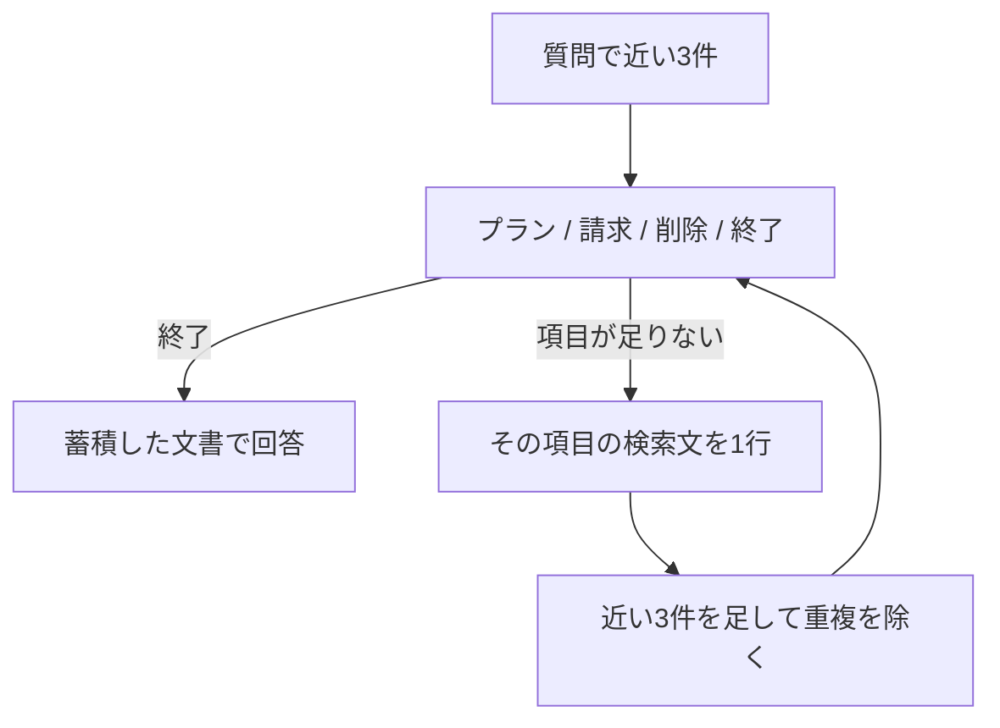

> SSOが使えるプランを月の途中で退会した場合、当月の請求額とデータ削除までの日数は？

この章のために、マニュアルへ2件足しました。SSOが使えるのはProプランだけです。Proプランの月額は12000円（税別）です。再登録した件数は 18 です。

近い3件は「退会後のデータ削除」「退会後の請求」「プラン変更時の日割り」です。Proの月額も、SSOの規定も入っていません。次に何を探すかを選ぶと、終了の確率は 0.9500 でした。検索は1回のままです。回答は、当月は満額、データは退会完了から30日後、で、Proとも12000円とも書いていません。

**終了と判断しても、足りない規定が3件の外にあることはあります。**

## 取るたびに、次の項目か終了かを選ぶ



選択肢は4つです。

- プラン。使えるプランや機能の規定が、まだ足りない
- 請求。料金や請求の規定が、まだ足りない
- 削除。データ削除の規定が、まだ足りない
- 終了。質問に必要な規定は、渡された文書に揃っている

終了以外なら、その不足を埋める検索文を1行書かせ、同じマニュアルの近い3件を足します。同じ id は重ねません。検索は最初を含めて最大3回です。3回目の判定が終了でなければ、確認できない項目は推測させません。この実行は、どちらも1回目で終了でした。追加の検索文は作っていません。

第10章は、検索の前に回数を選びます。この章は、取れた文書を見てから次の項目を選びます。

マニュアルを再登録してから実行します。

```bash
docker compose run --rm app index
docker compose run --rm app hop
```

リクエストのモデルは `jev-latest`、応答のモデルは `jev-1.14.0` です。再登録は 18 件で、読み戻しも一致しています。第13章までの実行は、この2件を足す前です。

## プランと金額は、3件の外に残った

| | 毎回検索 | 次の項目を選ぶ |
|---|---|---|
| 検索 | 1回 | 1回 |
| 渡した文書 | 上の3件 | 同じ3件 |
| 終了の確率 | なし | 0.9500 |
| 回答 | 満額。削除は30日後 | 同じ内容 |
| 回答生成の入力 | 230トークン | 230トークン |


毎回検索の回答生成は、出力 55 トークン、1093 ミリ秒です。選択ありは、出力 57 トークン、1048 ミリ秒です。判定は、入力 654 トークン、207 ミリ秒です。確率は、終了 0.9500、プラン 0.0400、請求 0.0100、削除 0.0000 で、confidence は 0.9300 です。

回答が書いている満額は「退会後の請求」、30日は「退会後のデータ削除」にあります。12000円と、SSOがProだけだという規定は、この3件にありません。終了の判断は、その2件が外に残っていても起きています。

## 削除時期は、1回で終了した

質問は「退会後、データはいつ削除されますか？」です。1位は「退会後のデータ削除」で、距離は 0.1920 です。終了の確率は 0.9800 です。プランと請求は 0.0000、削除は 0.0200、confidence は 0.9700 です。判定は、入力 607 トークン、151 ミリ秒です。

回答はどちらも「退会完了から30日後にデータを削除します。」で、回答生成の入力は 201 トークン、出力は 17 トークンです。毎回検索は 981 ミリ秒、選択ありは 825 ミリ秒です。


**1項目の質問では、追加の検索を避けられました。** 終了の判断そのものは、入力 607 トークン分だけ増えています。

:::details 結果の出典と条件
上の確率、トークン、時間、回答は、このリポジトリで `docker compose run --rm app hop` を実行したログです。小数は第4位までです。その前の `docker compose run --rm app index` では、ベクトル化が 808 トークン、1742 ミリ秒、件数は 18、期待値も 18、読み戻しは一致でした。質問のベクトル化は、SSOの質問が 44 トークン、削除時期が 17 トークンです。検索の上限は、最初を含めて3回です。

[Jevで複数の文書をたどって回答する！Multi-hop RAGを実装してみた](https://qiita.com/koji0705/items/5cff292ee6b113923da1) は、別の候補での対照です。そちらのSSOの質問は検索が3回で、次に探す項目は削除、プラン、終了の順でした。回答はProプラン、満額、30日後で、回答生成の入力トークンは 340 と 708 です。Proの月額12000円（税別）は、文書を取ったあとも最終回答から抜けています。削除時期は1回で終了し、判断は 210 ミリ秒、入力トークンはどちらも 343 でした。本書の18件では、SSOの質問も1回目の終了が 0.9500 で、Proの月額とSSOの規定は近い3件に入っていません。
:::
