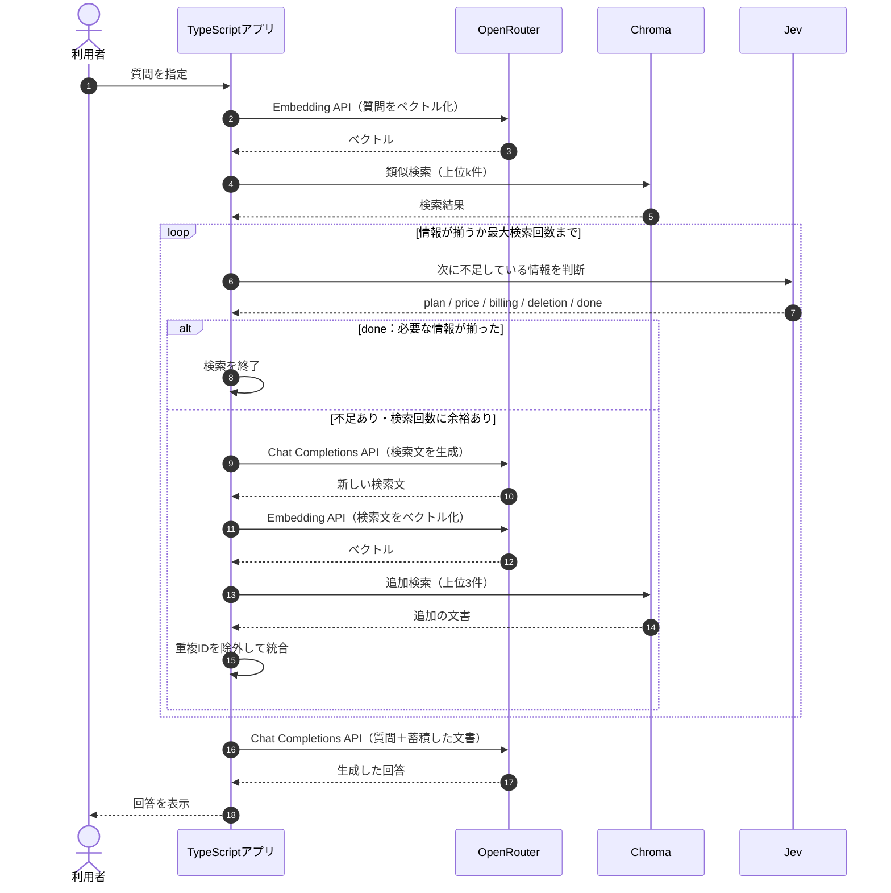

## Multi-hop RAGとは？

**Multi-hop RAGとは、複数の文書を段階的に検索し、集めた情報を組み合わせて回答するRAGです。** 例えば「SSOが使えるプランの月額料金」を知りたい場合、「SSOが使えるプラン」と「そのプランの月額料金」という別々の規定を調べる必要があります。

Naive RAGでは1回の検索結果をLLMに渡しますが、Multi-hop RAGでは取得した情報を確認し、不足していれば追加検索します。本書ではJevが次に必要な情報を判断し、OpenRouterが検索文を生成する方法を実装します。


## ① 今回の実験内容

TaskFlowについて、次の質問を考えます。

> SSOが使えるプランを月の途中で退会した場合、当月の請求額とデータ削除までの日数は？

この質問に正しく答えるには、4つの規定が必要です。

| 必要な情報 | マニュアルの規定 |
|---|---|
| SSO対応プラン | Proプランのみ |
| Proプランの月額 | 12,000円（税別） |
| 解約月の請求 | 満額・日割りなし |
| データ削除 | 退会完了から30日後 |

しかし、Chromaで最初に検索された上位3件は次のとおりでした。

| 順位 | 文書 | 分かること |
|---|---|---|
| 1 | 退会後のデータ削除 | 30日後に削除 |
| 2 | 退会後の請求 | 解約月は満額 |
| 3 | プラン変更時の日割り | プラン変更時の請求規定 |

この3件には、SSOの対応プランとProプランの月額料金がありません。そこで、**取得した文書を評価して、不足する情報を追加検索できるか**を確認します。

## ② 処理の流れ

Multi-hop RAGでは、検索と評価を繰り返します。今回は最大3回の検索を行い、Jevが`done`を選択するか、検索回数の上限に達したら終了します。



Jevは不足している情報の種類を選択し、OpenRouterは検索文と最終回答を生成します。検索の継続・終了や文書の統合は、TypeScriptアプリが制御します。

## ③ 実装コードを確認する

実際に実行するのは`app/src/commands.ts`の`hopQuestion()`です。最初にChromaから文書を取得し、Jevへ不足情報の判断を依頼します。

```typescript
const first = await searchHits(question, limit);
let documents = first.hits;
let searches = 1;
let choice = "";

while (true) {
  const decision = await chooseOption(
    passageState(question, documents),
    instructions,
    { ...criteria },
  );

  choice = decision.choice;

  if (choice === "done" || searches >= MAX_HOPS) {
    break;
  }

  const gap = criteria[choice];

  const rewritten = await completeAnswer(
    `${passageState(question, documents)}\n\n不足:\n${gap}`,
    HOP_REWRITE_INSTRUCTION,
  );

  const nextQuery = rewritten.text.split("\n")[0]?.trim() ?? "";
  const again = await searchHits(nextQuery, 3);

  documents = mergeHits(documents, again.hits);
  searches += 1;
}
```

`MAX_HOPS`は3です。Jevが`done`を返すと検索を終了し、それ以外なら不足項目をOpenRouterに渡して検索文を作ります。追加検索で取得した文書は、同じIDが重複しないように統合します。

## ④ Jevに次の検索対象を判断させる

最初の実装では、`app/src/models.ts`に次の基準を定義しています。

```typescript
export const HOP_INSTRUCTIONS =
  "この質問に答えるために、次に探す情報はどれか";

export const HOP_CRITERIA = {
  plan: "使えるプランや機能の規定が、まだ足りない",
  billing: "料金や請求の規定が、まだ足りない",
  deletion: "データ削除の規定が、まだ足りない",
  done: "質問に必要な規定は、渡された文書に揃っている",
} as const;
```

Jevへのリクエストでは、元の質問と取得した文書を`state`に含め、`choice`機能で次に探す情報を選択させます。

**Jevへのリクエスト例（最初の1件だけ取得した場合）**

```json
{
  "model": "jev-latest",
  "state": "質問:\nSSOが使えるプランを月の途中で退会した場合、当月の請求額とデータ削除までの日数は？\n\n文書:\n見出し: 退会後のデータ削除\n退会\n退会後のデータ削除\n退会完了から30日後にデータを削除します。",
  "questions": {
    "decision": {
      "type": "choice",
      "instructions": "この質問に答えるために、次に探す情報はどれか",
      "criteria": {
        "plan": "使えるプランや機能の規定が、まだ足りない",
        "billing": "料金や請求の規定が、まだ足りない",
        "deletion": "データ削除の規定が、まだ足りない",
        "done": "質問に必要な規定は、渡された文書に揃っている"
      }
    }
  }
}
```

**Jevの判断結果（保存ログからの抜粋）**

```json
{
  "choice": "billing",
  "confidence": 0.95,
  "probabilities": {
    "plan": 0.03,
    "billing": 0.96,
    "deletion": 0.01,
    "done": 0
  }
}
```

Jevは`billing`を選択しました。取得した1件にはデータ削除の日数は書かれていますが、請求規定がないためです。

アプリは`choice`の値から不足項目を特定し、次の検索文をOpenRouterへ生成させます。

```text
SSO対応プランの月途中退会時の請求額規定とデータ削除期間について
```

この検索文で追加検索すると、「退会後の請求」と「日割り請求のルール」が新しく取得され、文書数は3件になりました。

## ⑤ 追加検索しても、情報が揃わない場合がある

取得した3件を再びJevへ渡した結果は、次のとおりでした。

```json
{
  "choice": "done",
  "confidence": 0.72,
  "probabilities": {
    "plan": 0.18,
    "billing": 0.02,
    "deletion": 0.01,
    "done": 0.79
  }
}
```

Jevは`done`を選択したため、アプリは検索を終了しました。最終回答は「解約月は満額、データ削除は退会完了から30日後」という内容でした。

しかし、ここには問題があります。

| 必要な情報 | 取得できたか |
|---|---|
| SSO対応プランはPro | × |
| Proプランの月額は12,000円 | × |
| 解約月は満額 | ○ |
| データ削除は30日後 | ○ |

**Jevは`done`と判断しましたが、実際には必要な4つの情報のうち2つしか揃っていません。**

この1回では、`done`の文言が抽象的だったことと、初回件数や他の選択肢の文言を分けて確かめていません。抽象的な表現が原因で早く終わった、とまでは言えません。足りない情報が残ったまま `done` になった、という観測は残します。

## ⑥ 複数の条件を同時に変えた実行

別の実行では、評価基準をまとめて変えました。`done` に4つの情報を書いただけでなく、planなどの文言と `price` も同時に変わっています。どれか一文だけの効果ではありません。

**`app/src/models.ts`の改善後の基準**

```typescript
export const HOP_FACT_INSTRUCTIONS =
  "この質問に答えるために、次に足りない情報はどれか";

export const HOP_FACT_CRITERIA = {
  plan: "SSOが使えるプランの名前が、まだ文書に無い",
  price: "そのプランの月額が、まだ文書に無い",
  billing: "解約した月が日割りか満額かが、まだ文書に無い",
  deletion: "データ削除までの日数が、まだ文書に無い",
  done: "プラン名、月額、解約月の請求、削除までの日数の4つが文書にある",
} as const;
```

これまでの基準には`price`がありませんでした。今回は価格を独立した不足項目として追加し、`done`にも4つの完了条件を明示しています。

改善後の実験は`runHopFacts()`から実行します。

```typescript
export async function runHopFacts(): Promise<void> {
  const collection = await getOrCreateCollection();

  field("collection_count", await countRecords(collection.id));
  field("space", collection.space);
  field("criteria_set", "four-facts");

  await hopQuestion(
    MULTI_QUESTION,
    3,
    HOP_FACT_INSTRUCTIONS,
    { ...HOP_FACT_CRITERIA },
  );
}
```

最初の検索件数は3件です。前の実験とは異なる評価基準を使い、同じ質問に対して追加検索がどう変わるのかを確認します。

## ⑦ 改善後の実験結果

実行するコマンドは次のとおりです。

```bash
docker compose run --rm app hop-facts
```

**1回目：Proプランの月額が不足**

Jevは`price`を選択しました。

| choice | probabilities |
|---|---:|
| plan | 0.27 |
| **price** | **0.69** |
| billing | 0.01 |
| deletion | 0.00 |
| done | 0.03 |

OpenRouterが生成した検索文は次のとおりです。

```text
SSOが使えるプランの月額料金およびそのプランの詳細料金体系
```

追加検索によって、新しく「Standardプランの月額」と「Proプランの月額」の2件が取得されました。Proプランの本文には「Proプランの月額は12000円（税別）です。」と記載されています。

**2回目：SSO対応プランが不足**

文書数が5件になった状態でJevが再評価すると、今度は`plan`が0.83で選ばれました。

OpenRouterが生成した検索文は次のとおりです。

```text
SSOが使えるプラン名は何ですか？
```

追加検索によって「SSO」と「プランの種類」が新しく取得されました。「SSO」には「SSOが使えるのはProプランだけです。」という規定があります。

**3回目：必要な情報が揃った**

7件の文書を使って再評価した結果、Jevは`done`を選択しました。

| 項目 | 結果 |
|---|---|
| choice | done |
| doneのprobability | 0.97 |
| confidence | 0.96 |
| 検索回数 | 3回 |
| 最終的な文書数 | 7件 |

4つの必要情報を確認すると、すべて取得できていました。

| 必要な情報 | 取得した文書 |
|---|---|
| SSO対応プランはPro | SSO |
| Proプランの月額は12,000円 | Proプランの月額 |
| 解約月は満額 | 退会後の請求 |
| データ削除は30日後 | 退会後のデータ削除 |

**完了条件を具体化したことで、最初の検索では取得できなかったSSOとProプランの月額を追加できました。**

## ⑧ 文書が揃っても回答が完成するとは限らない

必要な7件をOpenRouterの回答生成モデルへ渡した結果、次の回答が返ってきました。

```text
SSOが使えるProプランを月の途中で退会した場合、

- 当月の請求額は満額請求され、日割りにはならない。
- 退会完了から30日後にデータが削除される。

以上です。
```

一見、正しく回答できているように見えます。しかし、**質問では当月の請求額を聞いているのに、12,000円という金額が回答に含まれていません。**

| 必要な情報 | 文書に存在 | 回答に存在 |
|---|---|---|
| SSO対応プランはPro | ○ | ○ |
| Proプランの月額12,000円 | ○ | **×** |
| 解約月は満額 | ○ | ○ |
| データ削除は30日後 | ○ | ○ |

今回のJevは「必要な情報が文書に揃ったか」を判断しましたが、「生成された回答に必要な情報がすべて含まれているか」までは確認していません。

つまり、**検索の完了と回答の完了は別の問題**です。根拠となる文書をすべて取得できても、LLMが一部の情報を回答に含めない可能性があります。

## ⑨ 実行結果を比較する

`done`、新しい文書が0件、回答が完成、はこのログでは同じ状態でしょうか。保存ログを初回件数で分けると、次のようになります。`hop-facts` は完了文だけでなく、planなどの文言と `price` の追加も同時に変えた構成です。1つの要因を変えた結果としては読みません。

| 保存ログ | 初回件数 | 検索回数 | 観測 |
|---|---:|---:|---|
| 抽象的な `done` | 3 | 1 | `done` のprobabilityは0.9400。Proと月額は文書に無い |
| 抽象的な `done` | 1 | 2 | 最初は `billing`。追加後もProと月額は無い |
| `hop-facts` | 3 | 3 | SSOと月額の文書は増えた。回答に12,000円は無い |

※ これらは別のAPI実行ログです。Jevの判断値やLLMの生成結果には変動があるため、この比較だけで一般的な精度改善を証明するものではありません。

今回の結果から、**検索対象を増やすことと、質問に必要な情報を漏れなく回答することを分けて評価する必要がある**と分かりました。

## Multi-hop RAGの課題は？

Multi-hop RAGでは、不足している情報を順番に検索できる一方、Jevが `done` と判断しても必要な文書が揃っているとは限りません。`hop-facts` では文書は増えましたが、変えた文言が複数あるため、どの条件が効いたかは分かれていません。

ただし、検索回数が増えるほど、Jevへの評価、OpenRouterによる検索文の生成、Embedding、Chroma検索などの処理も増えます。また、必要な文書が揃っても最終回答に情報が抜ける可能性があるため、回答生成後の検証も重要です。

## まとめ

Multi-hop RAGは、**取得した情報を確認し、不足している情報を追加検索して蓄積する方法**です。`hop-facts` では、完了条件を含む複数の文言を同時に変えた結果、最初の検索では取得できなかったSSOとProプランの月額規定まで収集できました。どの一文が効いたかは、このログだけでは分かれません。

一方で、必要な文書が揃っていても、最終回答から12,000円が抜けるという問題が残りました。次章では、**文書同士の関係を明示的に管理し、その関係をたどって必要な情報を探す方法**を学びます。


