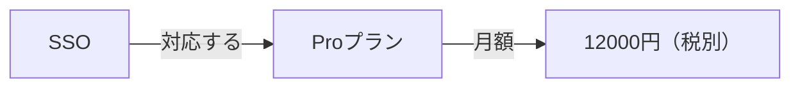

> SSOが使えるプランの月額はいくらですか？

始点は、手で指定した「SSO」です。2歩たどると、関係は2本です。SSOはProプランに対応し、Proプランの月額は12000円（税別）です。出典は「SSO」と「Proプランの月額」の2件で、回答は「SSOが使えるプランの月額は12,000円（税別）です。」でした。

**関係は、文書の文から手で結んだ線です。** モデルに抽出させていません。

## 点と線に、出典を残す



点は対象、線は対象どうしの関係です。線には、その文がある文書の id を付けます。回答へ渡すのは、線の言葉だけではありません。出典の本文も渡します。

今のグラフは、次の8本です。

| 始点 | 関係 | 終点 | 出典の見出し |
|---|---|---|---|
| SSO | 対応する | Proプラン | SSO |
| Proプラン | 月額 | 12000円（税別） | Proプランの月額 |
| Standardプラン | 月額 | 980円 | Standardプランの月額 |
| 契約開始 | 計算 | 開始日から月末までの日割り | 日割り請求のルール |
| 上位プランへの変更 | 計算 | 変更日から月末までの日割り | プラン変更時の日割り |
| 解約した月 | 料金 | 満額 | 退会後の請求 |
| 退会完了 | 削除 | 30日後 | 退会後のデータ削除 |
| 決済失敗から14日 | 状態 | 読み取り専用 | 支払いの失敗 |

この章の実行は、始点を「SSO」に固定し、2歩だけ進みます。上の表の残りは、この質問では辿っていません。

```bash
docker compose run --rm app relate
```

回答の指示は、第6章と同じです。渡した文書に書いてあることだけで答え、無ければ「分からない」と返します。

## 2歩で、プランと月額に届いた


関係は2本、文書は2件です。回答生成は、入力 177 トークン、出力 22 トークン、981 ミリ秒です。マニュアルの金額は「12000円（税別）」で、回答は「12,000円（税別）」と桁を区切っています。

始点を自分で置いているので、この結果は、近い文書との優劣ではありません。始点を質問から選ぶ比較は、この次に同じグラフで行います。

線が無い文は、何歩進んでも出てきません。マニュアルを直したときは、線と出典も直します。このグラフは、コミュニティ要約やグラフ全体の自動要約までは含みません。

:::details 結果の出典と条件
上の関係、トークン、時間、回答は、このリポジトリで `docker compose run --rm app relate` を実行したログです。始点「SSO」と歩数2は、実行前にコードへ書いています。線は、各出典の文から手で結んだものです。

[GraphRAGを学びたい](https://qiita.com/koji0705/items/384b91b9be59cfc36e05) は、別の題材での対照です。そちらのグラフ側の開始も手で指定され、ベクトル側とグラフ側で回答の指示が違います。本書では、その数値をこの実行の結果としては使いません。

手法の参照先は [Microsoft GraphRAG](https://microsoft.github.io/graphrag/) です。この章が動かしているのは、出典付きの小さなグラフを、指定した始点からたどる処理です。
:::
