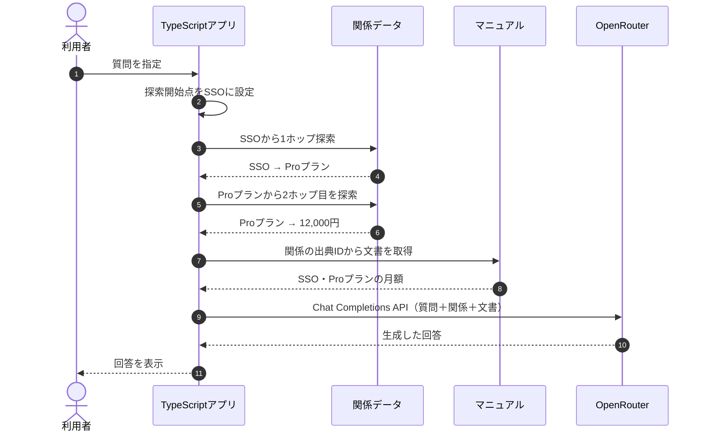

## Graph RAGとは？

**Graph RAGとは、情報同士の関係をグラフ構造で表現し、そのつながりを利用して回答に必要な情報を検索する方法です。** 通常のRAGでは文章の意味的な近さを利用しますが、グラフを使うと「どのプランがSSOに対応するか」「そのプランの料金はいくらか」という関係を順番にたどれます。

前章のMulti-hop RAGでは、Jevで不足情報を判断しながら検索を繰り返しました。今回はあらかじめ情報同士の関係を定義しておき、その関係をたどって必要な文書を集めます。

※ Graph RAGにはさまざまな実装があります。本章は手動で定義したグラフを使った学習用の簡易実装であり、Microsoft GraphRAGのような自動的な知識抽出やコミュニティ要約は実装していませ!


ん。


## ① 今回の実験内容

TaskFlowについて、次の質問を考えます。

> SSOが使えるプランの月額はいくらですか？

マニュアルには、次の2つの規定があります。

| 文書 | マニュアルの内容 |
|---|---|
| SSO | SSOが使えるのはProプランだけ |
| Proプランの月額 | Proプランの月額は12,000円（税別） |

質問には「Proプラン」という名前が含まれていません。そのため、まずSSOに対応するプランを特定し、次にそのプランの月額を調べる必要があります。

今回の実装では、次の関係をたどります。


このように、情報同士の関係を利用して、複数の文書に分かれた規定を結び付けます。

## ② 処理の流れ

今回は、関係データとマニュアルをTypeScriptアプリで管理します。グラフをたどる処理では、OpenRouterのEmbedding API、Chroma、Jevは使用しません。



今回は探索の開始点を`SSO`、探索する深さを2ホップに固定しています。ユーザーの質問から開始点を自動で判断する処理は、まだ実装していません。

## ③ 文書同士の関係を定義する

グラフでは、対象となる情報を**ノード（Node）**、ノード同士のつながりを**エッジ（Edge）**と呼びます。

今回の実装は`app/src/graph.ts`です。関係データには、始点・関係・終点・出典IDを持たせます。

```typescript
{
  from: "SSO",
  relation: "対応する",
  to: "Proプラン",
  sourceId: "billing.md#SSO",
},
{
  from: "Proプラン",
  relation: "月額",
  to: "12000円（税別）",
  sourceId: "billing.md#Proプランの月額",
},
```

ここで重要なのが`sourceId`です。関係をたどって金額が分かっても、その根拠となるマニュアルを確認できなければ、回答の正しさを検証しにくくなります。

| 項目 | 役割 |
|---|---|
| `from` | 関係の始点 |
| `relation` | どのような関係か |
| `to` | 関係の終点 |
| `sourceId` | 関係の根拠となる文書ID |

今回のグラフには、SSO・料金・退会・データ削除などに関する8本の関係を手動で登録しています。

## ④ グラフを2ホップ探索する

1つの関係をたどることを**1ホップ（Hop）**と呼びます。今回の質問では、SSOから月額料金まで2ホップで到達できます。

| ホップ | 始点 | 関係 | 到達先 |
|---|---|---|---|
| 1 | SSO | 対応する | Proプラン |
| 2 | Proプラン | 月額 | 12,000円（税別） |

`app/src/commands.ts`の`runRelate()`では、次のように探索します。

```typescript
const edges = walkRelations(
  [GRAPH_DEMO_START],
  GRAPH_DEMO_HOPS,
);
```

`GRAPH_DEMO_START`は`SSO`、`GRAPH_DEMO_HOPS`は`2`です。`walkRelations()`は関係をたどり、探索できたエッジを返します。

今回の実装では、関係の始点側からも終点側からも隣接するノードへ進めます。ただし、関係が表す意味の向きは保持されます。同じ関係を何度も追加したり、すでに訪れたノードを繰り返し探索したりしないようにしています。

## ⑤ 関係の出典から文書を取得する

探索で取得した関係には`sourceId`があります。このIDを使って、対応するマニュアルの本文を取得します。

**`app/src/commands.ts`からの抜粋**

```typescript
const chunks = await loadChunks();

const sources = edges.map((edge) => {
  const chunk = chunks.find(
    (item) => item.id === edge.sourceId,
  );

  if (chunk === undefined) {
    throw new Error(`relation source missing: ${edge.sourceId}`);
  }

  return chunk;
});

const unique = sources.filter(
  (chunk, index) =>
    sources.findIndex((item) => item.id === chunk.id) === index,
);
```

`sourceId`に対応する文書を探し、同じ文書が重複しないようにしています。

今回取得した文書は次の2件です。

```text
relation_count: 2
document_count: 2
heading: SSO
heading: Proプランの月額
```

**関係そのものをたどることと、回答の根拠となる本文を取得することは別の処理**です。最終的にLLMへ回答させる際には、関係と原文の両方を渡します。

## ⑥ OpenRouterで回答を生成する

取得した関係と文書を、OpenRouterの回答生成APIへ渡します。

**`app/src/commands.ts`からの抜粋**

```typescript
const relationText = edges
  .map((edge) => `${edge.from} —${edge.relation}→ ${edge.to}`)
  .join("\n");

const passages = unique
  .map((chunk) => `見出し: ${chunk.heading}\n${chunk.body}`)
  .join("\n\n");

const answer = await completeAnswer(
  `質問:\n${GRAPH_DEMO_QUESTION}\n\n関係:\n${relationText}\n\n文書:\n${passages}`,
  ANSWER_INSTRUCTION,
);
```

**OpenRouterに渡すユーザー文**

```text
質問:
SSOが使えるプランの月額はいくらですか？

関係:
SSO —対応する→ Proプラン
Proプラン —月額→ 12000円（税別）

文書:
見出し: SSO
請求
SSO
SSOが使えるのはProプランだけです。一度の認証で、複数のサービスにログインできます。

見出し: Proプランの月額
請求
Proプランの月額
Proプランの月額は12000円（税別）です。年払いの割引はありません。
```

回答モデルは`openai/gpt-4.1-mini`です。LLMには、渡された文書だけを根拠に回答するよう指示しています。

**保存ログで得られた回答**

```text
SSOが使えるプランの月額は12,000円（税別）です。
```

今回は2つの関係をたどり、対応する2つの文書を集めることで、正しい金額を回答できました。

## ⑦ 実行して結果を確認する

次のコマンドで実行できます。

```bash
docker compose run --rm app relate
```


保存ログの結果は次のとおりです。

| 確認項目 | 結果 |
|---|---|
| 探索開始点 | SSO |
| 探索ホップ数 | 2 |
| 取得した関係 | 2本 |
| 取得した出典文書 | 2件 |
| 回答 | 12,000円（税別） |

回答生成の入力は177トークン、出力は22トークンでした。今回は関係の自動抽出や開始点の自動判断を行っていないため、そのためのモデル呼び出しコストは含まれていません。

## Graph RAGの課題は？

今回のグラフでは「SSO → Proプラン → 月額」がつながっているため、必要な情報へ到達できました。しかし、**グラフに関係が登録されていなければ、探索するホップ数を増やしても情報には到達できません。**

例えば、「退会完了 → 30日後」という関係はありますが、SSOからそこへつながる経路は登録されていません。SSOを開始点にしても、データ削除の規定は見つかりません。

また、今回の開始点は手動で設定しています。実際のサービスでは、利用者の質問から適切な開始点を選ぶ処理が必要です。関係を手作業で管理する場合は、マニュアルの変更に合わせてグラフも更新する必要があります。

前章のMulti-hop RAGとの違いを整理します。

| 項目 | Multi-hop RAG | 今回のGraph RAG |
|---|---|---|
| 情報の探し方 | 不足を判断して再検索 | 定義済みの関係をたどる |
| 探索の判断 | Jevの`choice` | グラフの接続関係 |
| 検索文の生成 | OpenRouter | 不要 |
| 必要な準備 | ベクトルDBへの登録 | ノード・関係・出典の定義 |
| 主な課題 | 追加検索が失敗する可能性 | 関係がない情報には到達できない |

## まとめ

Graph RAGは、**情報同士の関係を利用して、複数の文書に分かれた情報を結び付ける検索方法**です。今回はSSOからProプラン、月額12,000円という関係を2ホップでたどり、出典となる2件のマニュアルを使って回答できました。

ただし、今回の成功は、適切な関係と探索開始点を手動で用意した条件での結果です。次章では、**ベクトル検索とグラフ検索を同じ質問で比較し、それぞれの得意・不得意を検証します。**


