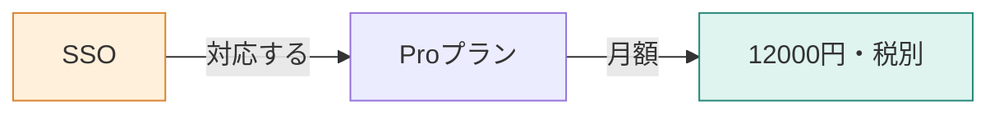

**この章では、「SSO → 対応プラン → 月額」という関係をたどって、二つの規定を集めます。** 一つの文書に答えが収まらないとき、対象同士のつながりを検索の経路にできます。線の持ち方、歩数、出典の本文を戻す理由を学びます。



## プラン名を知らない状態から、月額へ届きたい

> SSOが使えるプランの月額はいくらですか？

マニュアルでは、次の2節に分かれています。

| 見出し | 本文の内容 |
|---|---|
| SSO | SSOが使えるのはProプランだけ |
| Proプランの月額 | 月額12000円（税別）。年払いの割引はない |

SSOは、一度の認証で複数のサービスにログインできる仕組みです。質問には「Pro」という名前がないので、まず対応プランを調べ、次にその料金へ進みたい場面です。

この章では、関係も始点も手で用意します。自動抽出や、質問からの始点選びは実装しません。[環境構築](./02-setup)後、次を実行します。ローカルの関係と本文から回答するため、Chromaへの登録は不要です。

```bash
docker compose run --rm app relate
```

## STEP 1：対象と関係に、出典IDを持たせる

対象を点、関係を線として表したものをグラフと呼びます。実装は `app/src/graph.ts` です。今回たどる2本は次の値です。

```typescript
{
  from: "SSO",
  relation: "対応する",
  to: "Proプラン",
  sourceId: "billing.md#SSO",
},
{
  from: "Proプラン",
  relation: "月額",
  to: "12000円（税別）",
  sourceId: "billing.md#Proプランの月額",
},
```

`sourceId` は、その関係を確認できるマニュアルの節です。線だけに金額を持たせるのではなく、原文に戻れるようにします。規定を変更したときに、関係と本文が食い違っていないか調べるためにも必要です。

全体には、次の8本を手で登録しています。

| 始点 | 関係 | 終点 |
|---|---|---|
| SSO | 対応する | Proプラン |
| Proプラン | 月額 | 12000円（税別） |
| Standardプラン | 月額 | 980円 |
| 契約開始 | 計算 | 開始日から月末までの日割り |
| 上位プランへの変更 | 計算 | 変更日から月末までの日割り |
| 解約した月 | 料金 | 満額 |
| 退会完了 | 削除 | 30日後 |
| 決済失敗から14日 | 状態 | 読み取り専用 |

## STEP 2：一歩ごとに、隣の対象へ進む

始点は `SSO`、歩数は2です。1本の関係をたどる操作を1ホップと呼びます。

| 歩数 | いまいる場所 | 取れる線 | 新しく到達する場所 |
|---|---|---|---|
| 1 | SSO | SSO —対応する→ Proプラン | Proプラン |
| 2 | Proプラン | Proプラン —月額→ 12000円（税別） | 12000円（税別） |

実装の `walkRelations` は、線の始点・終点のどちらからも隣へ進みます。ただし、回答へ表示する関係の向きは保持します。「ProがSSOに対応する」関係をたどれたとしても、「12000円がプランである」といった逆向きの事実に変えるわけではありません。

同じ線は二度集めず、同じ点も新しい探索先に繰り返し追加しません。ループする関係があっても、今回の上限を超えて探索し続けることはありません。

## STEP 3：関係から、回答に使う本文を戻す

`runRelate` は、集めた線の `sourceId` でマニュアルの節を探し、同じIDの本文を重複させずに集めます。

```typescript
const edges = walkRelations([GRAPH_DEMO_START], GRAPH_DEMO_HOPS);
```

保存ログでは、関係2本・出典2件になりました。

```text
relation_count: 2
document_count: 2
heading: SSO
heading: Proプランの月額
```

この間にJevやLLMの判断はありません。手で定義した線をコードがたどった結果です。

## STEP 4：関係と原文を、同じ回答モデルへ渡す

モデルは `openai/gpt-4.1-mini`、システム文は「渡された文書だけを根拠に答え、判断できなければ分からないと答える」です。ユーザー文の全文です。

```text
質問:
SSOが使えるプランの月額はいくらですか？

関係:
SSO —対応する→ Proプラン
Proプラン —月額→ 12000円（税別）

文書:
見出し: SSO
請求
SSO
SSOが使えるのはProプランだけです。一度の認証で、複数のサービスにログインできます。

見出し: Proプランの月額
請求
Proプランの月額
Proプランの月額は12000円（税別）です。年払いの割引はありません。
```

返った回答は次のとおりでした。

```text
SSOが使えるプランの月額は12,000円（税別）です。
```


線が二つの節を結び、金額まで回答できています。ただし、始点を人間が正しく選んだ条件です。任意の質問から自動で同じ経路を選べた結果ではありません。

## 線がなければ、歩数を増やしても届かない

この小さなグラフでは、SSOとProの月額がつながる部分と、退会完了と30日後がつながる部分は離れています。SSOから何歩進んでも、削除の規定へは移動できません。

:::details 考えてみる：歩数を1にしたら？
「SSO → Proプラン」までです。月額の出典を集めるには2歩目が必要になります。1歩で同じ金額を答えられるとしたら、元の本文に金額もあるか、渡していない情報を補っていないかを調べます。これは経路からの推論で、1歩の回答生成を実行した結果ではありません。
:::

採用しやすいのは、対象と関係が明確で、更新時に線も保守できる資料です。曖昧な自然文をすべて手で関係にする負担や、関係にしなかった情報の取りこぼしもあります。次章では、始点を手で選ばずに比較します。

:::details 計測条件と出典
`relate` 保存ログです。現在と同じ手動の8関係を使い、始点SSO・2歩を実行前に固定しました。回答生成は入力177・出力22トークン、981ミリ秒でした。関係の自動抽出費用は計測していません。

[著者のGraphRAG記事](https://qiita.com/koji0705/items/384b91b9be59cfc36e05)は別題材です。[Microsoft GraphRAG](https://microsoft.github.io/graphrag/)のコミュニティ検出・階層的な要約までを、本章の実装が含むわけではありません。
:::
