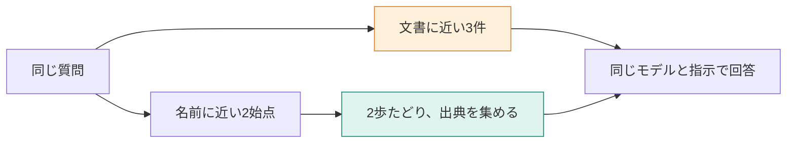

**この章では、同じ質問と回答モデルで、根拠を集める方法を比べます。** 文書のベクトルで探す方法と、対象名から関係をたどる方法です。比較条件をそろえるだけでなく、根拠の取りこぼしが入口・経路・生成のどこで起きたかを読めるようになります。



## 正しい入口を、最初から人間が渡さない

「SSOが使えるプランの月額」なら、始点をSSOに固定すれば月額へ届きました。しかし、利用者の質問からアプリ自身が始点を選べるかは、別の問題です。

ここでは、関係の中にある**点の名前**と質問をベクトル化し、近い2点から2歩たどります。ベクトル側は文書本文の近い3件です。

| 条件 | 文書のベクトル検索 | 関係の探索 |
|---|---|---|
| 質問 | 同じ | 同じ |
| 検索対象 | 文書本文 | 点の名前と、手動の8関係 |
| 入口の選び方 | 本文の近い3件 | 名前の近い2点 |
| 回答へ渡すもの | 本文 | 関係と出典の本文 |
| 回答モデル・システム文 | 同じ | 同じ |

モデルと指示は固定できますが、取得件数・情報の表現・入力の長さは同じではありません。手法全体の優劣を判定する実験ではなく、今回の経路で何が届くかの比較です。

[環境構築](./02-setup)と現在のマニュアルの登録後、実行します。本文の数値は18節時点の保存ログです。

```bash
docker compose run --rm app compare
```

## STEP 1：質問と全ノード名を同じモデルで数値化する

`app/src/commands.ts` の `compareQuestion` は、`nodeNames()` で集めた名前を質問と一緒にEmbeddingモデルへ送ります。

```typescript
const embedded = await embedTexts([question, ...names]);
```

この実装では、名前のベクトルも比較のたびに作っています。保存済み本文のベクトルを使う側とは、事前処理の範囲も違います。

質問と各名前のコサイン類似度を計算し、次のコードで始点を選びます。

```typescript
ranked.sort((left, right) => right.similarity - left.similarity);
const starts = ranked.slice(0, COMPARE_STARTS);
```

この選択で、文書の本文は見ていません。名前だけが質問に近い点が入口になります。

## STEP 2：解約の質問は、両方の経路が同じ規定へ届く

> Standardプランを月の途中で解約したら、日割りになりますか？

| 項目 | ベクトル側 | グラフ側 |
|---|---|---|
| 入口 | プラン変更時の日割り、Standardプランの月額、退会後の請求 | 解約した月 0.6378、変更日から月末までの日割り 0.5588 |
| 回答に使う出典 | 上の3節 | 退会後の請求、プラン変更時の日割り |
| 回答の結論 | 満額。日割りにはならない | 満額。日割りにはならない |

表のグラフ側の値は類似度で、大きいほど近い値です。始点からたどるのはコードであり、LLMに線を選ばせる処理ではありません。

両方に「退会後の請求」が入っているため、満額を答えられる状態です。グラフ側はStandardの月額本文を持っていませんが、今回の日割りの可否には不要でした。

## STEP 3：複数項目の質問では、入口の選択を点検する

> SSOが使えるプランを月の途中で退会した場合、当月の請求額とデータ削除までの日数は？

回答前に、必要な情報を並べます。

| 必要な情報 | 根拠の見出し |
|---|---|
| SSO対応はPro | SSO |
| Proは12000円（税別） | Proプランの月額 |
| 解約月は満額 | 退会後の請求 |
| 削除は退会完了から30日後 | 退会後のデータ削除 |

文書側は「退会後のデータ削除」「退会後の請求」「プラン変更時の日割り」を取得します。グラフ側の始点は「解約した月」0.5618と「変更日から月末までの日割り」0.4655でした。

どちらの始点からも、SSOや削除の線へはつながりません。グラフに正しい関係が存在するだけでは、その出典を取得できない例です。

## STEP 4：同じ回答指示でも、材料の不足は残る

回答モデルは `openai/gpt-4.1-mini`、システム文は次のとおりです。

```text
渡された文書だけを根拠に答えてください。文書から判断できなければ、「分からない」と答えてください。
```

グラフ側のユーザー文の全文は次のとおりです。

```text
質問:
SSOが使えるプランを月の途中で退会した場合、当月の請求額とデータ削除までの日数は？

関係:
解約した月 —料金→ 満額
上位プランへの変更 —計算→ 変更日から月末までの日割り

文書:
見出し: 退会後の請求
退会
退会後の請求
解約した月の料金は満額です。日割りにはなりません。

見出し: プラン変更時の日割り
請求
プラン変更時の日割り
月の途中で上位プランへ変更した場合、変更日から月末までを日割りで計算します。下位プランへの変更は、翌月から新しい料金です。
```

モデルが読める材料に「30日」がないので、正しい削除日数をこの入力だけから答えることはできません。

| 確認項目 | 文書のベクトル検索 | 関係の探索 |
|---|---|---|
| 解約月の請求 | 満額と回答 | 満額と回答 |
| 削除までの日数 | 退会完了から30日後と回答 | 文書にないと回答 |
| Proと12000円 | どちらも回答にない | どちらも回答にない |
| 回答生成の入力 | 230トークン | 224トークン |


本文のベクトル検索では削除の規定が1位なので、30日を答えられました。Proと12000円は、どちらの材料にもありません。ここは回答モデルの変更より、根拠の集め方を直すべき場所です。

## 「グラフにしたら良い」から、経路を調べる設計へ

| 失敗した段 | この実験での確認 | 検討する変更 |
|---|---|---|
| 入口 | SSOが始点に選ばれない | 質問を項目に分けて始点を選ぶ |
| 経路 | 請求の点から削除の点へ届かない | 必要な別の始点を追加する |
| 出典の集合 | 両方式に月額本文がない | 料金に絞った追加検索を行う |

右列は未実行の案です。今ある線を維持したまま歩数だけ増やしても、離れた成分には届きません。また、始点をむやみに増やすと無関係な文書も増えるため、必要項目と費用の両方を見ます。

:::details 考えてみる：グラフ側が30日を答えていたら、高性能と判断する？
この入力には30日の本文がないため、根拠のある成功とは扱えません。答えの文字列が合うだけでなく、入力に根拠が届いているかを確認します。両者を分けると、偶然の一致を改善と取り違えにくくなります。
:::

この2問・各1回では、グラフの優位性は確認できませんでした。採用の判断には、対象の関係が整備されているか、始点を質問から選べるか、必要項目を取りこぼしていないかまで含めます。

:::details 計測条件と出典
`compare` の18節時点の保存ログです。始点数2、歩数2、関係8本を実行前に固定。解約の回答入力はベクトル214・グラフ210、回答時間898・843ミリ秒。複合質問は入力230・224、時間1057・1108ミリ秒でした。

グラフ側の質問とノード名のベクトル化は、解約122トークン・1347ミリ秒、複合質問140トークン・1434ミリ秒です。文書のベクトル検索側の質問ベクトル化とは別の処理で、回答生成の入力差だけから全体費用は比較しません。

[著者のRAGとGraphRAGの比較記事](https://qiita.com/koji0705/items/c802968daad9e6e7e391)は浦島太郎を題材にした別実装です。この章は手動の小さなグラフで、Microsoft GraphRAGのコミュニティ要約は含みません。
:::
