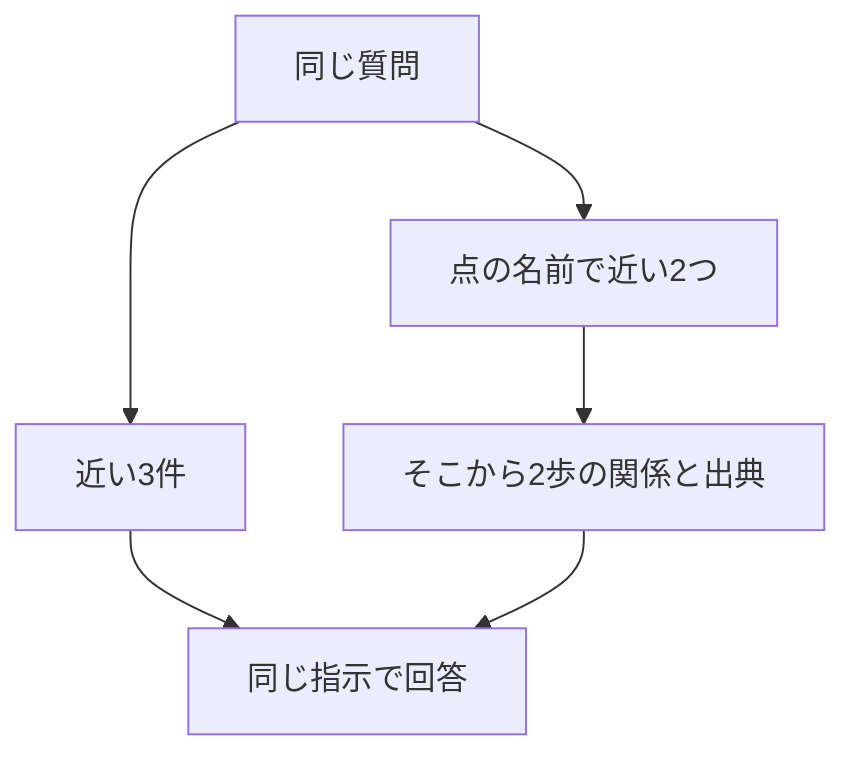

> SSOが使えるプランを月の途中で退会した場合、当月の請求額とデータ削除までの日数は？

近い3件の1位は「退会後のデータ削除」です。回答は、当月は満額、削除は退会完了から30日後、でした。関係をたどる側の始点は「解約した月」と「変更日から月末までの日割り」で、30日後の線には乗っていません。回答は満額で、削除までの日数は文書に無い、となっています。

**どちらの回答にも、Proと12000円は出てきません。** 渡した文書が違うのは、削除の日数です。

## 集め方だけを変える



回答の指示は、どちらも第6章と同じです。渡した文書に書いてあることだけで答え、無ければ「分からない」と返します。モデルも同じ `openai/gpt-4.1-mini` です。

関係の始点は、質問と点の名前をベクトルにし、コサイン類似度の高い2つに固定しています。歩数は2です。この2つは、実行の前に決めています。第15章のように、始点を手で「SSO」にはしていません。線そのものは、あいかわらず手で結んだものです。

```bash
docker compose run --rm app compare
```

## 解約の日割りは、どちらも満額

質問は「Standardプランを月の途中で解約したら、日割りになりますか？」です。

近い3件は「プラン変更時の日割り」「Standardプランの月額」「退会後の請求」です。回答は、解約した月は満額で、日割りにはなりません。回答生成は、入力 214 トークン、出力 33 トークン、898 ミリ秒です。

関係の始点は「解約した月」0.6378 と「変更日から月末までの日割り」0.5588 です。出典は「退会後の請求」と「プラン変更時の日割り」の2件で、回答も満額です。回答生成は、入力 210 トークン、出力 29 トークン、843 ミリ秒です。点の名前のベクトル化は、122 トークン、1347 ミリ秒で、回答生成とは別にかかっています。


**この質問では、両方とも「退会後の請求」を渡して、同じ結論になりました。** 近い3件には「Standardプランの月額」も入っています。関係の2件には入っていません。

## 削除の日数は、始点の外に残った

| | 近い3件 | 関係 |
|---|---|---|
| 渡した文書 | 退会後のデータ削除、退会後の請求、プラン変更時の日割り | 退会後の請求、プラン変更時の日割り |
| 請求 | 満額 | 満額 |
| 削除までの日数 | 退会完了から30日後 | 文書に無い |
| Proと12000円 | 出ていない | 出ていない |
| 回答生成の入力 | 230トークン | 224トークン |


近い3件の回答生成は、出力 49 トークン、1057 ミリ秒です。関係の始点は「解約した月」0.5618 と「変更日から月末までの日割り」0.4655 です。回答生成は、出力 63 トークン、1108 ミリ秒です。点の名前のベクトル化は、140 トークン、1434 ミリ秒です。

「SSO」も「30日後」も、類似度の上位2つには入っていません。2歩進んでも、その線の出典は渡していません。近い3件は削除の規定が1位だったので、30日後と書けています。金額の12000円と、SSOがProだけだという規定は、どちらの材料にもありません。

:::details 結果の出典と条件
上の類似度、トークン、時間、回答は、このリポジトリで `docker compose run --rm app compare` を実行したログです。小数は第4位までです。始点は2つ、歩数は2で、実行後に変えていません。質問のベクトル化は、解約の日割りが 26 トークン、908 ミリ秒、SSOの質問が 44 トークン、675 ミリ秒です。点の名前のベクトル化は、これとは別です。

[RAGとGraphRAGの比較](https://qiita.com/koji0705/items/c802968daad9e6e7e391) は、浦島太郎を題材にした別の対照です。ベクトル側とグラフ側で回答の指示が違います。本書では、その数値をこの実行の結果としては使いません。

この章のグラフは、第15章で手で結んだ8本です。Microsoft GraphRAG のコミュニティ要約は含みません。
:::
