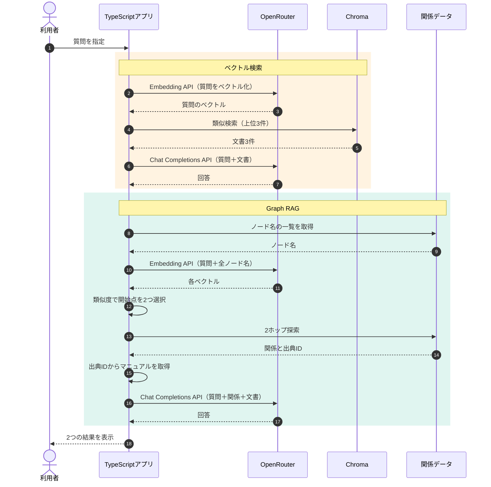

## ベクトル検索とGraph RAGを比較する

前章では、文書同士の関係をたどるGraph RAGを実装しました。しかし、グラフを使えば必ずベクトル検索より良い回答が得られるのでしょうか？

今回は、**同じ質問・同じ回答生成モデルを使い、検索方法の違いによって取得文書と回答がどう変わるか**を比較します。

| 比較項目 | ベクトル検索 | Graph RAG |
|---|---|---|
| 検索対象 | マニュアルの本文 | ノードと関係 |
| 検索の入口 | 意味の近い文書 | 質問に近いノード |
| 文書の取得 | Chromaの上位3件 | 2つの開始点から2ホップ探索 |
| 回答生成 | OpenRouter | OpenRouter |

今回のGraph RAGは、8本の関係を手動で定義した簡易実装です。Microsoft GraphRAGのような、自動的な関係抽出やコミュニティ要約は含みません。


## ① 今回の実験内容

今回はTaskFlowに関する2つの質問を使用します。

| 質問 | 確認したいこと |
|---|---|
| Standardプランを月の途中で解約したら、日割りになりますか？ | 解約月の請求規定を取得できるか |
| SSOが使えるプランを月の途中で退会した場合、当月の請求額とデータ削除までの日数は？ | 複数の規定を取得できるか |

第15章ではGraph RAGの開始点を`SSO`に固定していました。今回は質問と各ノード名をEmbeddingし、コサイン類似度が高い2つのノードを開始点に選びます。つまり、**人間が正しい開始点を指定しなくても、必要な文書に到達できるか**を検証します。

グラフに削除の線があっても、どの開始点からでもその文書へ届くわけではありません。線が開始点からつながっている必要があります。

類似度の順位を「解約した月、SSO、契約開始、決済失敗から14日」に固定し、開始点の数だけを変えると、1件では退会後の請求だけ、2件ではProの月額にも届き、4件では支払いの失敗も入ります。これはモデルが返した類似度ではなく、順位を固定した探索の確認です。開始点を増やすと、必要な出典が増えることも、無関係な出典が増えることもあります。

回答へ渡す本文を3件で打ち切ると、4つの出典が必要な質問では1件が落ちます。いまのグラフ側は、取れた出典を3件では切っていません。ベクトル検索の上位3件とは、渡す件数が揃っていません。同じモデルでも、検索だけを公平に比べた結果ではありません。

## ② 処理の流れ

2つの検索方法を同じTypeScriptアプリで実行し、取得した文書を同じ回答生成モデルへ渡します。



ベクトル検索は文書本文の近さを使います。一方、Graph RAGはノード名の近さで入口を決めた後、定義された関係をたどります。今回の比較ではJevは使用しません。

## ③ 実装コードを確認する

実際に実行する処理は`app/src/commands.ts`の`runCompare()`です。

```typescript
export async function runCompare(): Promise<void> {
  for (const question of [PRORATION_QUESTION, MULTI_QUESTION]) {
    await compareQuestion(question);
  }
}
```

`compareQuestion()`では、最初にベクトル検索を実行します。

```typescript
const searched = await searchHits(question, 3);
await printAnswer("vector", question, searched.hits);
```

次に、Graph RAGの開始点を選びます。`nodeNames()`から取得したノード名と質問をまとめてEmbeddingし、コサイン類似度を計算します。

```typescript
const names = nodeNames();
const embedded = await embedTexts([question, ...names]);
const query = embedded.vectors[0];

const ranked = names.map((name, index) => {
  const vector = embedded.vectors[index + 1];

  if (vector === undefined) {
    throw new Error(`node embedding missing: ${name}`);
  }

  return {
    name,
    similarity: cosineSimilarity(query, vector),
  };
});

ranked.sort((left, right) => right.similarity - left.similarity);

const starts = ranked.slice(0, COMPARE_STARTS);
```

ここで重要なのは、**文書の内容ではなくノード名との類似度で開始点を選んでいること**です。例えば、質問に「解約」が含まれていれば、解約に関連するノードが選ばれやすくなります。

開始点が決まったら、`walkRelations()`で関係をたどります。

```typescript
const edges = walkRelations(
  starts.map((start) => start.name),
  COMPARE_HOPS,
);
```

今回の設定は開始点2つ、探索深さ2ホップです。取得した関係の`sourceId`を使って対応するマニュアルを取得し、質問と関係情報をOpenRouterへ渡します。

## ④ ケースA：解約月の日割りを比較する

**質問**

> Standardプランを月の途中で解約したら、日割りになりますか？

正しい回答は「解約した月の料金は満額で、日割りにはならない」です。

### ベクトル検索の結果

Chromaでは、次の3件が取得されました。

| 順位 | 文書 |
|---|---|
| 1 | プラン変更時の日割り |
| 2 | Standardプランの月額 |
| 3 | 退会後の請求 |

回答に必要な「退会後の請求」は3位に含まれています。

### Graph RAGの結果

質問とノード名の類似度から、次の2つが開始点に選ばれました。

| 開始点 | コサイン類似度 |
|---|---:|
| 解約した月 | 0.6378 |
| 変更日から月末までの日割り | 0.5588 |

この2点から関係をたどることで、「退会後の請求」と「プラン変更時の日割り」の本文を取得しました。

### 回答の比較

| 方法 | 回答の結論 |
|---|---|
| ベクトル検索 | 満額・日割りなし |
| Graph RAG | 満額・日割りなし |

今回は、どちらの方法でも正しい回答が得られました。検索の入口は異なりますが、両方とも「退会後の請求」という必要な規定を取得できていたためです。

## ⑤ ケースB：複数の規定が必要な質問を比較する

次は、より複雑な質問です。

> SSOが使えるプランを月の途中で退会した場合、当月の請求額とデータ削除までの日数は？

回答するためには、次の4つの情報が必要です。

| 必要な情報 | 根拠となる文書 |
|---|---|
| SSO対応プランはPro | SSO |
| Proの月額は12,000円（税別） | Proプランの月額 |
| 解約月は満額 | 退会後の請求 |
| データ削除は30日後 | 退会後のデータ削除 |

### ベクトル検索の結果

Chromaでは次の3件が取得されました。

| 順位 | 文書 |
|---|---|
| 1 | 退会後のデータ削除 |
| 2 | 退会後の請求 |
| 3 | プラン変更時の日割り |

解約月の請求と削除日数の規定は取得できました。しかし、SSO対応プランとProプランの月額は含まれていません。

### Graph RAGの結果

Graph RAGでは、質問とノード名の類似度から次の開始点が選ばれました。

| 開始点 | コサイン類似度 |
|---|---:|
| 解約した月 | 0.5618 |
| 変更日から月末までの日割り | 0.4655 |

この2点から2ホップ探索した結果、「退会後の請求」と「プラン変更時の日割り」を取得しました。しかし、**データ削除に関する関係には到達できませんでした。**

なぜなら、今回のグラフでは請求のノードとデータ削除のノードがつながっていないためです。関係が登録されていても、選んだ開始点からその関係へ到達できなければ、検索結果には含まれません。

## ⑥ LLMに渡す情報を比較する

2つの方法で回答モデルは同じ`openai/gpt-4.1-mini`を使用します。システム指示も共通です。

```text
渡された文書だけを根拠に答えてください。文書から判断できなければ、「分からない」と答えてください。
```

Graph RAGでOpenRouterに渡したユーザー文は、次の内容でした。

```text
質問:
SSOが使えるプランを月の途中で退会した場合、当月の請求額とデータ削除までの日数は？

関係:
解約した月 —料金→ 満額
上位プランへの変更 —計算→ 変更日から月末までの日割り

文書:
見出し: 退会後の請求
退会
退会後の請求
解約した月の料金は満額です。日割りにはなりません。

見出し: プラン変更時の日割り
請求
プラン変更時の日割り
月の途中で上位プランへ変更した場合、変更日から月末までを日割りで計算します。下位プランへの変更は、翌月から新しい料金です。
```

ここには「退会完了から30日後」という規定が含まれていません。したがって、LLMはこの入力だけでは削除日数を判断できません。

**実行結果の比較**

| 確認項目 | ベクトル検索 | Graph RAG |
|---|---|---|
| 解約月の請求 | 満額と回答 | 満額と回答 |
| データ削除までの日数 | **30日後と回答** | 文書にないと回答 |
| SSO対応プラン | 回答にない | 回答にない |
| Proの月額12,000円 | 回答にない | 回答にない |
| 回答生成の入力 | 230トークン | 224トークン |


今回の質問では、ベクトル検索の方が多くの必要情報を取得できました。ただし、どちらの方法も4つの情報をすべて揃えられたわけではありません。

## ⑦ 実行して結果を確認する

第5章でマニュアルをChromaへ登録した状態で、次のコマンドを実行します。

```bash
docker compose run --rm app compare
```

18チャンク時点の保存ログでは、次の結果となりました。

| 質問 | ベクトル検索 | Graph RAG |
|---|---|---|
| 解約月の日割り | 満額・日割りなし | 満額・日割りなし |
| SSOプランの退会 | 満額・削除30日後 | 満額・削除日数は不明 |

今回、Graph RAGはノード名のEmbeddingを実行時に行っています。回答生成の入力トークンが少し短くても、検索全体の処理コストが小さいとは限りません。

また、両方とも同じ回答モデルを使っていますが、**取得文書数や入力形式は異なるため、検索方式そのものの優劣を厳密に測定した比較ではありません。** この2問・各1回の実験から分かるのは、それぞれの検索経路でどの規定に到達できたかということです。

## ⑧ Graph RAGが失敗した原因は？

今回の複合質問でGraph RAGが必要な情報を取得できなかった原因は、次のように整理できます。

| 問題 | 今回起きたこと | 改善案 |
|---|---|---|
| 開始点の選択 | SSOが選ばれなかった | 質問を分解して開始点を選ぶ |
| 関係の探索 | 請求から削除へ到達できなかった | 複数の開始点から探索する |
| 情報の不足 | Proの月額が取得できなかった | 不足項目を追加検索する |

改善案はまだ実験していません。例えば探索深さを増やしても、グラフ上でつながっていないノードには到達できません。一方、開始点を増やしすぎると、無関係な文書まで取得する可能性があります。

また、LLMが正しい回答を生成できなかった場合も、まずは**必要な根拠がLLMに届いていたのか**を確認することが重要です。文書が届いていない問題と、文書が届いているのに回答できない問題では、改善する場所が異なります。

## まとめ

今回は、**ベクトル検索とGraph RAGを同じ質問で比較し、検索の入口と経路によって取得できる文書が変わる**ことを確認しました。

解約月の日割りでは両方とも正しく回答できましたが、複数の規定が必要な質問では、Graph RAGが削除日数の文書を取得できませんでした。関係を登録するだけでは不十分で、質問から適切な開始点を選び、必要な情報へ到達できる設計が重要です。

次章はいよいよ最終章です。**これまで学んだRAGを整理し、どのような課題にどの方法を使うべきか**を考えます。

